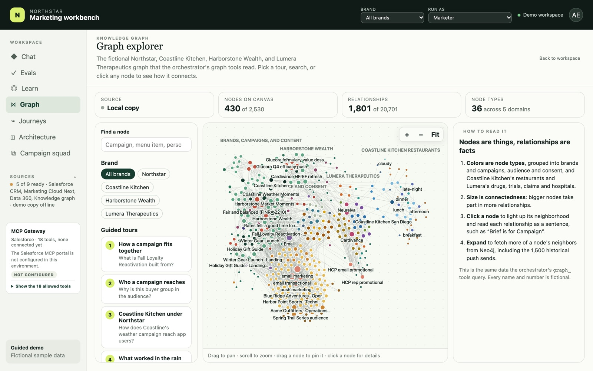
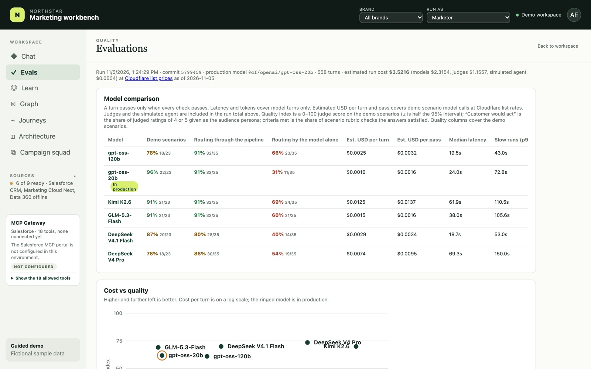
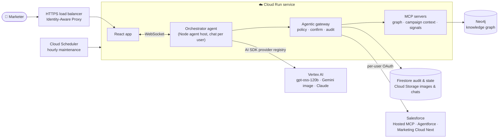

<div align="center">

# ✦ Northstar Marketing Workbench

**An AI marketing teammate that does the legwork and asks you before it writes anything back.**

Built on Salesforce and Google Cloud (Cloud Run, Firestore, Vertex AI); the same code also runs on Cloudflare. All companies and data in it are made up.


[Features](#-features) · [Tour](#-a-quick-tour) · [Architecture](#-how-it-works) · [Patterns](#-architecture-patterns) · [Run it](#-run-it-locally) · [Repo map](#-repository-map)

<br/>


</div>

<br/>

A marketer asks a question in plain language. The orchestrator agent reads campaigns, audiences, consent, brand rules and performance from Salesforce and a knowledge graph, then drafts the work. Before anything is saved back, a person confirms it. Every step can be traced, every write is audited, and every answer is scored.

## ✨ Features

- 💬 **Chat with your campaigns.** Ask *"Is the fall campaign ready?"* and get an answer drawn from real records, as readable cards with links back to Salesforce.
- 🛡️ **Nothing changes without you.** The agent can only propose a write. You confirm it, it's saved once, logged, and checked against Salesforce afterwards.
- 🔍 **See the whole route.** Every answer shows which systems it touched (sign-in, router, classifier, model, Salesforce, graph) and a step-by-step trace of what the model did.
- 🔀 **Pick the AI platform.** A menu in the top bar, beside Brand and Run as, runs the models on Workers AI or Vertex AI, whichever cloud hosts the app. Chat, campaign images and the squad's open models all follow it, and the server's config decides which platforms it offers.
- 🕸️ **A knowledge graph you can explore.** Brands, campaigns, audiences, approvals and disclosures in one connected graph. The agent uses it to ground answers (GraphRAG) and to remember things across chats.
- 🤝 **A squad of agents.** A campaign lead hands a brief to four specialists. You play the compliance reviewer and the client, and pick a concept made from an approved image library. When a guardrail stops an agent (a rule check, a policy denial or a malformed tool call), the page shows it as it happens and explains what it protected. Click any claim for its library record, browse every tool the agents can use (highlighted when used this session), and reset the session from the top of the page.
- 🧭 **Watch an asset get made.** Journeys run real agents from goal to approved asset, pausing only where a person must decide.
- 🏛️ **An architecture you can click through.** Governed objects, one gateway for every call, agent and prompt catalogs, and a plan-to-learn content lifecycle.
- 📊 **Scored, not assumed.** An evaluation suite compares models on quality, routing, cost and speed, so the production model is chosen on evidence.
- 🔗 **Every page has a link.** `/squad`, `/architecture`, `/journeys`, `/graph`, `/learn` and `/evaluations` survive a reload and work from the back button.
- 🎓 **A built-in course.** 29 short lessons explain context, RAG and GraphRAG, and every moving part of the demo, written for the cloud you're on and the AI platform you picked, with low-level detail folded away until you open it. A CI check keeps them in step with the code.
- 🔐 **Secure by default.** Identity-Aware Proxy sign-in (Cloudflare Access on Cloudflare), per-user Salesforce OAuth, allow-listed tools, and kill switches for writes, tools and memory.

## 📸 A quick tour

<table>
  <tr>
    <td width="50%">
      
      <p align="center"><b>Graph</b><br/><sub>Explore the knowledge graph the agent reads, with guided tours.</sub></p>
    </td>
    <td width="50%">
      
      <p align="center"><b>Campaign squad</b><br/><sub>Five agents turn a brief into a proposal on Vertex AI (or Workers AI), Claude or OpenAI.</sub></p>
    </td>
  </tr>
  <tr>
    <td width="50%">
      
      <p align="center"><b>Journeys</b><br/><sub>Watch an orchestrator and subagents build an asset block by block.</sub></p>
    </td>
    <td width="50%">
      
      <p align="center"><b>Architecture</b><br/><sub>How content moves from plan to proof, and who decides at each step.</sub></p>
    </td>
  </tr>
  <tr>
    <td width="50%">
      
      <p align="center"><b>Evals</b><br/><sub>Compare models side by side on quality, cost and speed.</sub></p>
    </td>
    <td width="50%">
      
      <p align="center"><b>Learn</b><br/><sub>A hands-on course in context, GraphRAG and this demo.</sub></p>
    </td>
  </tr>
</table>

## 🧩 How it works



What happens when you ask a question:

1. **You sign in** through Identity-Aware Proxy, which lets in only the workspace's members. Salesforce access is per user, so the agent only sees what you can see.
2. **Your chat is an agent.** Each chat is a stateful agent (an Agents SDK chat agent, hosted on Cloud Run) that keeps the conversation and the records in focus, saves itself to Cloud Storage, and runs `gpt-oss` on Vertex AI.
3. **It picks tools, within policy.** A classifier labels the request (claims, a target list, Fed news, … or off topic). Cedar policies turn the labels, your brand and role, and what has already run into the tools on offer, so a claims question starts with the claims check and an off-topic one gets a plain answer with no tools. The model chooses among what is offered; nothing forces a call. The tools are Salesforce over Hosted MCP, plus MCP servers in the service for the graph, campaign context (weather, menus, inventory) and outside signals.
4. **It asks before writing.** A proposed write becomes a confirmation card with an idempotency key. Once you confirm, it runs once, is logged in Firestore, and is read back from Salesforce.
5. **It shows its work.** Answers render as cards with a trace and a route map, so you can see exactly how the answer was made.

The Architecture and Campaign squad views take this further, with many narrow agents behind a single `gateway.invoke()`. [docs/architecture-roadmap.md](docs/architecture-roadmap.md) maps the reference architecture's AWS components to Google Cloud and Cloudflare.

**Two hosts, one codebase.** The same commit also deploys to Cloudflare, where the pieces are a Worker, Cloudflare Access, Durable Objects, D1, R2, Workers AI through AI Gateway and a cron trigger. Only a thin platform layer differs ([ADR-018](docs/decisions/ADR-018-google-cloud-target.md)), and the page names whichever services it is running on.

**The AI platform is chosen apart from the host** ([ADR-021](docs/decisions/ADR-021-ai-platform-apart-from-host.md)). Workers AI and Vertex AI are providers in one [AI SDK](https://ai-sdk.dev) registry, and the top bar's **AI platform** menu picks one per request. Cloudflare offers Workers AI, plus Vertex AI once the Worker holds a Google credential; Google Cloud offers Vertex AI. `AI_PLATFORMS_ENABLED` (in `wrangler.jsonc`, or an environment variable on Cloud Run) narrows the menu: a platform left out is neither offered nor run. The chat, campaign images and the Campaign squad's open-model tier follow the choice. The trace, route map and each squad run name the platform they ran on.

| | Google Cloud | Cloudflare |
| --- | --- | --- |
| Server | Cloud Run (Node) behind an HTTPS load balancer | Worker |
| Sign-in | Identity-Aware Proxy + Firestore members | Cloudflare Access |
| Chats | Node agent host, each chat saved to Cloud Storage | Durable Objects |
| Data | Firestore | D1 |
| Images | Cloud Storage | R2 |
| Models (default) | Vertex AI (gpt-oss-120b, Gemini image, Claude) | Workers AI via AI Gateway; Vertex AI with a Google credential |
| Hourly job | Cloud Scheduler | Cron trigger |

## 🏗️ Architecture patterns

The design choices that carry the demo, each with the decision record that explains it:

| Pattern | What it means here | Decision |
| --- | --- | --- |
| **A stateful agent per chat** | Each chat is an Agents SDK chat agent with its own storage: a Durable Object on Cloudflare, a Node agent host saving SQLite snapshots to Cloud Storage on Google Cloud. | [ADR-002](docs/decisions/ADR-002-phase-1-cloudflare-foundation.md), [ADR-018](docs/decisions/ADR-018-google-cloud-target.md) |
| **Tools over MCP behind one gateway** | Every tool, whether Salesforce, the graph or an internal one, is an MCP tool called through one agentic gateway that checks policy, asks for confirmation and audits. | [ADR-010](docs/decisions/ADR-010-architecture-agents-on-real-models.md), [ADR-020](docs/decisions/ADR-020-cedar-policies-and-request-classifier.md) |
| **Policy as code (Cedar)** | One Cedar decision both offers a tool and allows its call, so a model is never shown a tool it may not use. The context is the brand, role, surface, pharma stage, the classifier's labels and the tools already run. | [ADR-020](docs/decisions/ADR-020-cedar-policies-and-request-classifier.md) |
| **Classify, then scope; never force** | Rules plus a small model label the request. Labels scope the tools on offer, and the model chooses. Guardrails: look before answering, ground before drafting, write last. | [ADR-019](docs/decisions/ADR-019-scoped-tools-not-forced-calls.md), [ADR-020](docs/decisions/ADR-020-cedar-policies-and-request-classifier.md) |
| **Propose, confirm, write once** | Writes are proposals with an idempotency key. A person confirms, the write runs once, is audited and is read back from Salesforce. | [ADR-008](docs/decisions/ADR-008-marketing-cloud-agents-create-campaigns.md) |
| **GraphRAG and long-term memory** | Answers are grounded in a Neo4j knowledge graph, and decisions are remembered across chats in that graph, with expiry. | [ADR-006](docs/decisions/ADR-006-neo4j-knowledge-graph.md), [ADR-007](docs/decisions/ADR-007-long-term-graph-memory.md) |
| **Models chosen by evaluation** | A model catalog routes each task class to the champion an evaluation picked, and every run is scored by a judge. | [ADR-005](docs/decisions/ADR-005-gpt-oss-20b-and-campaign-context.md), [ADR-009](docs/decisions/ADR-009-model-catalog-and-routing.md) |
| **Hub-and-spoke agent squad** | A campaign lead coordinates specialists over a shared bus and semantic layer, with people as the compliance reviewer and client. | [ADR-013](docs/decisions/ADR-013-campaign-squad.md), [ADR-014](docs/decisions/ADR-014-squad-people-and-evals.md) |
| **Governed lifecycle** | Content moves through plan, brief, create, review, approve, deploy and learn. Per-stage tools are decided by policy, and claims are managed objects. | [ADR-015](docs/decisions/ADR-015-pharma-campaign-lifecycle.md), [ADR-017](docs/decisions/ADR-017-claims-managed-lifecycle.md) |
| **A platform seam, not a fork** | Data, chats, sign-in and scheduling sit behind small interfaces, so one commit runs on Cloudflare or Google Cloud. | [ADR-018](docs/decisions/ADR-018-google-cloud-target.md) |
| **Pluggable AI platforms** | Models come from an AI SDK provider registry, chosen per request, independent of the host. | [ADR-021](docs/decisions/ADR-021-ai-platform-apart-from-host.md) |
| **Observable by default** | Every turn streams a trace (classification, steps, tools, tokens), a route map and a turn record, and every write leaves an audit row. | [Learn: observability](docs/learn-google-cloud.md) |

## 🚀 Run it locally

You need **Node 26** and **pnpm 11**.

```sh
pnpm install --frozen-lockfile
pnpm dev:gcp
```

Open **http://127.0.0.1:8080**. That builds the app and runs the Google Cloud server against a local Firestore emulator (it needs the Google Cloud CLI and Java), signed in as a local evaluator, with the made-up sample data and an in-memory knowledge graph. Set `GCP_PROJECT` (after `gcloud auth application-default login`) and the agents call Vertex AI; without a model they say none is available instead of faking an answer.

For a fast edit loop with hot reload, `pnpm dev` runs the same code in the Cloudflare runtime locally (http://127.0.0.1:5173); `pnpm dev:local` adds real Workers AI after `wrangler login`.

## ☁️ Deploy it

**Google Cloud.** After `gcloud auth login`:

```sh
GCP_PROJECT=<project> scripts/gcp/bootstrap.sh                       # once: APIs, Firestore, bucket (7-day image expiry), accounts, secrets
GCP_PROJECT=<project> IAP_MEMBERS=<you@example.com> pnpm deploy:gcp   # build, deploy, load balancer, IAP, scheduler
```

The deploy builds the image with Cloud Build, runs it on Cloud Run behind a global HTTPS load balancer with Identity-Aware Proxy, and prints the URL. [infra/gcp/README.md](infra/gcp/README.md) lists every resource, the organization policies the setup satisfies, and the steps that need a person (secrets, Model Garden, the Salesforce callback).

**Cloudflare.** `pnpm run deploy` builds the app, applies pending D1 migrations and deploys the Worker; merging to `main` does the same through Workers Builds; [infra/cloudflare/pot/README.md](infra/cloudflare/pot/README.md) has the gates.

<details>
<summary><b>All commands</b></summary>
<br/>

| Command | What it does |
| --- | --- |
| `pnpm dev:gcp` | Build and run the Google Cloud server locally against the Firestore emulator. |
| `pnpm verify:fast` | Formatting, lint, types, unit contracts, documentation and invariants. |
| `pnpm verify` | All fast gates, Workers-runtime tests, the Google Cloud tests, the 20-case evaluation, and both production builds. |
| `pnpm test:unit` / `pnpm test:gcp` / `pnpm test:worker` | Unit tests in jsdom; the Google Cloud adapters, chat host and server (starts the Firestore emulator); tests inside the Workers runtime. |
| `pnpm test:e2e` | Chrome and Edge-equivalent UI and reconnect proof with screenshots. |
| `pnpm learn:check` / `pnpm learn:export` | Check that the Learn course covers the code, and regenerate `docs/learn-google-cloud.md` and `docs/learn.md`. |
| `pnpm eval` / `pnpm eval:team` | Run the orchestrator evaluation, or compare squad providers on the reference briefs. |
| `pnpm build:gcp` / `pnpm deploy:gcp` | Bundle the Google Cloud server; build and deploy it to Cloud Run. |
| `pnpm deploy:dry-run` / `pnpm run deploy` | Package the Cloudflare Worker, or build it, apply pending D1 migrations and deploy it. |
| `pnpm run db:migrate` | Apply pending D1 migrations to the Worker's database (every deploy does this first). |
| `pnpm sf:metadata:check` | Validate the Salesforce Agent Script, Apex actions, permissions, catalog, Postman and audit-migration contract. |
| `SF_TARGET_ORG=<sandbox-alias> SF_APPROVED_PROOF_ORG_ID=<org-id> pnpm sf:validate` | Fails closed unless the target is a Salesforce sandbox or the approved proof org, then checks API level, sample records, consent access and Agent Script metadata. |
| `pnpm test:e2e:live` | Live proof against the deployed Cloudflare Worker; fails closed without authorized live-proof variables. |

</details>

## 🗺️ Repository map

```text
apps/
  web/              React front end: chat, every view, the Learn course
  edge/             the shared server: orchestrator, gateway, MCP servers, APIs, platform seam;
                    plus the Cloudflare Worker entry
  gcp/              the Google Cloud host: Node server, chat host, Firestore, Vertex AI, Cloud Storage
packages/
  contracts/        shared Zod schemas and the allow-listed tool catalog
  architecture/     agents, prompts, models, workspaces, squad data, asset library
  knowledge-graph/  graph datasets per brand, GraphRAG tools, memory, Neo4j query API
  evals/            evaluation cases, judge calibration, pricing
  ui/               shared UI tiles
salesforce/         Agent Script, Apex actions, permissions, Lightning surface
migrations/         D1 schema
scripts/            verification gates, evals, seeding, live proofs
tests/              Playwright end-to-end tests
infra/              Google Cloud and Cloudflare deployment notes
docs/               plan, decisions, work units, security notes, the Learn course (both hosts)
```

## 🤖 Built by agents

This repository is agent-first: coding agents build, test, document and refine it. People step in for sign-ins, consent and final review. If you're an agent picking up work, start with the [getting-started checklist](docs/getting-started-for-agents.md) and [AGENTS.md](AGENTS.md), and don't infer live Salesforce, Google Cloud or Cloudflare state from this README.

**Read more:** [the Learn course as one page](docs/learn-google-cloud.md) ([Cloudflare edition](docs/learn.md)) · [the plan](docs/agentic-marketing-workbench-plan.md) · [decision records](docs/decisions/) · [work units](docs/work-units/) · [Google Cloud deployment](infra/gcp/README.md) · [Cloudflare deployment gates](infra/cloudflare/pot/README.md) · [the Salesforce side](salesforce/README.md)
