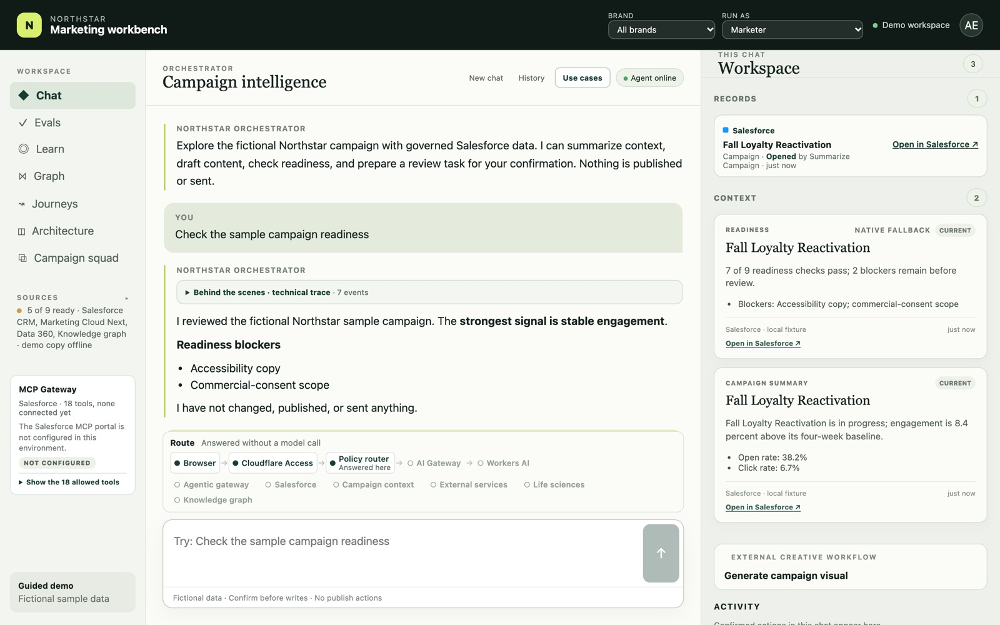
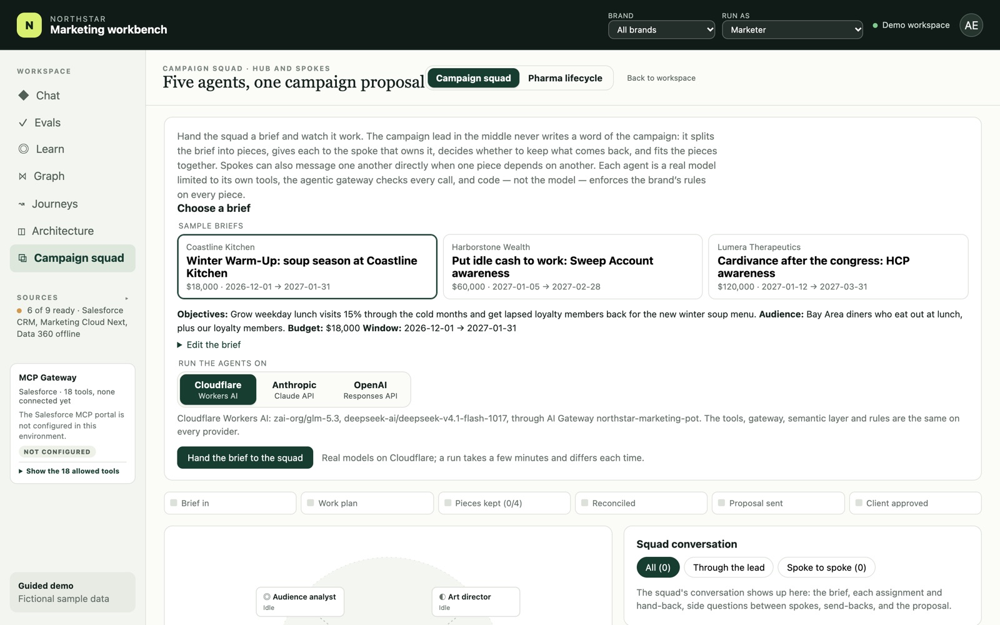
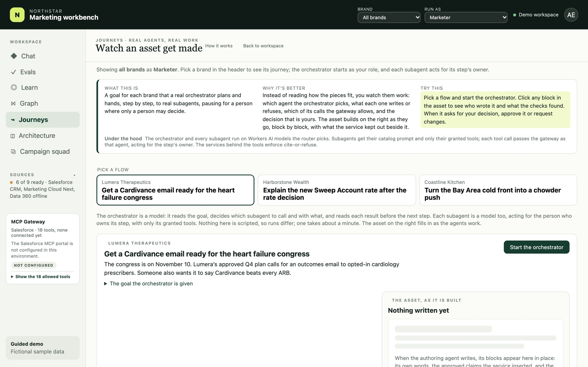
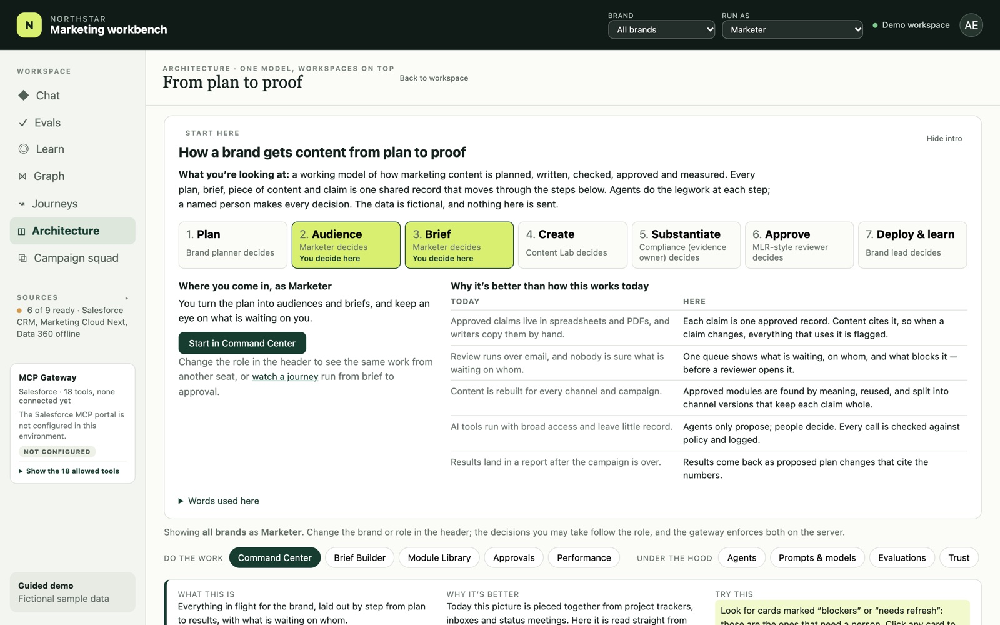
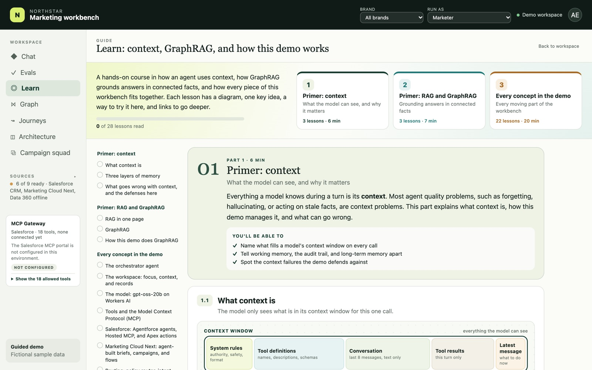
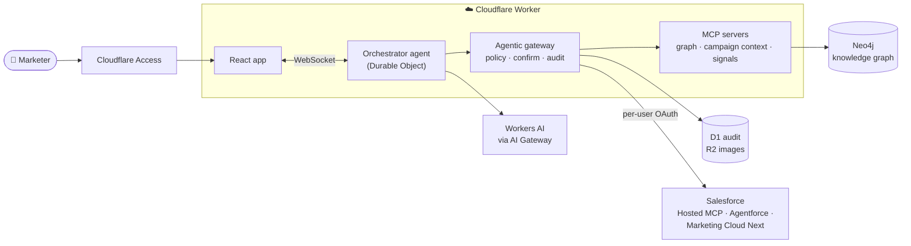

<div align="center">

# ✦ Northstar Marketing Workbench

**An AI marketing teammate that does the legwork and asks you before it writes anything back.**

Built on Salesforce and Cloudflare, and runs on Google Cloud from the same code. All companies and data in it are made up.


[Features](#-features) · [Tour](#-a-quick-tour) · [Architecture](#-how-it-works) · [Run it](#-run-it-locally) · [Repo map](#-repository-map)

<br/>



</div>

<br/>

A marketer asks a question in plain language. The orchestrator agent reads campaigns, audiences, consent, brand rules and performance from Salesforce and a knowledge graph, then drafts the work. Before anything is saved back, a person confirms it. Every step can be traced, every write is audited, and every answer is scored.

## ✨ Features

- 💬 **Chat with your campaigns.** Ask *"Is the fall campaign ready?"* and get an answer drawn from real records, as readable cards with links back to Salesforce.
- 🛡️ **Nothing changes without you.** The agent can only propose a write. You confirm it, it's saved once, logged, and checked against Salesforce afterwards.
- 🔍 **See the whole route.** Every answer shows which systems it touched (Access, router, AI Gateway, Salesforce, graph) and a step-by-step trace of what the model did.
- 🕸️ **A knowledge graph you can explore.** Brands, campaigns, audiences, approvals and disclosures in one connected graph. The agent uses it to ground answers (GraphRAG) and to remember things across chats.
- 🤝 **A squad of agents.** A campaign lead hands a brief to four specialists. You play the compliance reviewer and the client, and pick a concept made from an approved image library.
- 🧭 **Watch an asset get made.** Journeys run real agents from goal to approved asset, pausing only where a person must decide.
- 🏛️ **An architecture you can click through.** Governed objects, one gateway for every call, agent and prompt catalogs, and a plan-to-learn content lifecycle.
- 📊 **Scored, not assumed.** An evaluation suite compares models on quality, routing, cost and speed, so the production model is chosen on evidence.
- 🎓 **A built-in course.** 29 short lessons explain context, RAG and GraphRAG, and every moving part of the demo. A CI check keeps them in step with the code.
- 🔐 **Secure by default.** Cloudflare Access sign-in, per-user Salesforce OAuth, allow-listed tools, and kill switches for writes, tools and memory.

## 📸 A quick tour

<table>
  <tr>
    <td width="50%">
      
      <p align="center"><b>Graph</b><br/><sub>Explore the knowledge graph the agent reads, with guided tours.</sub></p>
    </td>
    <td width="50%">
      
      <p align="center"><b>Campaign squad</b><br/><sub>Five agents turn a brief into a proposal on Workers AI, Claude or OpenAI.</sub></p>
    </td>
  </tr>
  <tr>
    <td width="50%">
      
      <p align="center"><b>Journeys</b><br/><sub>Watch an orchestrator and subagents build an asset block by block.</sub></p>
    </td>
    <td width="50%">
      
      <p align="center"><b>Architecture</b><br/><sub>How content moves from plan to proof, and who decides at each step.</sub></p>
    </td>
  </tr>
  <tr>
    <td width="50%">
      
      <p align="center"><b>Evals</b><br/><sub>Compare models side by side on quality, cost and speed.</sub></p>
    </td>
    <td width="50%">
      
      <p align="center"><b>Learn</b><br/><sub>A hands-on course in context, GraphRAG and this demo.</sub></p>
    </td>
  </tr>
</table>

## 🧩 How it works



What happens when you ask a question:

1. **You sign in** through Cloudflare Access. Salesforce access is per user, so the agent only sees what you can see.
2. **Your chat is an agent.** Each chat is a Durable Object (Cloudflare Agents SDK) that keeps the conversation and the records in focus, and runs `gpt-oss` on Workers AI.
3. **It picks tools.** A router narrows a curated tool catalog for each step: Salesforce over Hosted MCP, plus MCP servers in the Worker for the graph, campaign context (weather, menus, inventory) and outside signals.
4. **It asks before writing.** A proposed write becomes a confirmation card with an idempotency key. Once you confirm, it runs once, is logged in D1, and is read back from Salesforce.
5. **It shows its work.** Answers render as cards with a trace and a route map, so you can see exactly how the answer was made.

The Architecture and Campaign squad views take this further, with many narrow agents behind a single `gateway.invoke()`. [docs/architecture-roadmap.md](docs/architecture-roadmap.md) maps the reference architecture's AWS components to Cloudflare.

## 🚀 Run it locally

You need **Node 26** and **pnpm 11**.

```sh
pnpm install --frozen-lockfile
pnpm dev
```

Open **http://127.0.0.1:5173**. Local mode uses the made-up sample data and an in-memory knowledge graph, and never changes anything outside your machine.

The agents run on real models, not scripts. To give them one, run `wrangler login` and then:

```sh
pnpm dev:local
```

That keeps D1 and R2 local and calls Workers AI. Without a model, the agents say none is available instead of faking an answer.

<details>
<summary><b>All commands</b></summary>
<br/>

| Command | What it does |
| --- | --- |
| `pnpm verify:fast` | Formatting, lint, types, unit contracts, documentation and invariants. |
| `pnpm verify` | Generated Worker types, all fast gates, Workers-runtime tests, the 20-case evaluation and a production build. |
| `pnpm test:unit` / `pnpm test:worker` | Unit tests in jsdom, and tests inside the Workers runtime. |
| `pnpm test:e2e` | Chrome and Edge-equivalent UI and reconnect proof with screenshots. |
| `pnpm learn:check` / `pnpm learn:export` | Check that the Learn course covers the code, and regenerate `docs/learn.md`. |
| `pnpm eval` / `pnpm eval:team` | Run the orchestrator evaluation, or compare squad providers on the reference briefs. |
| `pnpm deploy:dry-run` | Build and package the exact production Worker without changing Cloudflare. |
| `pnpm deploy` | Build and deploy the Worker (for the reviewed `main` branch or an explicit operator deploy). |
| `pnpm sf:metadata:check` | Validate the Salesforce Agent Script, Apex actions, permissions, catalog, Postman and audit-migration contract. |
| `SF_TARGET_ORG=<sandbox-alias> SF_APPROVED_PROOF_ORG_ID=<org-id> pnpm sf:validate` | Fails closed unless the target is a Salesforce sandbox or the approved proof org, then checks API level, sample records, consent access and Agent Script metadata. |
| `pnpm test:e2e:live` | Live proof against the deployed Worker; fails closed without authorized live-proof variables. |

Pushes to `main` deploy through Workers Builds, and each pull request gets a preview Worker with its own D1 database and R2 bucket.

</details>

### On Google Cloud

The same code also runs as one Node server on Cloud Run, with Firestore, Cloud Storage, Vertex AI and Identity-Aware Proxy in place of D1, R2, Workers AI and Access ([ADR-018](docs/decisions/ADR-018-google-cloud-target.md)). After `gcloud auth login`:

```sh
GCP_PROJECT=<project> scripts/gcp/bootstrap.sh                 # once: APIs, Firestore, bucket, accounts, secrets
GCP_PROJECT=<project> IAP_MEMBERS=<you@example.com> pnpm deploy:gcp
pnpm test:gcp                                                   # adapters and the Node chat host (starts the Firestore emulator)
```

[infra/gcp/README.md](infra/gcp/README.md) lists what maps to what and the steps that need a person.

## 🗺️ Repository map

```text
apps/
  web/              React front end: chat, every view, the Learn course
  edge/             Cloudflare Worker: orchestrator, gateway, MCP servers, APIs
  gcp/              Google Cloud host: Node server, chat host, Firestore, Vertex AI, Cloud Storage
packages/
  contracts/        shared Zod schemas and the allow-listed tool catalog
  architecture/     agents, prompts, models, workspaces, squad data, asset library
  knowledge-graph/  graph datasets per brand, GraphRAG tools, memory, Neo4j query API
  evals/            evaluation cases, judge calibration, pricing
  ui/               shared UI tiles
salesforce/         Agent Script, Apex actions, permissions, Lightning surface
migrations/         D1 schema
scripts/            verification gates, evals, seeding, live proofs
tests/              Playwright end-to-end tests
docs/               plan, decisions, work units, security notes, the Learn course
```

## 🤖 Built by agents

This repository is agent-first: coding agents build, test, document and refine it. People step in for sign-ins, consent and final review. If you're an agent picking up work, start with the [getting-started checklist](docs/getting-started-for-agents.md) and [AGENTS.md](AGENTS.md), and don't infer live Salesforce or Cloudflare state from this README.

**Read more:** [the Learn course as one page](docs/learn.md) · [the plan](docs/agentic-marketing-workbench-plan.md) · [decision records](docs/decisions/) · [work units](docs/work-units/) · [deployment gates](infra/cloudflare/pot/README.md) · [the Salesforce side](salesforce/README.md)
