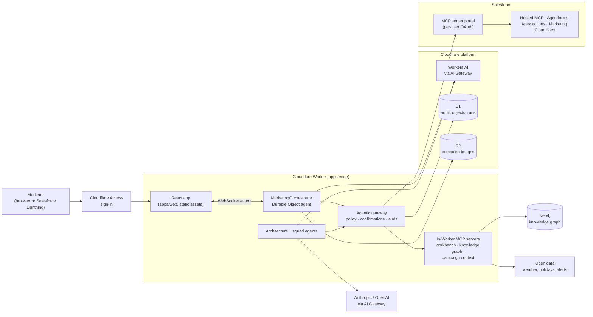

# Northstar Marketing Workbench

A working demo of what an **agentic marketing workbench** looks like when it is built on real systems: Salesforce CRM, Marketing Cloud Next, Data 360 and Agentforce for the records, and Cloudflare (Workers, Durable Objects, D1, R2, Workers AI, AI Gateway and Access) for everything that runs between the marketer and those records.

A marketer opens one screen and talks to an orchestrator agent. The agent reads campaigns, audiences, consent, brand rules and performance through governed tools, drafts work, and asks a person to confirm before it writes anything back to Salesforce. Around that chat sit the views that explain how it works and prove it works: a knowledge graph, an architecture model, a multi-agent campaign squad, evaluations, and a built-in course.

All of the companies, people and campaigns in it (Lumera, Harborstone Wealth, Coastline Kitchen and the rest) are fictional sample data.

## What you can do in it

| View | What it shows |
| --- | --- |
| **Chat** | The orchestrator agent. Ask it about a campaign, a segment or a brief; it plans tool calls, reads Salesforce and the knowledge graph, and answers with cards and citations. Writes (save a draft, open a review task, create a Marketing Cloud campaign) stop for your confirmation, are audited in D1, and are read back from Salesforce. Each answer has a technical trace and a route map of what it touched. History and the use-case library live here too. |
| **Evals** | The evaluation set: cases, rubric, judged quality dimensions and a comparison of models on the same cases. |
| **Learn** | A course that teaches every concept in the demo, from what a context window is to how GraphRAG grounds answers here. A check in CI keeps it in step with the code (also exported to [docs/learn.md](docs/learn.md)). |
| **Graph** | An explorer for the knowledge graph: brands, campaigns, audiences, approvals, disclosures, assets and the agent's long-term memories, and how they connect. |
| **Journeys** | End-to-end sample flows through the architecture, each run by real agents on real models. |
| **Architecture** | The layered model from the reference architecture: governed objects, one agentic gateway, an agent registry, the plan-to-learn content lifecycle, prompt and model catalogs, drift watch, trust and channels. |
| **Campaign squad** | A campaign lead and four specialist agents working a brief together on Workers AI, Anthropic or OpenAI. You play the people it stops for: a compliance (MLR) reviewer for regulated copy and the client choosing between concepts drawn from an approved asset library. Every run is scored. |

The left rail also shows which sources are connected, and the **MCP Gateway** box shows how many Salesforce tools the agent can reach right now.

## Architecture



How a turn flows:

1. **Sign-in.** Cloudflare Access authenticates the person in front of the Worker. Salesforce access is per user, through OAuth at the MCP server portal, so the agent only ever sees what that person can see.
2. **The agent.** Each chat is a `MarketingOrchestrator` Durable Object (Cloudflare Agents SDK) holding the conversation, a working set of records in focus, and the turn history. It runs `gpt-oss` on Workers AI through AI Gateway.
3. **Tools.** The model sees a curated, allow-listed tool catalog ([packages/contracts/src/tool-catalog.json](packages/contracts/src/tool-catalog.json)): Salesforce tools over Hosted MCP, plus MCP servers that run inside the Worker for the knowledge graph (GraphRAG and long-term memory), campaign context (restaurant data, live weather, inventory) and external signals. A policy router and intent router narrow the tools per step, and reliability guards force or repair tool calls when the model wanders.
4. **Writes.** The model can propose a write but never perform one on its own. The server builds a confirmation envelope with an idempotency key; the person confirms; the Worker executes it, records it in the D1 audit, and reads the result back from Salesforce as the only authority. Kill switches (`WRITES_ENABLED`, `DISABLED_TOOLS`, `MEMORY_ENABLED`) turn capabilities off without a deploy.
5. **Answers.** Responses render as Markdown and structured cards (HXL / MCP Apps cards with native fallbacks), with a trace of every tool call and model step.

The **Architecture** and **Campaign squad** views take the same ideas further: many narrow agents instead of one orchestrator, every call through a single `gateway.invoke()` choke point, governed objects with a state machine and history in D1, and model, prompt and agent catalogs with evaluations and drift. [docs/architecture-roadmap.md](docs/architecture-roadmap.md) maps the reference architecture's AWS components onto their Cloudflare equivalents.

## Repository layout

```text
apps/
  web/             React 19 + Vite front end: chat, views, Learn course
  edge/            Cloudflare Worker: orchestrator agent, gateway, MCP servers, APIs
    src/architecture/   governed objects, agent runtime, judge, sample flows
    src/team/           campaign squad: director, specialists, lifecycle, provider adapters
    src/knowledge-graph/, campaign-context/, external-services/, life-sciences/
                        MCP servers that run inside the Worker
packages/
  contracts/       Zod schemas and the tool catalog shared by Worker and UI
  architecture/    the architecture model: agents, prompts, models, workspaces, squad data, asset library
  knowledge-graph/ graph datasets per brand, GraphRAG tools, memory, Neo4j query API
  evals/           evaluation cases, judge calibration, pricing
  ui/              shared UI tiles
salesforce/        Salesforce DX metadata: Agent Script, Apex actions, permissions, Lightning surface
migrations/        D1 schema migrations
scripts/           verification gates, evals, seeding, live proofs
tests/             Playwright end-to-end tests
docs/              plan, decisions (ADRs), work units, security notes, the exported Learn course
infra/cloudflare/  deployment gates for the Cloudflare proof environment
```

## Running it locally

You need Node 26 and pnpm 11.

```sh
pnpm install --frozen-lockfile
pnpm dev
```

Open `http://127.0.0.1:5173`. Local mode uses the fictional sample data, a local knowledge graph and a local-only evaluator, and makes no external changes.

The agents run on real models, not scripts. To give them one locally, sign in with `wrangler login` and run:

```sh
pnpm dev:local
```

That keeps D1 and R2 local and calls Workers AI. Without a model, the agents say none is available rather than fall back to canned answers.

## Commands

| Command | What it does |
| --- | --- |
| `pnpm verify:fast` | Formatting, lint, types, unit contracts, documentation and invariants. |
| `pnpm verify` | Generated Worker types, all fast gates, Workers-runtime tests, the 20-case evaluation and a production build. |
| `pnpm test:unit` / `pnpm test:worker` | Unit tests in jsdom, and tests inside the Workers runtime. |
| `pnpm test:e2e` | Chrome and Edge-equivalent UI and reconnect proof with screenshots. |
| `pnpm learn:check` / `pnpm learn:export` | Check that the Learn course covers the code, and regenerate `docs/learn.md`. |
| `pnpm eval` / `pnpm eval:team` | Run the orchestrator evaluation, or compare squad providers on the reference briefs. |
| `pnpm deploy:dry-run` | Build and package the exact production Worker without changing Cloudflare. |
| `pnpm deploy` | Build and deploy the Worker (for the reviewed `main` branch or an explicit operator deploy). |
| `pnpm sf:metadata:check` | Validate the Salesforce Agent Script, Apex actions, permissions, catalog, Postman and audit-migration contract. |
| `SF_TARGET_ORG=<sandbox-alias> SF_APPROVED_PROOF_ORG_ID=<org-id> pnpm sf:validate` | Fails closed unless the target is a Salesforce sandbox or the approved proof org, then checks API level, sample records, consent access and Agent Script metadata. |
| `pnpm test:e2e:live` | Live proof against the deployed Worker; fails closed without authorized live-proof variables. |

Pushes to `main` deploy through Workers Builds, and each pull request gets a preview Worker with its own D1 database and R2 bucket.

## How the repository is built

This repo is agent-first: coding agents build, test, document and refine it, and people step in at credential and consent boundaries and at the final review. If you are an agent picking up work, start with the [agent getting-started checklist](docs/getting-started-for-agents.md) and [AGENTS.md](AGENTS.md). Do not infer live Salesforce or Cloudflare state from this README.

Further reading:

- [docs/learn.md](docs/learn.md): the whole Learn course as one page.
- [docs/agentic-marketing-workbench-plan.md](docs/agentic-marketing-workbench-plan.md): the plan and the decisions it settled.
- [docs/decisions/](docs/decisions/): architecture decision records, from the Cloudflare foundation (ADR-002) to the campaign squad (ADR-013 to ADR-015).
- [docs/work-units/](docs/work-units/): the record of each piece of delivered work and its evidence.
- [infra/cloudflare/pot/README.md](infra/cloudflare/pot/README.md): deployment gates for the proof environment.
- [salesforce/README.md](salesforce/README.md): the Salesforce side.
