# Learn: how the workbench works

> Generated from the Learn page's sources in `apps/web/src/learn` by `pnpm learn:export`. Don't edit it by hand: `pnpm learn:check` fails when it's out of date.

A reference for every piece of this workbench: what the model sees each turn, the knowledge graph behind its answers, and each system, guard and page around them. Each lesson has a diagram, one key idea, a way to try it here, and where to find it in the code.

## Contents

- [Part 1: Context and memory](#part-1-context-and-memory): What the model sees each turn, and where the rest is kept (3 lessons, 6 min)
  - [1.1 What the model sees on each turn](#11-what-the-model-sees-on-each-turn)
  - [1.2 Three layers of memory](#12-three-layers-of-memory)
  - [1.3 What goes wrong with context, and the defenses here](#13-what-goes-wrong-with-context-and-the-defenses-here)
- [Part 2: The knowledge graph](#part-2-the-knowledge-graph): Grounding answers in connected facts (1 lessons, 4 min)
  - [2.1 The graph, its tools, and evidence paths](#21-the-graph-its-tools-and-evidence-paths)
- [Part 3: Every concept in the demo](#part-3-every-concept-in-the-demo): Every moving part of the workbench (23 lessons, 20 min)
  - [3.1 The orchestrator agent](#31-the-orchestrator-agent)
  - [3.2 Two hosts: Cloudflare and Google Cloud](#32-two-hosts-cloudflare-and-google-cloud)
  - [3.3 The workspace: focus, context, and records](#33-the-workspace-focus-context-and-records)
  - [3.4 The model: gpt-oss-120b on Vertex AI](#34-the-model-gpt-oss-120b-on-vertex-ai)
  - [3.5 Tools and the Model Context Protocol (MCP)](#35-tools-and-the-model-context-protocol-mcp)
  - [3.6 Salesforce: Agentforce agents, Hosted MCP, and Apex actions](#36-salesforce-agentforce-agents-hosted-mcp-and-apex-actions)
  - [3.7 Marketing Cloud Next: agent-built briefs, campaigns, and flows](#37-marketing-cloud-next-agent-built-briefs-campaigns-and-flows)
  - [3.8 Routing: policy router, intent router, and scenario toolsets](#38-routing-policy-router-intent-router-and-scenario-toolsets)
  - [3.9 Reliability guards for tool calling](#39-reliability-guards-for-tool-calling)
  - [3.10 Governance: permissions, confirmations, and kill switches](#310-governance-permissions-confirmations-and-kill-switches)
  - [3.11 Structured UI: Markdown, HXL cards, and native fallbacks](#311-structured-ui-markdown-hxl-cards-and-native-fallbacks)
  - [3.12 Observability: route map, technical trace, turn history, and audit export](#312-observability-route-map-technical-trace-turn-history-and-audit-export)
  - [3.13 Evaluations](#313-evaluations)
  - [3.14 Campaign image workflow](#314-campaign-image-workflow)
  - [3.15 Campaign context: restaurant data and live weather](#315-campaign-context-restaurant-data-and-live-weather)
  - [3.16 The use-case library: marketing, sales, service, and financial services](#316-the-use-case-library-marketing-sales-service-and-financial-services)
  - [3.17 Governed objects and workspaces](#317-governed-objects-and-workspaces)
  - [3.18 The agentic gateway](#318-the-agentic-gateway)
  - [3.19 The content lifecycle: plan to learn](#319-the-content-lifecycle-plan-to-learn)
  - [3.20 Agents, prompts, models, and drift](#320-agents-prompts-models-and-drift)
  - [3.21 The campaign squad: a lead, four spokes, and the platform under them](#321-the-campaign-squad-a-lead-four-spokes-and-the-platform-under-them)
  - [3.22 A pharma campaign, focus to analytics, with MLR](#322-a-pharma-campaign-focus-to-analytics-with-mlr)
  - [3.23 Long-term memory: remembering across chats](#323-long-term-memory-remembering-across-chats)
- [Glossary](#glossary)
- [Reference: every concept in the code](#reference-every-concept-in-the-code)

## Part 1: Context and memory

*What the model sees each turn, and where the rest is kept* · 3 lessons · 6 min

What the orchestrator puts in front of the model on each turn, where the workbench keeps everything else, and the guards against stale or injected context.

**You'll be able to**

- Name what fills the model's context window on every turn here
- Tell working memory, the audit trail, and long-term memory apart
- Spot the context failures the demo defends against

### 1.1 What the model sees on each turn

*The context window the orchestrator builds for every model call.*

**Diagram: What fills the context window**

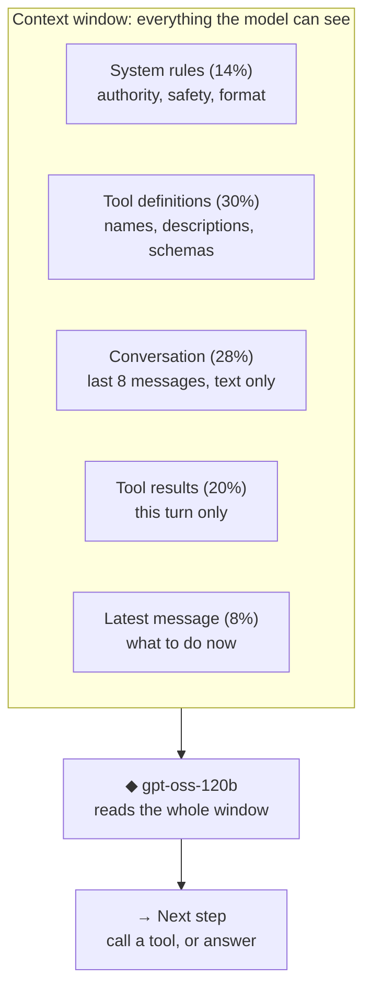

*One model call. Proportions are illustrative; the window is rebuilt from scratch every call.*

> **Key idea:** The model sees only this call's window: rules, the route's tools, the last 8 messages as text, this turn's tool results and a workspace summary.

Each time the orchestrator calls the model, it sends a **context window**, and nothing else reaches the model. Here that window holds:

- **System instructions:** the orchestrator's rules, such as "Salesforce tool results are the only authority" and "never claim a write happened".
- **Tool definitions:** the name, description, and JSON input schema of every tool the model may call on this step.
- **Conversation messages:** the recent user and assistant messages.
- **Tool results:** what each tool returned earlier in this turn.
- **The workspace summary:** the draft in focus, the records the chat opened, and the context cards its tools gathered (see *The workspace*).

What stays out matters as much: earlier replies arrive as text only, old tool results and reasoning never re-enter, and only the tools the turn's route offers are defined (see *Routing*). Why a small, high-signal window beats a large one is in the Playbook.

**Try it**

- Ask a question, then open its technical trace: “Summarize the sample campaign and its recent performance”

**In this demo**

- System prompt: apps/edge/src/turn-policy.ts (orchestratorSystemPrompt)
- Technical trace at the top of each answer shows what the model did with its context

**Learn more**

- Guide: [Effective context engineering for AI agents (Anthropic)](https://www.anthropic.com/engineering/effective-context-engineering-for-ai-agents)

### 1.2 Three layers of memory

*Working memory, the audit trail, and long-term memory each live somewhere different.*

**Diagram: Three layers of memory**

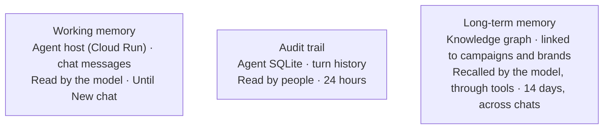

*Each layer has a different reader and lifetime. Only working memory is sent to the model every turn.*

> **Key idea:** “Session context” is three things: working memory for the model, an audit trail for people, and long-term memory by relationship.

"Session context" is really three things, with different lifetimes and owners:

| Layer | Holds | Lives in | Lifetime |
|---|---|---|---|
| **Working memory** | The current conversation, plus the workspace: the focus draft, open records, and context cards | Each user's chat in the Cloud Run agent host | Until **New chat** |
| **Audit trail** | What each turn did: route, tools, inputs and outputs, outcome, and the brand and role it ran under | Agent SQLite (turn history) | 24 hours |
| **Long-term memory** | Drafts you asked to remember and confirmed Salesforce writes | Knowledge graph, linked to the campaigns and brands involved | 14 days, across chats |

**Working memory** reaches the model as a bounded window: the last 8 messages, with earlier assistant replies reduced to their text so old tool results and reasoning never re-enter the prompt. The workspace (the draft being built, the records the chat opened, the context its tools gathered) is summarized in every prompt, so the model works from structured state instead of re-reading old replies. See *The workspace*.

**The audit trail** is never sent to the model. It's for people: History (a button on the Chat page) and the audit export.

**Long-term memory** lives in the graph because it's retrieved *by relationship* ("what did we decide about the Coastline push?"), not by recency, and needs provenance. It's never sent automatically: the model reads it through recall tools, only when a question asks about earlier work. See *Long-term memory*.

**Try it**

- Open turn history and memory (opens the history view)

**In this demo**

- Chat → History: Turns (the audit trail) and Memory (long-term memory)
- apps/edge/src/orchestrator.ts (conversationWindow)
- packages/knowledge-graph/src/memory.ts

**Learn more**

- Guide: [Effective context engineering for AI agents (Anthropic)](https://www.anthropic.com/engineering/effective-context-engineering-for-ai-agents)
- Docs: [Cloud Run documentation](https://cloud.google.com/run/docs)
- Docs: [Agents SDK chat agents (the protocol the Node agent host speaks)](https://developers.cloudflare.com/agents/api-reference/chat-agents/)

### 1.3 What goes wrong with context, and the defenses here

*Stale claims, prompt injection, and overflow, plus the guards this demo uses against each.*

**Diagram: Context risks and defenses**

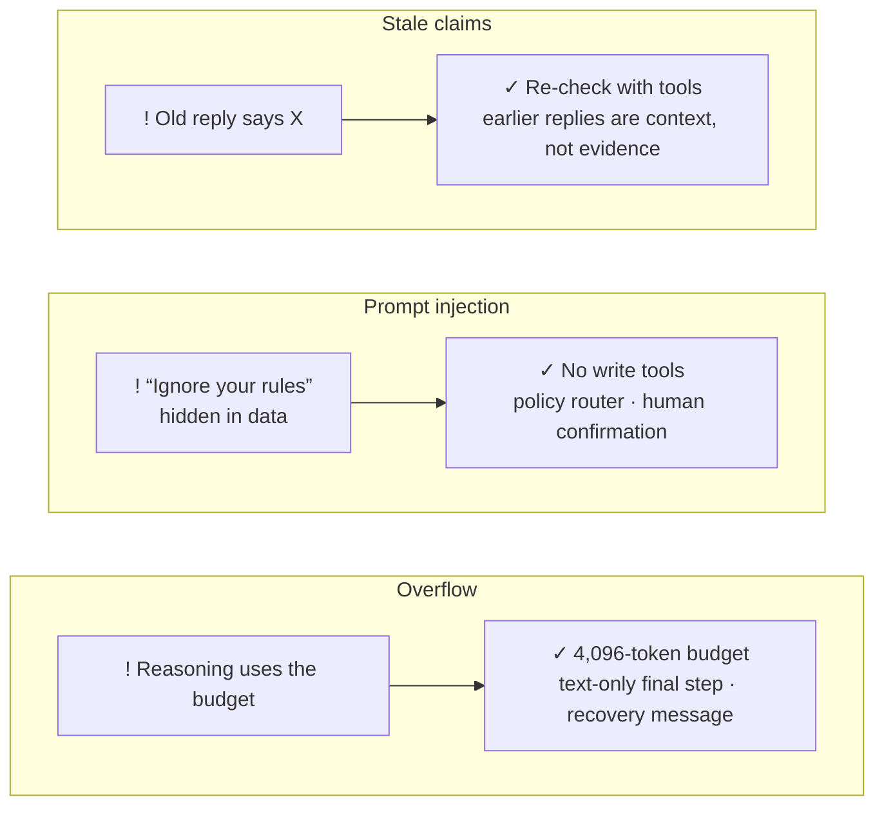

*Each risk has a defense that doesn't depend on the model behaving.*

> **Key idea:** Treat earlier replies and tool results as data, not instructions, and never let the model hold write tools.

**Stale or unsupported claims.** Defense: earlier replies are *context, not evidence*. The system prompt requires re-checking Salesforce facts with tools each turn, and old tool results are stripped from history.

**Prompt injection**, such as a campaign description saying "ignore previous instructions". Defenses:
- The model has **no write tools**; writes need a human confirmation.
- A **policy router** answers write and forbidden requests without calling the model.
- Tool results are treated as data.
- The Apex readiness check flags instruction-like text.

**Overflow and truncation.** A model endpoint's default output limit can be small enough for gpt-oss's reasoning to use up before any answer. Defenses: an explicit 4,096-token budget, forced text-only summary steps, and a recovery message if a turn still ends empty.

**Try it**

- Try a blocked request: “Publish and send the campaign”

**In this demo**

- apps/edge/src/turn-policy.ts (system rules)
- packages/contracts/src/index.ts (classifyPolicyIntent)
- Evaluations view: "No false write claims" check

**Learn more**

- Guide: [OWASP Top 10 for LLM Applications](https://owasp.org/www-project-top-10-for-large-language-model-applications/)
- Guide: [Effective context engineering for AI agents (Anthropic)](https://www.anthropic.com/engineering/effective-context-engineering-for-ai-agents)

### Check your understanding

Which of these does the model see on every turn?

1. The full turn history
2. The recent conversation and a summary of the workspace
3. Every earlier tool result, in full
4. The whole knowledge graph

<details><summary>Answer</summary>

**2. The recent conversation and a summary of the workspace** Models keep nothing between calls. Each turn sends the last 8 messages (text only) and a workspace summary: the draft, open records and gathered context. Turn history is for people; the graph is queried through tools.

</details>

## Part 2: The knowledge graph

*Grounding answers in connected facts* · 1 lessons · 4 min

The workbench grounds answers in a Neo4j knowledge graph through curated, read-only tools, and shows the path behind each answer. What RAG and GraphRAG are in general is in the Playbook.

**You'll be able to**

- Name what each brand contributes to the graph
- Explain why the model picks curated queries instead of writing Cypher
- Find the evidence paths behind a graph answer

### 2.1 The graph, its tools, and evidence paths

*Twelve read-only, curated graph tools over Neo4j, each returning evidence paths.*

**Diagram: The nine curated graph tools**

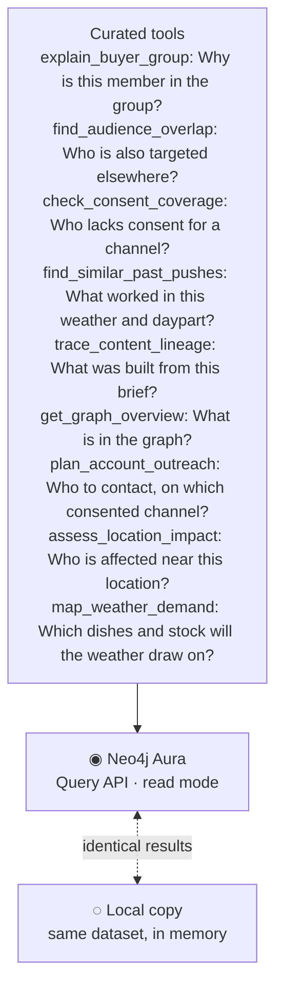

*Each tool is a fixed, parameterized Cypher query in read mode that returns an answer plus evidence paths.*

> **Key idea:** Curated, read-only graph queries return evidence paths, and a local copy must match Neo4j exactly.

**Curated queries, not text-to-Cypher.** The model picks from fixed, parameterized graph queries (*explain buyer group*, *check consent coverage*); it never writes Cypher. That keeps graph access predictable, safe to run, fast, and easy to evaluate, and every answer can carry the relationships that justify it.

**The graph.** A deterministic, fictional dataset of about 2,400 nodes and 20,300 relationships:
- **Northstar**, the parent brand: B2B accounts (each with a headquarters country), buying-role personas, campaigns, segments, content, brand rules, and consent scopes.
- **Coastline Kitchen**, a restaurant brand under Northstar: locations, menu, and dayparts from the restaurant system, with the same ids. Campaigns run on the **mobile app** and **email**. Each of 1,500 past push sends and 600 past email sends links to its campaign, content (push or email), app segment, channel consent, location, daypart, weather, and featured menu item, so an email campaign learns from past emails and a push from past pushes. Each location's app segment holds **marketing consent per channel** (separate push, email, and SMS opt-in counts): consent to one channel isn't consent to another.
- **Harborstone Wealth**, a wealth-management brand under Northstar: regulated content with approval records and required disclosures, an embargoed acquisition with its release package, and institutional clients with holdings, signals, advisors, and contacts.
- **Lumera Therapeutics**, a third brand modeling pharmaceutical promotion: seven more node types (Drug, Indication, ClinicalTrial, ClinicalClaim, Hospital, Specialty, PrescriberGroup) and twelve relationship types. It reuses ContentAsset, Approval, Disclosure, BrandRule and ConsentScope, so approval and consent checks work as for Harborstone. Its tools' Cypher hasn't been run against a live Neo4j database here; the fixture backend returns the rows the tests check.

**The store.** Neo4j AuraDB over the HTTPS **Query API**, the same way from either host the workbench runs on. Tool queries run in **read access mode**, so the database itself rejects writes; the only writes are the server's fixed long-term memory statements, kept to their own dataset.

<details>
<summary>The twelve tools, and how they're tested</summary>

**The tools**, each returning an answer plus up to 25 **evidence paths**: `explain_buyer_group`, `find_audience_overlap`, `check_consent_coverage`, `find_similar_past_pushes`, `trace_content_lineage`, `get_graph_overview`; for sales and service use cases, `plan_account_outreach`, `assess_location_impact`, `map_weather_demand`; for financial services, `match_news_to_approved_content`, `prepare_deal_release`, `build_aum_account_plan`.

**Parity, grounding, flows.**
- Every tool also has an in-memory implementation over the same dataset; `pnpm kg:parity` proves both return identical results (so local development and evals match production) and reports latency, with the median under 500 ms.
- Evaluations check that a graph answer names only accounts, people, campaigns, and menu items the tools returned.
- The restaurant push campaign calls `find_similar_past_pushes` to learn what worked in the same weather and daypart, then passes that to the Salesforce content tool.

</details>

**Graph explorer.** The Graph page's brand filter is the header's brand. It narrows the canvas to the nodes at least as close to that brand as to any other, walking loaded relationships without crossing another brand. So Coastline Kitchen keeps its campaigns, locations, shared channels and consent without pulling in Northstar's B2B accounts, and Lumera shows only its own nodes and what sits close. There's also a Lumera group and two guided tours.

**Evidence, shown twice.** Every path an answer used appears in words under the answer and, for a claims check, as a workspace card with each claim's evidence and the assets carrying it.

**Try it**

- Ask a graph question: “Who should be in the buyer group for Acme Outfitters, and why?”
- Open the graph explorer (opens the graph view)

**In this demo**

- Use cases: Buyer-group recommendation, and Buyer-group outreach around local holidays
- Graph evidence panel under answers; “Knowledge graph · Neo4j” in Sources
- packages/knowledge-graph, apps/edge/src/knowledge-graph

**Learn more**

- Docs: [Cypher manual: introduction](https://neo4j.com/docs/cypher-manual/current/introduction/)
- Docs: [Neo4j Aura Query API](https://neo4j.com/docs/aura/connecting-applications/query-api/)
- Code: [Official Neo4j MCP server](https://github.com/neo4j/mcp)
- Guide: [Salesforce Agentforce + Neo4j (Neo4j Labs)](https://neo4j.com/labs/genai-ecosystem/genai-frameworks/salesforce-agentforce/)
- Paper: [From Local to Global: A Graph RAG Approach (Microsoft Research)](https://arxiv.org/abs/2404.16130)

### Check your understanding

What stops a graph tool from changing the graph?

1. The system prompt tells the model not to
2. Tool queries run in Neo4j's read access mode, so the database rejects writes
3. The model only sees a summary of the graph
4. Nothing: the tools can write, but rarely do

<details><summary>Answer</summary>

**2. Tool queries run in Neo4j's read access mode, so the database rejects writes** The guarantee is in the database, not the prompt: tool queries run in read access mode. The only writes are the server's fixed long-term memory statements, kept to their own dataset.

</details>

## Part 3: Every concept in the demo

*Every moving part of the workbench* · 23 lessons · 20 min

Each piece of the workbench: how it works and where to see it.

**You'll be able to**

- Trace one chat turn from the browser to Salesforce and back
- Explain why routing and guards sit around the model
- Know where to look when something goes wrong

### 3.1 The orchestrator agent

*A stateful agent per user, on Cloud Run, that runs each chat turn.*

**Diagram: How a turn travels through the system**

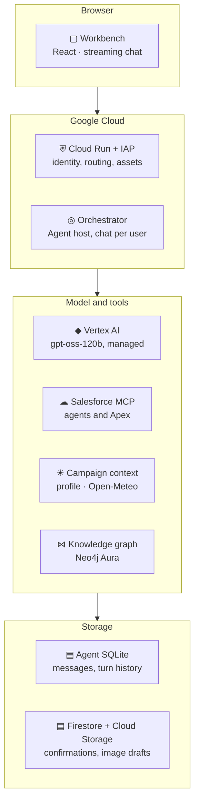

*The browser talks to one Cloud Run service behind Identity-Aware Proxy; each user's orchestrator reaches the model and three MCP servers.*

> **Key idea:** One stateful agent per user runs each turn as a short tool loop and records every event.

The **orchestrator** is an **Agents SDK** chat agent, run on Google Cloud by the workbench's own Node agent host on **Cloud Run**: one stateful instance per user with its own SQLite storage, saved to **Cloud Storage** after every change.
- Each user gets their own instance, keyed by a hash of their IAP identity and the workspace, so conversations and history are isolated by construction.
- Each turn streams to the browser over a WebSocket, and the stream is **resumable** if the tab reconnects.

**The tool loop.** A turn runs up to 6 steps; on each, the model calls a tool or writes the answer. Tools come from five MCP servers, connected per turn: Salesforce, campaign context, the knowledge graph, external services (public holidays and weather alerts) and the mocked life-sciences systems (see *Tools and the Model Context Protocol*). The orchestrator picks the tools available on each step (see *Routing*) and records a **turn trace** of every event.

**Around the loop**, the orchestrator handles what the model must not.

<details>
<summary>Confirmed writes, brief refinements, inventory checks and memory</summary>

- **Confirmed writes.** Once you confirm, it asks Marketing Cloud's Campaign Creation agent to save the brief or create the campaign, then reads the records back. It checks Salesforce before and after the call, so a retry links what an earlier attempt saved instead of saving it twice. Each step is published as agent state over the WebSocket, so progress is live, not a spinner.
- **Brief refinements.** It adds the Brief ID to a saved brief's preview refinement if the model left it out.
- **Inventory checks.** It collects the forecast, the graph's demand map, and stock counts, computes which items are low, and rebuilds the answer step's system prompt so the model presents exactly that list.
- **Long-term memory.** It writes memory when a write is read back or you ask it to remember a draft, and reopens one into the workspace on **Reopen**. The hourly Cloud Scheduler job prunes the 24-hour audit and deletes memory past 14 days.

</details>

**Every tool call passes the gateway.** Before a chosen tool runs, the server asks the agentic gateway whether the orchestrator may call `tool:<name>`. The decision, policy and caller are recorded; a denial reaches the model as a tool error. See *The agentic gateway*.

<details>
<summary>How a tool result is judged usable</summary>

**Is a result usable?** A Salesforce agent answers in words, so its reply is checked for phrases such as "no business units" or "cannot access"; if found, the model is told the result was empty and not to fill the gap. The workbench's own tools (knowledge graph, life-sciences systems, campaign context, external services) return data that can quote such words and still be a full answer (a claim that "is not on the approved label" is evidence), so theirs counts as empty only as an error or `found: false`.

</details>

<details>
<summary>How the header's brand and role shape a turn</summary>

**The header's brand and role.** Each chat message carries both. The server withholds other brands' tools, answers a request about another brand with a note to switch (not from memory), and tells the model the role so it leads with what that person decides. The model knows what each brand sells (Lumera's Cardivance, Glucora and Neurelva; Harborstone's Sweep Account; Coastline's chowder), so a named product maps to its brand. The brand also sets which claims checks a new draft starts with. The role changes emphasis only, never what Salesforce allows or what needs confirmation.

</details>

<details>
<summary>The Lightning surface: sign-in, turns and scope</summary>

**The Lightning surface.** A Salesforce Lightning component onto the same agent is part of this demo, but not on Google Cloud: it depends on handing a signed-in person's token to a Salesforce origin, which Identity-Aware Proxy doesn't do. Here the workbench is used from its own page (ADR-018).

</details>

**In this demo**

- apps/edge/src/orchestrator.ts
- apps/edge/src/surface.ts
- salesforce/workbench-surface/main/default/lwc/northstarWorkbench/
- “Behind the scenes · technical trace” at the top of each answer

**Learn more**

- Docs: [Agents SDK (the chat agent API the orchestrator is written to)](https://developers.cloudflare.com/agents/)
- Docs: [Agents SDK chat agents (the protocol the Node agent host speaks)](https://developers.cloudflare.com/agents/api-reference/chat-agents/)
- Docs: [Cloud Run documentation](https://cloud.google.com/run/docs)
- Docs: [AI SDK: introduction](https://ai-sdk.dev/docs/introduction)
- Paper: [ReAct: Synergizing Reasoning and Acting in Language Models](https://arxiv.org/abs/2210.03629)

### 3.2 Two hosts: Cloudflare and Google Cloud

*The same code runs as a Cloudflare Worker or as a Node server on Cloud Run, behind a thin platform seam.*

**Diagram: How a turn travels through the system**


*The browser talks to one Cloud Run service behind Identity-Aware Proxy; each user's orchestrator reaches the model and three MCP servers.*

> **Key idea:** Only storage, sign-in, where chats live and the default models differ between hosts; everything else is the same code.

The workbench runs on either host from the same commit: on **Cloudflare** as one Worker, on **Google Cloud** as one Node server on **Cloud Run**. The routes, the orchestrator, the gateway, and the agents don't know which host they're on (ADR-018).

**The seam.** Only four things differ, each behind a small interface in `apps/edge/src/platform/`:

| | Cloudflare | Google Cloud |
| --- | --- | --- |
| The app's tables (audit, image drafts, architecture, squad library) | D1 | Firestore |
| Models (the default; the top bar can switch) | Workers AI through AI Gateway, or Vertex AI | Vertex AI: gpt-oss-120b as a managed model, Gemini images, Claude |
| Sign-in | Cloudflare Access | Identity-Aware Proxy, plus a members list in Firestore |
| Chats | A Durable Object per user | A Node agent host, each chat saved to Cloud Storage |

<details>
<summary>How feature code reaches each platform</summary>

Feature code asks `dataPlatform(env)` for repositories (D1, or the Firestore the GCP host puts into the environment) and `modelPlatform(env, choice)` for models. The HTTP routes live in `app.ts`; each host supplies only where chats run, how static files are served, and what readiness reports.

</details>

**The AI platform is chosen apart from the host (ADR-021).** Workers AI and Vertex AI are AI SDK providers in one registry, so code asks for `workers-ai:@cf/openai/gpt-oss-120b` or `vertex:@cf/openai/gpt-oss-120b` the same way.
- The top bar's **AI platform** menu (beside Brand and Run as) lists what this server can reach and sends the choice with every chat message and workspace request. Cloudflare offers Workers AI, plus Vertex AI once it holds Google credentials; Google Cloud offers Vertex AI.

<details>
<summary>Credentials, tracing and narrowing the menu</summary>

- The Worker needs no Google key: through **Workload Identity Federation** it signs its own short-lived token, which Google's Security Token Service exchanges for an hour's access as a service account that may only call Vertex AI.
- The route map and trace name the platform each turn ran on. A Vertex turn has no AI Gateway hop, whichever host served it.
- `AI_PLATFORMS_ENABLED` (in `wrangler.jsonc`, or a Cloud Run environment variable) narrows the menu: a comma-separated list; a platform left out is neither listed nor run, even if requested.

</details>

<details>
<summary>Chats, models and sign-in on Google Cloud</summary>

**Chats without Durable Objects.** The orchestrator extends the Agents SDK's chat agent. On Google Cloud the server bundle swaps that one import for a Node implementation of the same WebSocket protocol, so the browser's `useAgentChat` and the orchestrator are unchanged. As in a Durable Object, a chat keeps all its storage (messages, state, turn history, Salesforce tokens) in one in-memory SQLite database. The host saves it to Cloud Storage after each change, and the save fails if anyone else saved the chat since it was loaded. One Cloud Run instance with session affinity keeps each chat on a single writer.

**Models.** Vertex AI serves gpt-oss-120b as a managed model, the family the agents were evaluated on, but no gpt-oss-20b. So on Vertex the chat orchestrator (20b on Workers AI) and the catalog's other Workers AI models run 120b, and the trace names the model served; campaign images come from Gemini's image model. Two things follow the host, not the menu: on Google Cloud the answer-quality judge (Clef on Workers AI) is gpt-oss-120b answering the same rubric, and the squad's Anthropic provider reaches Claude on Vertex while OpenAI stays off until approved. Vertex's gpt-oss refuses a forced tool choice, so a step that must call a tool asks for one in words instead; and when the endpoint drops a call the model wrote (it returns only the reasoning), the adapter asks again for the call as JSON and hands it on (`platform/vertex.ts`).

**Sign-in and Salesforce on Google Cloud.** IAP signs each request it lets through; the server checks that assertion, then looks the email up in Firestore's `members` collection for the role, which IAP doesn't carry. Requests that bypass IAP are refused. The chat connects to Salesforce's hosted MCP server directly, with OAuth and PKCE, storing tokens encrypted in the chat's own storage (on Cloudflare, per-user OAuth goes through an Access MCP portal). The Lightning surface needs an Access token, so it stays on Cloudflare.

</details>

<details>
<summary>How the page names its host, and the hourly job</summary>

**The page names its host.** `packages/contracts/src/host.ts` says what each host calls its sign-in, models, database, storage and scheduler. The Google Cloud server tags its page with `<meta name="northstar-host" content="google-cloud">`; the Worker leaves it untouched. The browser reads the tag once, so one build names the right services in the route map, image workflow, squad providers, identity chain, and this course. The course is written once, with inline host and AI-platform markers that `apps/web/src/learn/variants.ts` resolves: host from the meta tag, platform from the **AI platform** menu. `docs/learn.md` is the Cloudflare/Workers AI edition; `docs/learn-google-cloud.md` the Google Cloud edition.

**Maintenance.** The hourly job (audit pruning, drift sweeps, memory expiry) runs from the Worker's cron, or from Cloud Scheduler calling the service with a Google-signed token only its service account can get. Firestore's time-to-live policies also delete expired rows as a backstop.

**The image allowance outlives the drafts.** The proof's fixed cap on generated images counts every image a workspace has ever made, not the drafts still stored. Drafts expire after seven days (Cloud Storage's lifecycle rule deletes the files, Firestore's time-to-live the rows), so counting them would hand the allowance back as they expire. On Google Cloud a per-workspace counter in Firestore, which never expires, holds the count; deleting an expired draft doesn't change it. A workspace with drafts from before the counter existed starts it from those drafts. On Cloudflare the D1 rows outlive their R2 files (only the file expires), so the cap counts those rows.

</details>

**In this demo**

- apps/edge/src/app.ts, apps/edge/src/platform/
- apps/gcp/src/ (the Node host, Firestore, Vertex AI, Cloud Storage)
- scripts/gcp/bootstrap.sh, scripts/gcp/deploy.sh, infra/gcp/README.md
- docs/decisions/ADR-018-google-cloud-target.md
- Top bar → AI platform; GET /api/ai-platforms; docs/decisions/ADR-021-ai-platform-apart-from-host.md
- apps/web/src/learn/variants.ts; docs/learn.md, docs/learn-google-cloud.md

**Learn more**

- Docs: [Cloud Run documentation](https://cloud.google.com/run/docs)
- Docs: [Firestore documentation](https://cloud.google.com/firestore/docs)
- Docs: [gpt-oss-120b on Vertex AI (managed API)](https://cloud.google.com/vertex-ai/generative-ai/docs/maas/openai/gpt-oss-120b)
- Docs: [Identity-Aware Proxy for Cloud Run](https://cloud.google.com/iap/docs/enabling-cloud-run)
- Docs: [Cloudflare chat agents](https://developers.cloudflare.com/agents/api-reference/chat-agents/)
- Docs: [AI SDK: provider and model management (provider registry)](https://ai-sdk.dev/docs/ai-sdk-core/provider-management)

### 3.3 The workspace: focus, context, and records

*A per-chat, structured model of the work, built from tool results rather than model text.*

**Diagram: How the workspace is built and used**

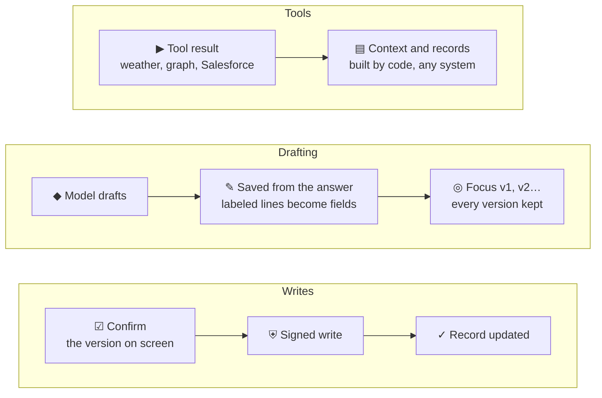

*Code turns tool results into context and records; the model drafts into the focus; confirmed writes act on the focus version shown.*

> **Key idea:** Tools fill the workspace, the model drafts into it, and confirmed writes act on exactly what it shows.

Each chat has a **working set**, shown in the Workspace panel and summarized in every prompt. **New chat** empties it. It has three parts:

- **Focus:** the draft being built, as structured data: title, labeled fields, change note, and the context it came from.

<details>
<summary>How a draft becomes the focus</summary>

- A campaign's focus is the **brief** Marketing Cloud's Campaign Creation agent drafted, read field for field from its reply (Key Message, Target Audience, Primary Goal, and so on), or from the answer if no brief comes back.
- Other drafts, such as Content Builder agent copy, are read from the answer's labeled parts: "**Headline:** …" on one line, or a label heading the lines below ("Body:" then bullets, "Ruled out" then a table, one line per row). A two-column table ("| Subject | … |") gives one field per row; HTML line breaks in it read as line breaks.
- After a claims check, the draft card shows its claims review: every factual sentence approved, or each flagged one with why.
- Each revision is a new version; earlier ones stay viewable. Once saved, the focus shows the brief's campaign preview, then the campaign and flow Salesforce read back.

</details>

- **Context:** cards for what tools returned, each with source and fetch time: weather, forecasts, weather alerts, public holidays, the Federal Reserve's latest rate decision, store inventory, the inventory risk the workbench computed, the restaurant profile, graph evidence, remembered work, and Salesforce summaries.
- **Records:** records the chat opened, created, or updated in any connected system, plus any reopened from memory (marked *Remembered* until read again). Every system, Salesforce or restaurant data alike, joins through one reference: system, object type, and id.

Why it's trustworthy:

1. **Deterministic ingestion.** Cards and records come from tool results through code, never from model text, so nothing is invented.
2. **Open versus available.** Records the systems make available are listed separately as a catalog, so the model never acts on one the chat hasn't opened.
3. **Approvals come to you.** An **action card** appears in the chat when something needs approval: save the brief in Marketing Cloud, then create its campaign, or request a review after a readiness check. Accepting it prepares the confirmation card, with Salesforce's permission check.
4. **Writes act on what you see.** Saving asks the Campaign Creation agent to save exactly the focus version on screen, recorded in the confirmation's request hash. The Brief, Campaign, and flow then appear in Records as Salesforce read them back.

<details>
<summary>Life-sciences cards and the claims check, row by row</summary>

**Life-sciences cards.** The three Lumera tools add a target list, a claims check and a hospital plan, each with a summary line. The life-sciences systems add a card per answer, named for the system, so what came from Aprimo, Reltio or Drupal stays visible beside the graph's evidence. Each row has a status label, an ID and the date that matters: Aprimo assets as usable (with MLR ID and approval date) or not and why (pending review, expired, failed a check); Vault library claims with status; Screendragon jobs with stage and due date; HCP pages as compliant or not.

**The claims check, claim by claim.** One row per claim, usable first: a verdict (usable, blocked, no approved content, content needs MLR), the claim, and why it's blocked. Under each: its supporting evidence (the trial, enrollment and result) and every asset carrying it, with MLR ID and whether it's usable. The answer's *Graph evidence* lists every path in words.

</details>

**Try it**

- Draft an email and watch the workspace fill: “Draft an email campaign for Coastline Kitchen, our fast casual restaurant in California, tailored to the current weather, time of day, and our menu”

**In this demo**

- Workspace panel: Focus, Records, and Context
- apps/edge/src/working-set.ts, apps/edge/src/focus.ts
- Issue #46: session working set

**Learn more**

- Guide: [Effective context engineering for AI agents (Anthropic)](https://www.anthropic.com/engineering/effective-context-engineering-for-ai-agents)
- Guide: [Writing effective tools for agents (Anthropic)](https://www.anthropic.com/engineering/writing-tools-for-agents)
- Guide: [Building effective agents (Anthropic)](https://www.anthropic.com/engineering/building-effective-agents)

### 3.4 The model: gpt-oss-120b on Vertex AI

*An open-weight reasoning model, served as a managed model on Vertex AI.*

**Diagram: The model and its known quirks**

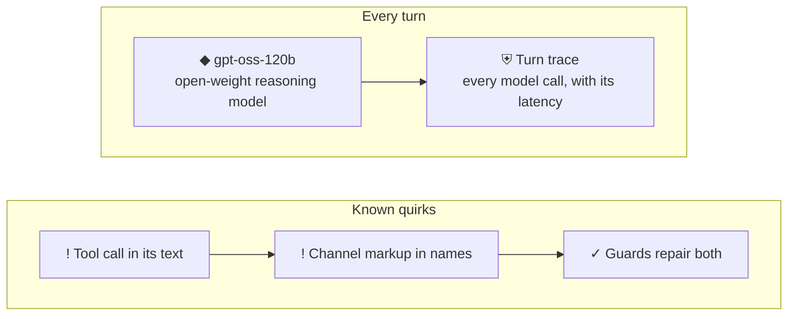

*The quirks are predictable, so each one has a targeted guard.*

> **Key idea:** The model was chosen by measuring the whole pipeline, and its known quirks shaped the guards.

The orchestrator runs **gpt-oss-120b**, OpenAI's open-weight reasoning model, as a managed model on **Vertex AI**. Every model call is logged to Cloud Logging. Its ID is set in one place: `PROOF_DEFAULTS.orchestratorModel`.

- **Why the catalog names 20b:** after the routing and reliability fixes, 20b matched or beat gpt-oss-120b through the pipeline at about 60% of the latency and lower cost (see *Evaluations*). Vertex AI serves no 20b, so the orchestrator runs the 120b it was compared with, and the trace names the model served.
- **Where it runs.** The top bar's **AI platform** menu shows where the models run: Vertex AI on Google Cloud (ADR-021).

<details>
<summary>The model's tool-calling quirks</summary>

- **Its quirks** shaped several guards: it sometimes writes a tool call into its reasoning or answer instead of calling the tool, and leaks its "harmony" channel markup into tool names.

</details>

**Try it**

- See the model comparison (opens the evaluations view)

**In this demo**

- packages/contracts/src/index.ts (PROOF_DEFAULTS)
- Evaluations view: model comparison
- docs/decisions/ADR-005

**Learn more**

- Docs: [gpt-oss-120b on Vertex AI (managed API)](https://cloud.google.com/vertex-ai/generative-ai/docs/maas/openai/gpt-oss-120b)
- Code: [openai/gpt-oss](https://github.com/openai/gpt-oss)
- Guide: [The harmony response format (OpenAI Cookbook)](https://cookbook.openai.com/articles/openai-harmony)

### 3.5 Tools and the Model Context Protocol (MCP)

*The five MCP servers the orchestrator connects to each turn, and what each offers.*

**Diagram: How MCP works**

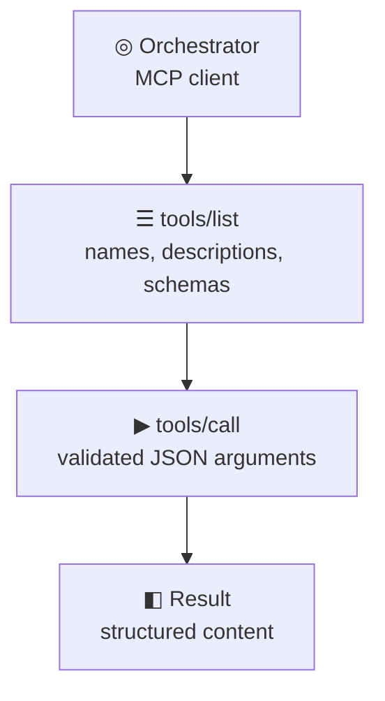

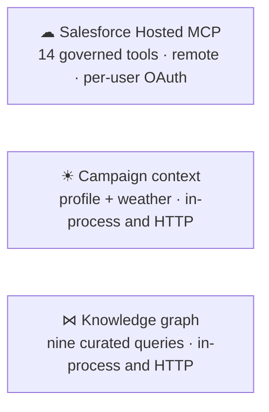

*Clients discover tools with tools/list and run them with tools/call; the transport can be HTTP or in-memory.*

> **Key idea:** MCP lets any agent list and call tools the same way, whether the server is remote or in-process.

Every tool reaches the orchestrator over **MCP**: each server advertises its tools (name, description, JSON Schema for input), and the orchestrator lists and calls them.

| Server | Tools | Reached |
|---|---|---|
| **Salesforce Hosted MCP** | 14 governed tools backed by Agentforce agents and Apex actions | Remote, per-user OAuth |
| **Campaign context** | Restaurant profile and store inventory (mocked); live weather and forecasts (Open-Meteo) | In-process; also `/mcp/campaign-context` |
| **External services** | Public holidays (Nager.Date) and weather alerts (National Weather Service), both free public APIs | In-process |
| **Knowledge graph** | Nine curated Neo4j queries, plus three memory recall tools in chat | In-process; also `/mcp/knowledge-graph` |
| **Life sciences** (`northstar-life-sciences`) | Mocked pharma systems, below | In-process |

In-process servers use an in-memory MCP transport: the real protocol, no network hop. External MCP clients reach the same servers over HTTP, behind Identity-Aware Proxy.

<details>
<summary>How loosely typed tool inputs are accepted</summary>

Tool inputs are typed, but models don't always type them exactly: the life-sciences tools accept a drug's name ("Cardivance") or its ID, and a channel or status in any case. The model still sees the strict values; only an input that matches nothing is rejected.

</details>

**Life-sciences systems (mocked).** Pharma marketing runs on more than Salesforce. These read-only tools answer from the same fictional drugs, claims, MLR approvals and hospitals as the knowledge graph, so one system can be checked against another. None is a live connection.

<details>
<summary>The mocked life-sciences tools, system by system</summary>

- **Aprimo** (digital assets, MLR workflow): `aprimo_search_approved_assets` (a drug's assets, MLR approval, expiry, usable now or not); `aprimo_get_mlr_review` (the medical, legal and regulatory stages, and why one is pending).
- **Reltio** (master data): `reltio_resolve_organization` (a hospital's golden record, hierarchy, merged sources, possible duplicates).
- **Veeva Vault PromoMats** (claims library, label): `vault_list_approved_claims`, `vault_get_prescribing_information`.
- **Screendragon** (work management): `screendragon_list_jobs`, `screendragon_get_job`, with the MLR approval each job awaits.
- **IQVIA** (prescription data, invented): `iqvia_get_prescribing_trends`.
- **Salesforce Life Sciences Cloud**: `lsc_get_call_plan`, a hospital's field plan as counts of prescribers.
- **Drupal** (the HCP website): `drupal_list_hcp_site_content` flags a live page with an expired approval.

</details>

Ask one question across them (is a drug's material consistent across Aprimo, the claims library and the website?) and the orchestrator calls three and points out where they disagree.

**In this demo**

- Sources list in the left rail (collapsed to a status line)
- apps/edge/src/campaign-context, apps/edge/src/knowledge-graph
- salesforce/…/mcpServerDefinitions

**Learn more**

- Docs: [Model Context Protocol: introduction](https://modelcontextprotocol.io/docs/getting-started/intro)
- Spec: [MCP specification (2025-06-18)](https://modelcontextprotocol.io/specification/2025-06-18)
- Spec: [Model Context Protocol specification](https://modelcontextprotocol.io/specification)
- Guide: [Writing effective tools for agents (Anthropic)](https://www.anthropic.com/engineering/writing-tools-for-agents)
- Docs: [AI SDK: tools and tool calling](https://ai-sdk.dev/docs/ai-sdk-core/tools-and-tool-calling)

### 3.6 Salesforce: Agentforce agents, Hosted MCP, and Apex actions

*Salesforce is the system of record, and every Salesforce fact comes from its tools.*

**Diagram: Reads and writes in Salesforce**

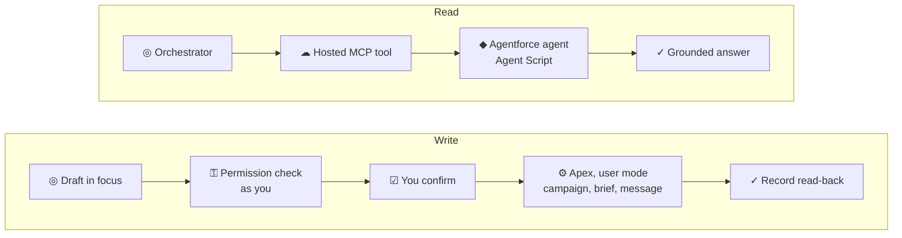

*Reads go through agents on Hosted MCP. Writes create or update real records through Apex actions, after a permission check and your confirmation.*

> **Key idea:** Salesforce is the system of record. Every Salesforce fact comes from its tools, and only a confirmed write, run as you, changes it; the model never holds a write tool.

Salesforce is **authoritative** for campaign data; the orchestrator never invents Salesforce facts. It calls tools on a **Salesforce Hosted MCP server**:

- **Agent-backed tools** each call an **Agentforce** agent defined as an Agent Script bundle. The **Salesforce agents** panel under each answer shows which (see *Structured UI*).

<details>
<summary>The four Salesforce agents</summary>

- **Northstar Campaign Creation** (a Marketing Cloud Next Campaign Creation agent): drafts, saves and refines briefs; creates campaigns and their flows. See *Marketing Cloud Next*.
- **Northstar Content Builder** (a Marketing Cloud Next Content Builder agent): drafts copy and content sections with the standard Draft Content and Create Section actions.
- **Northstar Account Discovery**: Marketing's account discovery and scoring APIs for signals, engagement and buyer groups.
- **Campaign Readiness and Governance**: a custom agent whose Apex actions summarize a campaign and check readiness, consent and brand rules. Custom on purpose: Marketing Cloud Next has no campaign-summary or readiness action, and its standard **Generate Campaign Insights** flow fails in this org until campaigns have sent and gathered engagement data.

</details>

- **Briefs and campaigns** come only from the Campaign Creation agent's standard actions, as Marketing Cloud's own **Brief**, **BriefPlanStep**, **Campaign** and campaign **flow** records. The workbench has no custom objects or Apex for them.
- **Other writes** (a review task, an image attachment, an inventory case for a store manager) are global **Apex invocable actions** that verify a signed confirmation.
- **Permission check:** `check_write_access`, a read-only Apex action called before any write is prepared, runs as the signed-in user and reports each permission it checked.

The model holds no write tool: only the confirmation flow calls write tools, and every write runs as you (see *Governance*).

<details>
<summary>How Salesforce metadata is deployed</summary>

Metadata (Apex, fields, the permission set, the MCP definition) deploys through a gated CI pipeline to one approved proof org.

</details>

**Try it**

- Check campaign readiness: “Check the sample campaign readiness and explain every blocker”

**In this demo**

- Use cases: Campaign performance summary, Launch readiness and review request
- “Salesforce agents” under each answer
- salesforce/force-app/main/default/aiAuthoringBundles, salesforce/force-app/main/default/classes
- docs/salesforce-deployment-pipeline.md

**Learn more**

- Docs: [Salesforce Hosted MCP servers reference](https://developer.salesforce.com/docs/platform/hosted-mcp-servers/guide/servers-reference.html)
- Course: [Introduction to Agentforce (Trailhead)](https://trailhead.salesforce.com/content/learn/modules/introduction-to-agentforce)
- Guide: [Salesforce Agentforce](https://www.salesforce.com/agentforce/)

### 3.7 Marketing Cloud Next: agent-built briefs, campaigns, and flows

*The workbench asks Salesforce's Campaign Creation agent to create briefs and campaigns, the way the Marketing app does.*

**Diagram: How a campaign is created in Marketing Cloud Next**

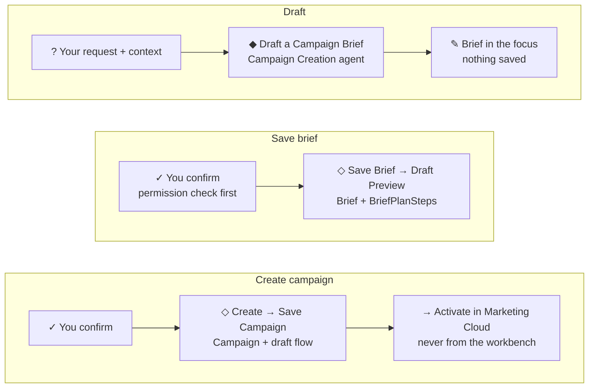

*Every record is created by the Campaign Creation agent's standard actions, after you confirm; the workbench reads each one back.*

> **Key idea:** Salesforce's Campaign Creation agent creates the brief, the campaign, and its flow; the workbench asks it to, after you confirm, and reads the result back.

In **Marketing Cloud Next**, a campaign starts as a **brief** and becomes a **campaign with a flow**. The workbench asks Salesforce's **Campaign Creation agent** to do this with standard actions instead of writing records itself.

<details>
<summary>The agent and its five standard actions</summary>

**The agent.** `Northstar_Campaign_Creation` is an Agent Script agent built from Salesforce's `MktCloud__CampaignCreationAgent` template and published as a Campaign Creation agent. Only Agent Script agents can be Hosted MCP tools, so the workbench reaches it through the `NorthstarMarketingWorkbench` MCP server. Its **Marketing Campaigns** subagent runs the standard actions in Salesforce's required order:

| Step | Standard action | What it does |
|---|---|---|
| 1 | Draft a Campaign Brief (`MktCloud__GenerateBrief`) | Drafts name, description, key message, audience, goal, CTAs, KPI, guardrails and priority. Saves nothing. |
| 2 | Save Campaign Brief (`saveBrief`) | Creates the **Brief** record. |
| 3 | Draft a Campaign Preview (`MktCloud__GenerateCampaignFromBrief`) | Plans the messages as **BriefPlanStep** records: channel, wait, subject, preheader, body. |
| 4 | Create Campaign (`createCampaign`) | Creates the **Campaign**, linked to the brief. |
| 5 | Save Campaign (`MktCloud__SaveCampaign`) | Builds the campaign's **flow** from the preview, as a draft. |

Its **Campaign Refinement** subagent runs **Refine Campaign Preview** on a saved preview ("make the second email shorter").

</details>

**How the workbench uses it.**
1. A campaign request (the Coastline plan, or "create a campaign in Marketing Cloud") ends with `draft_campaign_brief`. The agent's brief becomes the workspace focus, field for field.
2. **Save brief** (an action card, then a confirmation card): `save_marketing_brief` asks the agent to run steps 2 and 3.
3. **Create the campaign** (a second card): `create_marketing_campaign` asks for steps 4 and 5.
4. After each write, `get_marketing_records` (read-only Apex) reads back the Brief, its steps, the Campaign and the flow. The workspace shows only what Salesforce returned, never the agent's say-so.

<details>
<summary>How each call is made, and why a retry never saves twice</summary>

**One request per call.** Hosted MCP agent tools take a single message, so each call carries everything the agent needs: the confirmed brief fields, or the Brief ID whose preview was confirmed. The agent is asked to include record ids in its reply, and the read-back verifies them. When you change a saved brief, the server adds the Brief ID to the Refine Campaign Preview request if the model left it out (it did in half of the live evaluation runs), so the agent needn't guess which brief you meant.

**Safe to retry.** Marketing Cloud's save actions aren't idempotent, so the workbench checks Salesforce before asking the agent:
- A save sent before and never confirmed (say, it timed out after the agent saved) whose brief Salesforce now shows is linked, not saved again. A same-named brief from another chat is left alone.
- A brief that already has its campaign never gets a second one.
- If the agent call fails, it checks once more, since the agent may have saved before the timeout. Only if nothing is there are you asked to try again.

</details>

**What stays in Marketing Cloud.** The flow is created as a draft. Choosing its audience and sender, and activating it, happen in Marketing Cloud; the workbench never sends or activates anything. Previews in this org plan email (and SMS) steps; a push request is recorded in the brief's guardrails.

**Try it**

- Draft the Coastline Kitchen email: “Draft an email campaign for Coastline Kitchen, our fast casual restaurant in California, tailored to the current weather, time of day, and our menu”
- Create a campaign in Marketing Cloud: “Create a campaign in Marketing Cloud for Coastline Kitchen's late-night tacos”

**In this demo**

- Use cases: Weather-aware campaign in Marketing Cloud
- “Salesforce agents” under each answer, and the confirmation card's agent details
- Workspace focus: Brief saved, campaign preview, Campaign and flow links
- salesforce/force-app/main/default/aiAuthoringBundles/Northstar_Campaign_Creation
- apps/edge/src/marketing-writes.ts

**Learn more**

- Docs: [Agentforce in Marketing Cloud Next (Salesforce Help)](https://help.salesforce.com/s/articleView?id=mktg.mktg_einstein_copilot_in_mc.htm&language=en_US&type=5)
- Course: [Create and customize a marketing campaign with Agentforce (Trailhead)](https://trailhead.salesforce.com/content/learn/modules/ai-in-marketing-cloud-next/create-and-customize-a-marketing-campaign-with-agentforce)
- Docs: [Expose Agentforce agents as Hosted MCP tools (Salesforce Developers)](https://developer.salesforce.com/docs/platform/hosted-mcp-servers/guide/agentforce.html)

### 3.8 Routing: policy router, intent router, and scenario toolsets

*Deterministic decisions before and around the model.*

**Diagram: How a message is routed**

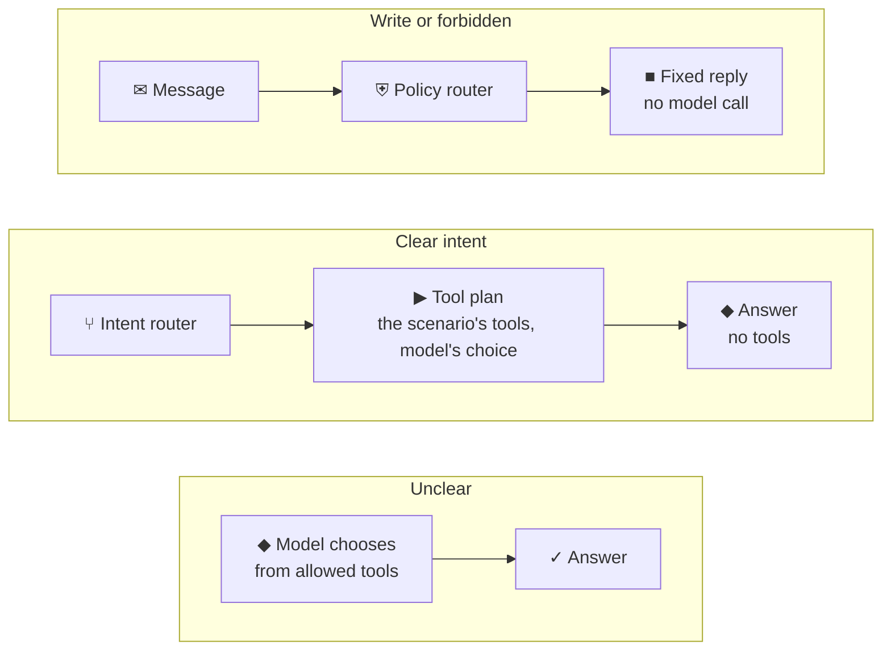

*Two deterministic routers run before the model. A scenario offers its tools and the model picks; then it answers with no tools.*

> **Key idea:** Deterministic routers decide what must never be left to chance; the model handles the rest.

Not every decision belongs to the model. Each turn passes two deterministic routers.

**1. Policy router.** Without calling the model, so it can never claim a write happened:
- "Remember this draft": the server stores the focus in long-term memory.
- Save or create, with a draft in the workspace: the server plans the write from the draft, Salesforce checks your permissions, and a confirmation card appears.
- Other save, create or change requests: a fixed reply pointing to the confirmation flow.
- Publish, send, delete and similar: refused.

<details>
<summary>How a question differs from a request</summary>

A question about what to send ("What can we send clients?") asks for guidance, not an action, and reaches the model. Each sentence that names an action is judged on its own, so context before the question ("The Fed moved rates.") doesn't make it a request.

</details>

**2. Classifier and intent router.**
- The **request classifier** labels the request's topic (claims, a target list, Fed news, inventory, …, or *off topic*). Rules label what the scenarios name, instantly; a small model call, run while the tools connect, adds labels the rules missed (a paraphrased claims question) and never removes one.
- A clear intent picks a **scenario**, whose tools are the turn's candidates, never the whole catalog. A request no rule recognises gets the brand's catalog. The rules need specific signals and **defer to the model** when unsure, because wrong tools narrow what the model can do.
- **Cedar policies** decide which candidates are on offer each step, from the labels and what has already run (see *The agentic gateway*). The model chooses among them; nothing forces a call (ADR-019, ADR-020).

<details>
<summary>Which request takes which route</summary>

| Request | Route |
|---|---|
| Labelled *claims* | Only the claims check until it has run, whatever else is asked; then the rest |
| Off topic (lottery numbers, sports scores) | No tools; a brief answer saying what it can help with |
| "Check readiness" | `check_campaign_readiness` |
| "Why is X in the buyer group?" | `explain_buyer_group` |
| "What did we decide about…?", "last time…" | `recall_decisions` |
| "What have we worked on recently?" | `recall_recent_work` |
| Outreach to an account's buyer group | `plan_account_outreach` → `get_public_holidays` for its country |
| Weather alerts or storms near a location | `get_weather_alerts` → `assess_location_impact` |
| Inventory, stock or ingredients at a location | `get_weather_forecast` → `map_weather_demand` → `get_location_inventory` |
| Fed or interest-rate news and approved content | `get_fed_announcements` → `match_news_to_approved_content` for the mapped event |
| Market volatility | `match_news_to_approved_content` alone |
| An acquisition announcement | `prepare_deal_release` |
| An account plan, AUM, a Harborstone client's plays | `build_aum_account_plan` |
| A Coastline Kitchen email or push campaign | Profile → weather → past sends on that channel → the Campaign Creation agent's brief, which becomes the focus |
| "Create a campaign … in Salesforce" / "in Marketing Cloud" | The agent's brief, then the save is prepared for confirmation |
| A change to a brief ("make it warmer") | Back to the agent: a re-drafted brief before saving, **Refine Campaign Preview** after |
| A change to other drafts | No tools; the model rewrites it as the next version |
| A target list or prescriber groups | `build_hcp_target_list` |
| Clinical claims, off-label use, a boxed warning, a Lumera drug beside *claims* | `check_clinical_claims` |
| A named hospital with formulary, P&T, access or a plan | `plan_hospital_engagement` |
| Aprimo, Reltio, Vault, Screendragon, IQVIA, Life Sciences Cloud, Drupal, an MLR or job ID | The matching life-sciences tool |
| A Lumera drug's materials consistent *across* systems | Three systems at once |

For life sciences, the model is told only supported, on-label, MLR-approved claims can be used and groups are never people. If the chosen brand excludes the tool a request needs, the router says so instead of calling anything.

</details>

**Checks first, Marketing Cloud last.** Every new draft starts with its brand's claims checks and ends with Marketing Cloud's agents, whatever order the prompt implies: Lumera runs `check_clinical_claims` → `aprimo_search_approved_assets` → the brief; Harborstone `get_fed_announcements` → `match_news_to_approved_content` → the brief. The model drafts from what the checks allow and lists what it ruled out and why before asking for the brief. The header's brand decides the checks (with all brands, the one the request names). Coastline has no claims library in chat, so it starts from the restaurant's context. A revision of a brief in focus goes straight back to the agent.

**Guardrails, not mandates.** Within a scenario:
- **Look before you answer.** The first step must call one of the scenario's tools, so answers about Salesforce or the graph start from evidence.
- **Ground before you draft.** A Marketing Cloud agent (it drafts and creates in Salesforce) is offered only once every tool planned before it has worked (a Cedar policy).
- **Fix, don't fail.** A failed tool (say, a rejected argument) stays on offer so the model can correct it.
- **Then write.** When every planned tool has worked, or on the last step, the model gets **no tools** and must answer. It may answer sooner, once it has enough.

**Try it**

- See each turn's interpretation (opens the history view)

**In this demo**

- apps/edge/src/turn-policy.ts
- Turn history: “Interpretation” for each turn

**Learn more**

- Guide: [Building effective agents (Anthropic)](https://www.anthropic.com/engineering/building-effective-agents)
- Guide: [Writing effective tools for agents (Anthropic)](https://www.anthropic.com/engineering/writing-tools-for-agents)

### 3.9 Reliability guards for tool calling

*How the demo keeps a small model's tool calls on track.*

**Diagram: Tool-call failures and their guards**

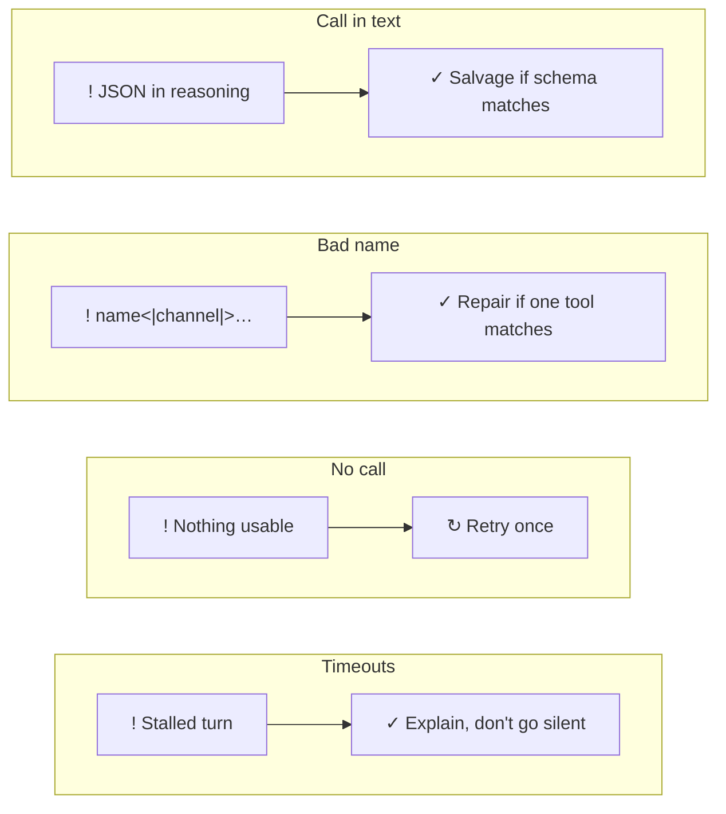

*The tool-call guard sits between the model and the tools.*

> **Key idea:** Small models fail at tool calls in predictable ways, so each failure mode gets a specific guard.

Small reasoning models fail at tool calling in predictable ways. The tool-call guard, a language-model middleware, handles each without deciding which tool the model calls (ADR-019).

<details>
<summary>The full list of failure cases</summary>

| Failure | What the guard does |
|---|---|
| Tool call written into reasoning or answer text | Recovers the JSON arguments if they match the tool's schema; hides the leaked text |
| Channel markup or a dropped prefix in a tool name | Repairs the name when exactly one real tool matches |
| Arguments that aren't valid JSON | Escapes raw newlines in strings, drops anything after the object (a literal "\n", channel markup), reads `<arg_key>`/`<arg_value>` markup. Arguments cut off mid-call count as no call |
| A call in reasoning that doesn't name the tool | On a must-call step, makes the call if exactly one offered tool fits the arguments. On a free step, only if the step produced nothing else, so an answer never becomes a call |
| No usable call on a must-call step | Retries the step once |
| A tool call in an answer step (no tools offered) | Drops it; if that was all, retries the answer once |
| Runaway reasoning | Caps must-call steps at 2,048 tokens, reasoning included; a detailed request to a Salesforce agent can take several hundred alone |

A mangled name looks like `summarize_campaign<|channel|>analysis`.

</details>

Per turn:
- Structured timeouts cover the whole turn, gaps between chunks, and each tool call.
- Errors and empty answers become an explanatory message, not silence. If the Campaign Creation agent drafted a brief but the model wrote no reply, the answer is written from the brief's fields.
- Model capacity errors are explained in plain language.

**In this demo**

- apps/edge/src/forced-tool-middleware.ts
- apps/edge/src/turn-trace.ts
- Technical trace: “Recovery message added”

**Learn more**

- Docs: [AI SDK: tools and tool calling](https://ai-sdk.dev/docs/ai-sdk-core/tools-and-tool-calling)
- Guide: [The harmony response format (OpenAI Cookbook)](https://cookbook.openai.com/articles/openai-harmony)

### 3.10 Governance: permissions, confirmations, and kill switches

*Salesforce decides who may write, a person approves every write, and operators can turn things off.*

**Diagram: How a write is checked and confirmed**

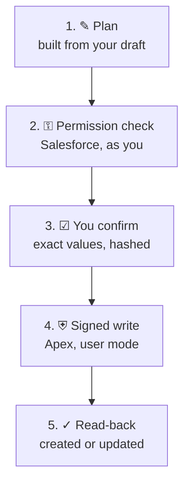

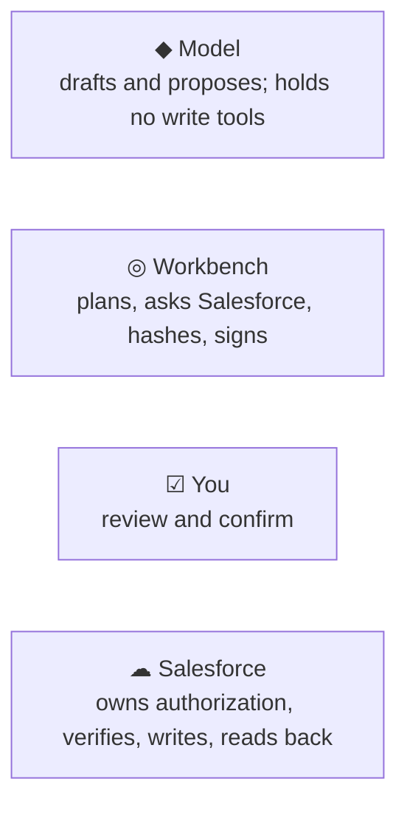

*Every write takes the same five steps. Salesforce checks your permissions before the card appears and again when the write runs; operators can also pause writes or tools without a deploy.*

> **Key idea:** Salesforce owns authorization: it checks your permissions before a write is prepared and again when it runs. A person confirms every write.

Every write (a brief, campaign and flow through Marketing Cloud's Campaign Creation agent; a review task, image or inventory case) follows one flow:

1. **Plan.** The server builds the request from the workspace draft, so the values are exactly what you reviewed. A review task or image targets a campaign this chat opened from Salesforce, never one only reopened from memory.
2. **Permission check.** Before anything is prepared, Salesforce checks **as you**: the workbench permission set, the Marketing User feature for campaigns, create or edit access on each object, field-level security, and record edit access for updates. The card lists every check; if one fails, nothing is prepared and the card says why.
3. **Confirmation.** The card shows what will be created, its values, the draft version and, for briefs and campaigns, the agent and the standard actions it will run. It's bound by a SHA-256 request hash and a 5-minute expiry, and works once.
4. **Execute.**
   - **Brief or campaign:** the Campaign Creation agent runs its standard actions through its Hosted MCP tool, as you, so Salesforce enforces your permissions on each.
   - **Review task, image or inventory case:** the server signs the confirmation with HMAC. Apex verifies signature, expiry, same user and hash, then writes in **user mode**. An inventory case's contents come from the server, so its hash covers exactly those contents and Apex re-hashes what it receives.
5. **Read-back.** The records are read back from Salesforce (`get_marketing_records` for Marketing Cloud), and only what Salesforce returns is shown. If the agent claims a save Salesforce doesn't show, nothing is shown as saved.

<details>
<summary>How each step shows live</summary>

Each step shows live. Preparing: the plan, the permission check (how many passed), binding to a one-time confirmation. Running: the confirmation check, a look for an earlier attempt or the signing, the agent or Apex call, the read-back, the memory record. A failure marks where it stopped and why.

</details>

**Approved claims, word for word.** Once the chat has checked a brand's claims, each saved draft is reviewed sentence by sentence, as Journeys checks a module: a sentence stating a fact or what the product does must be an approved claim's exact text. Rewording an approved claim, restating a blocked one, or asserting what no claim says ("can improve outcomes") is flagged on the draft card with the reason, and saving to Marketing Cloud waits for a revision that clears it. Legal text, IDs and logistics (safety information, MLR IDs, send time, audience) aren't checked. The model drafts with the exact approved and blocked claims in front of it.

| Layer | Responsible for | Not responsible for |
|---|---|---|
| **The model** | Drafting and proposing saves | Writing anything: it has no write tools |
| **The workbench** | Planning from your draft, asking Salesforce for a permission check, hashing, reading back | Deciding who may write, or creating briefs and campaigns itself |
| **The Marketing Cloud agent** | Marketing Cloud's standard actions for briefs, previews, campaigns and flows | Deciding what to save: it saves what you confirmed |
| **You** | Reviewing exact values and confirming | — |
| **Salesforce** | Authorization (profile, permission sets, field-level security, sharing), signature checks for Apex writes, the records, read-back | — |

<details>
<summary>The kill switches and what they turn off</summary>

**Kill switches.** `WRITES_ENABLED`, `DISABLED_TOOLS` and `MEMORY_ENABLED` are service settings that operators can change without a rebuild. `DISABLED_AGENTS` switches a registry agent off; the gateway denies everything it tries. Approval is separate from Salesforce writes: a workbench object becomes *approved* only through the state machine, by a person (see *Agents, prompts, models, and drift*).

</details>

**Read-only elsewhere.** Graph tools run read-only; only the server's fixed memory statements write, and only to the memory dataset. External-services tools read public data only (holidays, weather alerts, Federal Reserve press releases) and send nothing about customers. No customer PII enters prompts, logs or the graph.

**In this demo**

- Draft something → the Save to Salesforce action card in the chat → confirmation card with the permission check
- Check readiness → the Request a review action card → confirmation card
- Attach to campaign on a generated image
- infra/cloudflare/pot/README.md (operator runbook)

**Learn more**

- Guide: [OWASP Top 10 for LLM Applications](https://owasp.org/www-project-top-10-for-large-language-model-applications/)
- Guide: [Building effective agents (Anthropic)](https://www.anthropic.com/engineering/building-effective-agents)

### 3.11 Structured UI: Markdown, HXL cards, and native fallbacks

*Answers render as rich text, and records render as governed cards.*

**Diagram: How answers render**

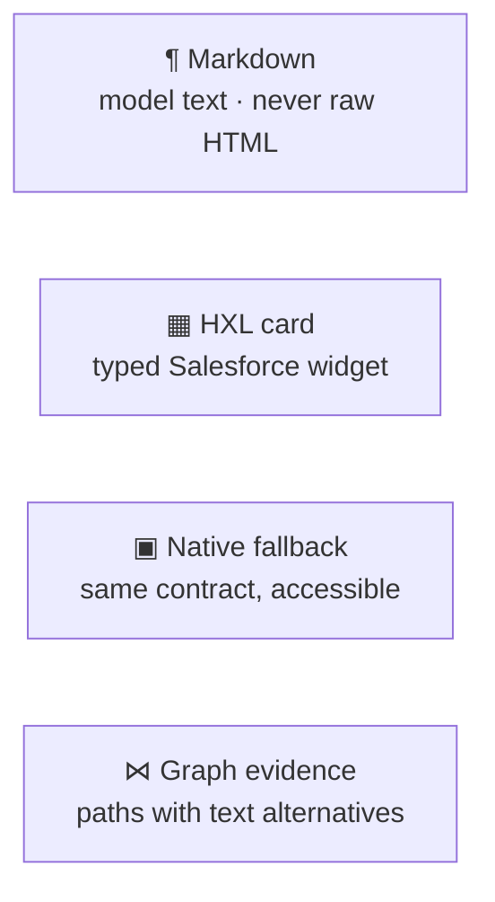

*Every surface has a safe, accessible rendering path.*

> **Key idea:** Model text renders as safe Markdown; records render as typed cards with accessible fallbacks.

- **Markdown answers.** The model may use concise Markdown, rendered with `react-markdown`, which never renders raw HTML, so model output can't inject markup.
- **HXL cards.** Salesforce's HXL widgets (MCP Apps) let an agent action return a typed, interactive card, such as campaign readiness. Where HXL can't render, an accessible **native fallback** is built from the same contract.
- **Phones and tablets.** Below 1000px the side rail narrows to one icon per page (each named on hover and to screen readers); on a phone the whole sidebar (pages, sources and the MCP gateway panel) slides out from the menu button (☰) in the header, closes when you pick a page, tap outside it or press Escape, and the brand, role and AI platform menus take a row of their own.

<details>
<summary>How native cards show each item</summary>

- **Item rows on native cards.** A list result shows one row per item: a colored status (usable, waiting, blocked), the item, a monospaced ID and a readable date, so an MLR ID and its expiry stand out. A row can list what stands behind it, such as a claim's trial evidence and the assets that carry it.

</details>

- **Salesforce agents panel.** Under each answer that called Salesforce: each call's agent, type and template, subagent, and actions (with their flow or Apex targets). The confirmation card shows the same for its write.
- **Graph evidence panel.** Knowledge-graph paths render as directional chains, each with a screen-reader text alternative. Claims checks show claim by claim in *The workspace*.

<details>
<summary>Write progress, the case confirmation and the left rail</summary>

- **Live write progress.** Accepting an action card shows **Preparing…** and the preparation steps until the confirmation card appears. **Confirm** disables the buttons and shows the write's steps as the server reports them. Afterwards a collapsible **Behind the scenes** record keeps each step and its duration, opening by itself if the write fails.
- **Inventory case confirmation.** The store manager, the forecast, and each low item (on hand, needed, the dishes it goes into). After you confirm, a banner links to the Case.
- **Left rail.** Data sources fold into one line (how many are ready, which are offline); open it for the full list. The **MCP Gateway** box below stays open: the Salesforce connection's state, how many governed tools are connected, and which.

</details>

- **Learn and Playbook.** Learn (this page) is the reference for how the workbench works; **Playbook** renders `docs/playbook.md`, general guidance for running agents in production, and links each of its sections to the Learn sections where the workbench shows it.
- **Use-case library.** Every scenario, filterable by team, with prompts, systems and data flow. **Try it** fills the chat box without sending.
- **Accessibility.** Targets WCAG 2.2 AA; tested in Chrome and Edge.

**Architecture workspaces.** Each **Architecture** tab is a *workspace manifest* (the roles, objects, tiles, agents and services it composes) drawn by one renderer, so a new workspace is data, not a new screen. The same approval card also renders as an Adaptive Card, as data for a Lightning Web Component, and as an MCP Apps resource. See *Governed objects and workspaces*.

**One scope in the header.** **Brand** and **Run as** apply everywhere: the chat (the message box suggests a prompt for the brand), the Graph's brand filter, the use-case library, the Architecture workspaces and the turn history. **AI platform** shows where the models run: Vertex AI only. It lists only what this server can reach, says why an option isn't set up, and is greyed out with one choice (ADR-021). Choices are remembered in the browser.

<details>
<summary>Every page's address</summary>

**Every page has an address.** Each left-rail page has a path: `/squad`, `/architecture`, `/journeys`, `/graph`, `/learn`, `/playbook`, `/evaluations`, plus `/history` and `/use-cases` from the chat (itself `/`). Reloads stay put, links open the page, and Back returns to the previous one.

</details>

**In this demo**

- Workspace panel (readiness card with native fallback)
- apps/web/src/Markdown.tsx, apps/web/src/GraphEvidence.tsx

**Learn more**

- Docs: [HXL widgets for Agentforce action output](https://developer.salesforce.com/docs/platform/hxl/guide/agentforce-action-output.html)
- Code: [react-markdown](https://github.com/remarkjs/react-markdown)
- Guide: [WCAG overview (W3C)](https://www.w3.org/WAI/standards-guidelines/wcag/)

### 3.12 Observability: route map, technical trace, turn history, and audit export

*See exactly what happened in every turn.*

**Diagram: Three ways to see what happened**

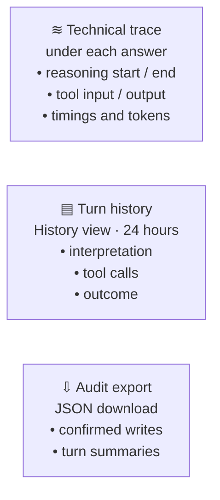

*Engineers read the trace; reviewers read history; auditors export it.*

> **Key idea:** Every turn leaves a trace for engineers and a history for reviewers.

- **Route map** (above the message box, in the browser and in Lightning) lights each component a turn passes through, pulsing on the one working now: the page, Identity-Aware Proxy, the policy router, Vertex AI, called directly, then the agentic gateway and each MCP server. A Lightning turn also shows the Apex relay. The model hop names the AI platform the turn actually ran on (ADR-021).

<details>
<summary>How the route map reads a turn</summary>

- It reads the same trace as the view below, not a script: a turn the policy router answers leaves the model dark; a tool the gateway denies marks the gateway, not the system behind it; a failed tool marks its system. The first hops are implied (a request can't reach the server without them); the router, model and tools are recorded.
- The finished route stays until the next message. It follows the query only: a confirmed write runs after the turn and shows its progress on its confirmation card. Lightning polls about once a second, so a shorter hop can appear already passed.

</details>

- **Live tool calls** under the trace while an answer streams: system and tool, a spinner until the result returns, then a check or a cross.
- **Technical trace** at the top of each answer, so the streaming answer doesn't move it: every lifecycle event in order, with timing. It opens while the answer streams (or when something went wrong) and stays open until you close it.

<details>
<summary>Every event the trace records, and the operator logs</summary>

- turn start; step start and finish (finish reason, token counts); reasoning start and end, with the reasoning redacted; text start and end
- tool input and output, with the Salesforce agent, subagent and actions behind each Salesforce tool; errors; recovery messages; the outcome, including an answer written from a tool's result because the model wrote none
- a failed or empty tool result names the system that answered (Aprimo, the knowledge graph, Salesforce) and whether the call failed or returned nothing usable
- a closing line: the turn's total time, **tokens** (input plus output, summed over steps) and **tool calls**
- **Cloud Logging** for operators: a failed Salesforce or agent call is logged with its error and stack, even when the user sees a friendly message; a failed write or confirmation logs the step where it stopped. Request content is never logged.

</details>

- **Turn history** (Chat → History → Turns): each utterance with the orchestrator's interpretation, tool calls with inputs and results, the outcome, and the brand and role it ran under; each row shows seconds, tokens and tool calls. Filterable; kept 24 hours per user.
- **Memory** (History → Memory): what the workspace remembers across chats, with provenance, **Reopen** and **Forget**. See *Long-term memory*.
- **Audit export:** a JSON download of the user's confirmed writes, memory remembers, reopens and forgets, and turn summaries.

**Try it**

- Open turn history (opens the history view)

**In this demo**

- Chat → the Route panel above the message box
- Any answer → “Behind the scenes · technical trace”
- Chat → History → Export audit (JSON)
- Chat → History → Memory

**Learn more**

- Guide: [Effective context engineering for AI agents (Anthropic)](https://www.anthropic.com/engineering/effective-context-engineering-for-ai-agents)

### 3.13 Evaluations

*Measure the whole pipeline across models, and publish the real results.*

**Diagram: What the evaluations measure**

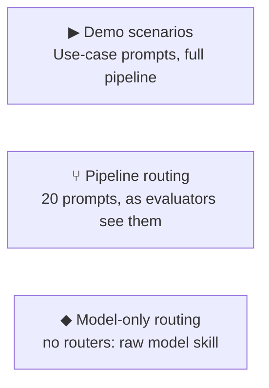

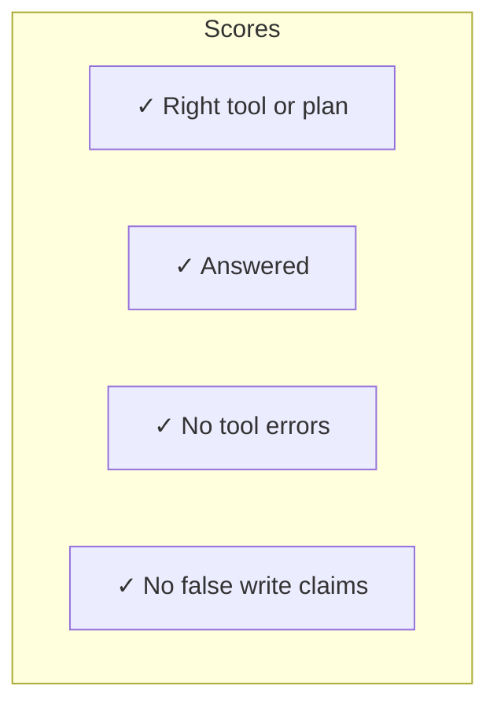

*Three suites run the production pipeline; every turn is scored on four checks.*

> **Key idea:** Evaluate the real pipeline, not just the model, and keep held-out prompts to catch overfitting.

**On Google Cloud.** The evaluation published below was measured on Cloudflare Workers AI, before the workbench moved to Google Cloud, and is kept as the reference. Here every model call goes to gpt-oss-120b on Vertex AI; re-running `pnpm eval:live` against this deployment produces the Google Cloud numbers.

`pnpm eval:live` runs the **production pipeline** (policy router, intent router, prompt, guards, step settings) against live Workers AI models, in three suites:

- **Demo scenarios:** the use-case library's prompts, through the full pipeline.
- **Routing through the pipeline:** a shared prompt set, including memory recall and the financial services use cases, as evaluators experience them.
- **Routing by the model alone:** the same prompts with no routers, isolating model quality.

Each turn is scored on **right tool** (or right plan, in order), **answered**, **no tool errors**, **no false write claims**, and two grounding checks:
- **graph-grounded:** a graph or memory answer names only accounts, clients, people, campaigns, content, menu items and compliance approval IDs its tools returned
- **agent request grounded:** the request the Marketing Cloud Campaign Creation agent actually receives carries what the turn gathered: a brief request names the brand, a menu item, and the city or weather; a preview refinement names the saved Brief ID

Latency and tokens are recorded before judging. The Evaluations view shows each turn's seconds, tokens and tool calls, and each model's mean tokens and tool calls per turn. Runs recorded before the grounding check show no rate for it.

**What good looks like.** Pass/fail says the pipeline behaved, not that the answer was *good*. Each demo scenario has a **rubric** in `packages/evals/src/rubric.ts`: a goal, an audience persona where a customer is involved, weights for the quality dimensions that matter, and deterministic **criteria** (for the weather-aware Coastline campaign: names a menu item, uses the real weather and time of day, cites what worked before, a key message of 160 characters or fewer, a measurable KPI). "Criteria met" is reported beside the pass gate, so pass rates stay comparable with earlier runs.

**Quantifying the qualitative.** Two judges from different families (GLM-5.3 and DeepSeek V4.1 Flash; a model never judges its own family) rate each answer 1 to 5 on anchored scales: context fidelity, accuracy, clarity, brand voice, engagement, marketer usefulness, and **would act**, which the judge answers as the audience persona on a standard purchase-intent scale (reported as top-2-box, the share of 4s and 5s). Ratings combine into a 0 to 100 **Quality Index** with a 95% bootstrap interval, alongside how often the judges agree. Before a run is published, `pnpm eval:calibrate` checks that each judge ranks hand-written strong, mediocre and weak answers in the right order. These are judge scores, not customer behavior: use them to rank models, not to forecast click rates.

<details>
<summary>Why one fixed model plays the Marketing Cloud agent</summary>

**A fixed stand-in for the Marketing Cloud agent.** The real agent's copy doesn't depend on the orchestrator model, so every contestant would get the same canned text. One fixed reference model plays the agent, so what differs is what the orchestrator asked for (weather, time, menu, past results) and how it presents the result.

</details>

<details>
<summary>How cost is estimated, capped and throttled</summary>

**Cost.**
- Every turn, judge call and simulated-agent call is priced from Cloudflare's published Workers AI per-million-token rates (neurons derived at $0.011 per 1,000): list rates before account-level allowances, shown to four decimal places.
- The run prints a projection and refuses to start above `--max-usd`. The report shows estimated USD per demo-scenario turn and per passing turn, a cost-versus-quality chart, and a run total including judges and the simulated agent.
- The default run compares gpt-oss-120b and gpt-oss-20b; the paid-access frontier model, DeepSeek V4.1 Flash, is opt-in with `--tier frontier`. GLM-5.3 stays on the judge panel.
- Kimi K2.6, GLM-5.3-Flash and DeepSeek V4 Pro left the roster when Workers AI retired them on November 20, 2026. GLM-4.7-Flash and Llama 4 Scout scored low and were retired in ADR-011.
- Cloudflare limits paid frontier models to 20 requests a minute per model, so the runner throttles every call (turns, judges, simulator) per model, serves contestant turns before judge calls, and refreshes its sign-in token during long runs.

</details>

<details>
<summary>Routing checks and the life-sciences scenarios</summary>

**Routing checks.** `pnpm eval` runs the routing set through the production policy and intent routers, without a model, on every verify. In the live run, read-style Salesforce tools are fixtures, so scores measure orchestration, not Salesforce agent quality. A held-out set of paraphrases guards the router against overfitting. The first published run found a real routing bug: any prompt mentioning "campaign" forced the summary tool.

**Life-sciences scenarios.** Four Lumera Therapeutics scenarios:
- A target list, a claims check and a hospital plan, whose rubrics check that the answer cites the trial and MLR approval IDs the tools returned, blocks unsupported and off-label claims instead of rewording them, and names groups rather than clinicians.
- One drug's materials compared across Aprimo, the claims library and the HCP website; the rubric checks that the answer names the systems, flags the page that is live with an expired approval, and says the systems are mocked.

</details>

**Try it**

- Open evaluations (opens the evaluations view)

**In this demo**

- Evaluations view
- scripts/run-live-evals.mjs, packages/evals

**Learn more**

- Guide: [Your AI product needs evals (Hamel Husain)](https://hamel.dev/blog/posts/evals/)
- Guide: [Building effective agents (Anthropic)](https://www.anthropic.com/engineering/building-effective-agents)

### 3.14 Campaign image workflow

*Generate reviewable variants, then attach one to Salesforce after confirmation.*

**Diagram: From concept to Salesforce file**

```mermaid
flowchart TB
  images0_0["✎ Concept<br/>PII and injection checks"]
  images0_1["◆ Gemini image<br/>1024 × 1024 draft"]
  images0_2["▤ Cloud Storage draft<br/>private, 7 days"]
  images0_3["☑ Confirm attach"]
  images0_4["✓ Campaign file<br/>hash checked by Apex"]
  images0_0 --> images0_1 --> images0_2 --> images0_3 --> images0_4
```

*Drafts stay private until a person confirms; Salesforce verifies the file hash.*

> **Key idea:** Generated images stay private drafts until a person confirms, and Salesforce verifies the file's hash.

**Gemini's image model** on Vertex AI (following the top bar's **AI platform**) generates a 1024×1024 draft from a bounded prompt, with PII and injection checks on the concept. Each draft records which model drew it.

<details>
<summary>Where drafts are stored</summary>

- Drafts are stored privately in **Cloud Storage** for 7 days, with provenance (model, prompt version, content hash) in **Firestore**.

</details>

- The variant gallery lets you select, reject or revise.
- **Attach to campaign** runs the confirmation flow: Apex checks the PNG's SHA-256 against the confirmed hash, creates one Salesforce file on the Campaign, and reads back its checksum and link.

**In this demo**

- Workspace → Generate campaign visual (expand it) → Attach to campaign

**Learn more**

- Docs: [Image generation with Gemini on Vertex AI](https://cloud.google.com/vertex-ai/generative-ai/docs/multimodal/image-generation)
- Docs: [Cloud Storage documentation](https://cloud.google.com/storage/docs)
- Docs: [Firestore documentation](https://cloud.google.com/firestore/docs)

### 3.15 Campaign context: restaurant data and live weather

*External context that makes a campaign draft specific to the moment.*

**Diagram: The Coastline campaign tool plan**

```mermaid
flowchart TB
  push_plan0_0["1. ☰ Restaurant profile<br/>menu, favorites, voice"]
  push_plan0_1["2. ☀ Current weather<br/>Open-Meteo, live"]
  push_plan0_2["3. ⋈ Past pushes<br/>knowledge graph"]
  push_plan0_3["4. ☁ Content draft<br/>Salesforce agent"]
  push_plan0_4["5. ◎ Workspace focus<br/>saved as version 1"]
  push_plan0_0 --> push_plan0_1 --> push_plan0_2 --> push_plan0_3 --> push_plan0_4
```

*Four tools on offer: context and past results first, the content draft once they have run. The model presents the draft, and the workspace saves it as the focus.*

> **Key idea:** Outside context (menu, weather, past results) turns a generic draft into one that fits this moment.

The **campaign-context** MCP server gives the orchestrator facts Salesforce doesn't have:

- `get_restaurant_profile`: the restaurant system's data for **Coastline Kitchen**, a fictional fast-casual brand under Northstar, open 24/7: five California locations, menu, favorites, dayparts, app audience with opt-ins **by channel** (push, email, SMS), brand voice and promotion rules. Locations and menu items share ids with their knowledge-graph nodes.
- `get_current_weather`: live conditions for a California city from **Open-Meteo** (free, keyless, CC BY 4.0).
- `get_weather_forecast`: Open-Meteo's daily forecast, with each day's demand-planning weather (heat, rain, fog, cloudy or clear).
- `get_location_inventory`: a restaurant's stock from a randomized **store inventory** mock, with par levels and typical daily use from the menu's recipes. See *The use-case library*.

The Coastline campaign plan (email or push) chains these with the knowledge graph's past performance and the Salesforce content tool. It is **channel-aware**: the server pins the requested channel (or the draft's) on the past-performance lookup, so an email campaign cites email opt-ins, never push, whatever the model passed. The draft fits the menu, time of day, weather and what worked before, is saved to the workspace **focus**, and "make it warmer" revises it as a new version.

**Try it**

- Draft the Coastline Kitchen email: “Draft an email campaign for Coastline Kitchen, our fast casual restaurant in California, tailored to the current weather, time of day, and our menu”
- Draft the Coastline Kitchen push: “Draft a push notification campaign for Coastline Kitchen, our fast casual restaurant in California, tailored to the current weather, time of day, and our menu”

**In this demo**

- Use cases: Weather-aware campaign in Marketing Cloud (the push prompt)
- Sources: Restaurant data, Weather · Open-Meteo

**Learn more**

- Docs: [Open-Meteo API docs](https://open-meteo.com/en/docs)
- Docs: [Model Context Protocol: introduction](https://modelcontextprotocol.io/docs/getting-started/intro)

### 3.16 The use-case library: marketing, sales, service, and financial services

*Every scenario the demo runs, how data flows through it, the ones that reach beyond marketing, and three for a regulated industry.*

**Diagram: Sales and service use cases**

```mermaid
flowchart TB
  subgraph use_cases0_lane0["Sales"]
    direction LR
    use_cases0_0_0["? Account + time frame"]
    use_cases0_0_1["⋈ plan_account_outreach<br/>contacts · consent · country"]
    use_cases0_0_2["↗ Nager.Date<br/>public holidays"]
    use_cases0_0_3["✎ Dated outreach plan<br/>consented channels only"]
    use_cases0_0_0 --> use_cases0_0_1 --> use_cases0_0_2 --> use_cases0_0_3
  end
  subgraph use_cases0_lane1["Service"]
    direction LR
    use_cases0_1_0["? Location + concern"]
    use_cases0_1_1["↗ National Weather Service<br/>active alerts"]
    use_cases0_1_2["⋈ assess_location_impact<br/>audience · push reach · campaigns"]
    use_cases0_1_3["✎ Impact + drafted notice<br/>aggregate only"]
    use_cases0_1_0 --> use_cases0_1_1 --> use_cases0_1_2 --> use_cases0_1_3
  end
  subgraph use_cases0_lane2["Inventory"]
    direction LR
    use_cases0_2_0["↗ Open-Meteo forecast<br/>heat, rain, …"]
    use_cases0_2_1["⋈ map_weather_demand<br/>dishes · stock · manager"]
    use_cases0_2_2["▤ Store inventory<br/>randomized mock"]
    use_cases0_2_3["✎ Case for the manager<br/>after you confirm"]
    use_cases0_2_0 --> use_cases0_2_1 --> use_cases0_2_2 --> use_cases0_2_3
  end
  use_cases0_lane0 ~~~ use_cases0_lane1 ~~~ use_cases0_lane2
```

*A live outside service says what's happening; the knowledge graph says who or what it affects, and a confirmed write goes to Salesforce only when you approve it.*

> **Key idea:** Each use case pairs a live outside service with the graph: the service says what's happening; the graph says who or what it affects, and how to reach them.

**Use cases** (a button on the Chat page) lists every scenario the demo runs end to end: the situation, its prompts (each with **Try it**), the systems involved, the data flow step by step, what the knowledge graph contributes, what it writes, and what to watch for. Drafted scenarios not yet built are greyed out as *Coming soon*. The library follows the header's brand: choosing Lumera Therapeutics shows only its use cases.

**Beyond marketing.** Two use cases (sales outreach and severe-weather impact) each pair a free, keyless public API with the knowledge graph, and **the graph supplies the key element**. Both APIs are called live from the server through an in-process **external services** MCP server. An API failure comes back as a tool error, and the answer says so instead of guessing.

<details>
<summary>Sales outreach, weather impact and the inventory check, step by step</summary>

**Sales: buyer-group outreach around local holidays.** "Plan outreach to Acme Outfitters' buyer group for the next month."
1. `plan_account_outreach` walks from the account to its buying-role personas: each one's engagement, when they last engaged, and **the channels they have marketing consent for** (Persona → HAS_CONSENT → ConsentScope → FOR → Channel), plus the account's headquarters country.
2. `get_public_holidays` asks **Nager.Date** for that country's upcoming public holidays.
3. The answer is a prioritized, dated plan on consented channels only, avoiding the holidays. Nothing is sent or logged.

**Service: severe-weather customer impact.** "There are weather alerts near our San Diego location. Which customers are affected and what should we tell them?"
1. `get_weather_alerts` asks the **National Weather Service** for active watches, warnings and advisories at the restaurant's coordinates, or, if none, alerts elsewhere in California.
2. `assess_location_impact` walks Location ← Segment → consent and Campaign → TARGETS → Segment: how many app users are near, how many each channel (push, email, SMS) can reach under its own consent, and which active campaigns target them and should be paused. Counts are aggregate; no customer is named.
3. The answer is an impact summary, a drafted customer notice and a note for the store team. Nothing is sent or paused.

**Service: weather-driven inventory check, with a case for the store manager.** "Check inventory for our Sacramento store against the forecast."
1. `get_weather_forecast` buckets each day of the **Open-Meteo** forecast: **heat** for highs of 88°F or more, **rain** for wet days, otherwise fog, cloudy or clear.
2. `map_weather_demand` walks WeatherCondition → **LIFTS_DEMAND** → MenuItem → **MADE_WITH** → InventoryItem, plus Location → **MANAGED_BY** → StoreManager. Each lift is learned from past push results (a dish's average order rate under that weather against its overall average) and kept when at least 15% higher. Heat lifts the cold drinks and açaí bowl; rain and fog lift soup, noodles and the burrito.
3. `get_location_inventory` reads the **store inventory system**, here a randomized mock stable within a day: on hand, par level and typical daily use per item.
4. **Code, not the model, decides what's low.** Each weather-lifted item's forecast need is its typical daily use, raised by the lift on days whose weather lifts a dish made with it; it's low when what's on hand won't cover that. The result becomes an **Inventory risk** card and an **action card**, and the answer step is told exactly this list.
5. Accepting the card prepares a **Salesforce case** for the store manager. Its contents are hashed into the confirmation's request hash; after you confirm, the `create_inventory_case` Apex action re-hashes what it received, refuses any mismatch, finds the manager's Contact by title and restaurant, creates the Case as you, and reads it back. The graph and prompts carry the manager's name only, never contact details. Nothing is ordered.

</details>

**Financial services: Harborstone Wealth**, a fictional wealth-management brand under Northstar. Three use cases (filter **Financial services**) show the graph in a regulated industry, where only content a registered principal approved can go out, exactly as approved, with its required disclosures.

<details>
<summary>The three Harborstone use cases</summary>

- **Market news to pre-approved content.** "The Fed just announced its rate decision. What pre-approved content can we send clients today?"
  1. `get_fed_announcements` reads the Federal Reserve's public press feed, finds the latest FOMC statement, reads its decision (raise, lower or maintain; the size; the new target range) and maps it to a market event.
  2. `match_news_to_approved_content` walks MarketEvent ← **RESPONDS_TO** ← ContentAsset → **APPROVED_UNDER** → Approval and → **REQUIRES** → Disclosure. It returns what's ready to send (approval IDs, expiry, disclosures); what's blocked and why (an expired or pending approval, or a **FAILED** compliance rule); reach per channel under marketing consent; and past responses, which show sends within hours of the news opened far better than next-day sends.
  3. The answer never writes new regulated copy. Asking for a Marketing Cloud campaign hands the approved asset, its approval ID and disclosures to the Campaign Creation agent's brief.
- **Acquisition announcement, released on time.** `prepare_deal_release` orders the embargoed package through **RELEASED_WITH** → Deal and checks each piece's audience through **ADDRESSED_TO** → Segment → **HAS_CONSENT**: advisors' FAQ first, then the press release, then client letters. The acquired firm's clients get service notices under their client agreement, never marketing, until they opt in, so an SMS that also failed its disclosure check is blocked for both reasons.
- **Account plan to grow assets under management.** `build_aum_account_plan` walks Client → **HAS_SIGNAL** → Signal → **SUGGESTS** → Product for products the client doesn't hold, sizes each play from estimated assets held elsewhere, counts how many similar clients hold it, and finds approved content through Product ← **EXPLAINS** ← ContentAsset. Each contact gets a channel with approved content they consented to, so the 30/60/90-day sequence never sends content on an unapproved channel. "Activate the plan" drafts a Marketing Cloud brief from it.

</details>

**Life sciences: Lumera Therapeutics**, a third Northstar brand, shows pharmaceutical promotion, where a claim is only as good as the trial, label and MLR approval behind it. Everything is fictional: the drugs (Cardivance for heart failure, Glucora for type 2 diabetes, Neurelva for chronic migraine), the trials and their results.

<details>
<summary>The Lumera use cases, tool by tool</summary>

- **Targets.** `build_hcp_target_list` ranks hospitals and prescriber groups for a drug by labeled-indication patients × (1 − Lumera's share) × a formulary access weight × decile. Where a drug isn't on formulary or is under P&T review, the approved value dossier comes before any detailing. Groups carry opted-in counts per channel (email, portal, rep visit), never people.
- **Claims.** `check_clinical_claims` walks Drug ← **CLAIMS_ABOUT** ← ClinicalClaim ← **SUPPORTS** ← ClinicalTrial, then compares **INDICATED_FOR** (on label) with **INVESTIGATED_FOR** (not). Content that **CARRIES** a claim is usable only with a current MLR approval, the safety information and, for Cardivance, the boxed warning. The “superior to every ARB” claim has no trial; the HFpEF claim is off label and its trial has no results; an expired approval blocks a supported Glucora claim.
- **Hospitals.** `plan_hospital_engagement` reads each drug's **ON_FORMULARY** status and days to P&T review at a hospital, the patients at stake, whether the value dossier is usable or still in MLR, and the prescriber groups' consent and engagement, then orders the next steps.
- **In the Architecture view**, Lumera runs through the same lifecycle as Harborstone: the authoring agent refuses a claim whose approval is draft or rejected, the farm flags superiority language, and a module can't be approved while its study report has lapsed.

</details>

**Try it**

- Plan buyer-group outreach: “Plan outreach to Acme Outfitters' buyer group for the next month”
- Assess a weather disruption: “There are weather alerts near our San Diego location. Which customers are affected and what should we tell them?”
- Check inventory against the forecast: “Check inventory for our Sacramento store against the forecast”

**In this demo**

- Chat → Use cases
- Sources: Holidays · Nager.Date, Weather alerts · NWS, Rate news · Federal Reserve
- Workspace: Forecast, Store inventory, and Inventory risk cards, then the case action card
- apps/edge/src/external-services, apps/edge/src/inventory-risk.ts, apps/web/src/usecases

**Learn more**

- Docs: [Nager.Date public holiday API](https://date.nager.at/Api)
- Docs: [National Weather Service API (api.weather.gov)](https://www.weather.gov/documentation/services-web-api)
- Docs: [Open-Meteo API docs](https://open-meteo.com/en/docs)
- Docs: [Federal Reserve press release feeds](https://www.federalreserve.gov/feeds/feeds.htm)
- Docs: [FINRA Rule 2210: communications with the public](https://www.finra.org/rules-guidance/rulebooks/finra-rules/2210)
- Docs: [Model Context Protocol: introduction](https://modelcontextprotocol.io/docs/getting-started/intro)

### 3.17 Governed objects and workspaces

*One identifier per plan, brief, module, claim and result, with governance attached, and screens composed from it.*

**Diagram: Plan to learn, with a person at every gate**

```mermaid
flowchart TB
  subgraph agent_lifecycle0_lane0["People decide"]
    direction LR
    agent_lifecycle0_0_0["? Brand planner<br/>approves the plan"]
    agent_lifecycle0_0_1["? Marketer<br/>validates brief and reuse"]
    agent_lifecycle0_0_2["? Content Lab<br/>approves every module"]
    agent_lifecycle0_0_3["? Compliance<br/>owns the evidence"]
    agent_lifecycle0_0_4["? Reviewer<br/>decides, by state machine"]
    agent_lifecycle0_0_5["? Brand lead<br/>disposes on optimization"]
    agent_lifecycle0_0_0 --> agent_lifecycle0_0_1 --> agent_lifecycle0_0_2 --> agent_lifecycle0_0_3 --> agent_lifecycle0_0_4 --> agent_lifecycle0_0_5
  end
  subgraph agent_lifecycle0_lane1["Agents work"]
    direction LR
    agent_lifecycle0_1_0["▸ Plan and scenario<br/>plan → structured demand"]
    agent_lifecycle0_1_1["▸ Brief and reuse<br/>inherits the plan"]
    agent_lifecycle0_1_2["▸ Module authoring<br/>cites or refuses"]
    agent_lifecycle0_1_3["▸ Substantiation<br/>evidence per claim"]
    agent_lifecycle0_1_4["◆ Readiness and farm<br/>block until it passes"]
    agent_lifecycle0_1_5["▸ Attribution and optimization<br/>signal → module → claim"]
    agent_lifecycle0_1_0 --> agent_lifecycle0_1_1 --> agent_lifecycle0_1_2 --> agent_lifecycle0_1_3 --> agent_lifecycle0_1_4 --> agent_lifecycle0_1_5
  end
  subgraph agent_lifecycle0_lane2["Governed by"]
    direction LR
    agent_lifecycle0_2_0["⋈ Governed objects<br/>one id for life"]
    agent_lifecycle0_2_1["◆ Gateway<br/>default-deny · identity"]
    agent_lifecycle0_2_2["▤ Registry<br/>versioned · scoped"]
    agent_lifecycle0_2_3["◆ State machine<br/>11 transitions"]
    agent_lifecycle0_2_4["✓ Evaluators<br/>13 · drift watch"]
    agent_lifecycle0_2_5["✎ Channels<br/>one card, four surfaces"]
    agent_lifecycle0_2_0 --> agent_lifecycle0_2_1 --> agent_lifecycle0_2_2 --> agent_lifecycle0_2_3 --> agent_lifecycle0_2_4 --> agent_lifecycle0_2_5
  end
  agent_lifecycle0_lane0 ~~~ agent_lifecycle0_lane1 ~~~ agent_lifecycle0_lane2
```

*People decide at each stage, agents do the narrow work, and every call between them passes the gateway. Performance re-enters planning inside the quarter.*

> **Key idea:** Every plan, brief, module, claim and result is one object with a lifelong identifier. Governance travels with it; lineage, screens and channels are derived from it, never copied.

Most marketing tools copy things forward (plan to brief to module), and each copy must be reconciled with the last. Here every **plan, brief, module, claim, piece of evidence, result, disclosure and gap** is a *governed object* with:

- a lifelong **urn**, such as `urn:northstar:module:hs-mod-fomc-push`
- a **version**, and the version it **supersedes**
- a **brand, market, owner and classification**
- an **approval state**, its creator (a person or an agent), and when

**Nothing is copied forward.** A brief holds only its plan's urn and the wave it covers; its audience, channel and timing are read from the plan *when you open it*, so changing the plan changes the brief. Relationships (`INHERITS`, `CITES`, `SUBSTANTIATED_BY`, `MEASURED_BY`, `VARIANT_OF`, `GAP_FOR`) are *derived from the objects' attributes*, so no second copy can go stale.

**The object inspector** shows any object by urn: attributes, inherited plan, evidence, lineage both ways, version chain, append-only history, and your next open decision. Open it from a Command Center card, a table row, a search result, or a link in an agent's answer.

**Workspaces are manifests**: who it's for, which objects it lists, which tiles it composes, which agents and services it calls. One renderer turns any manifest into a screen with the same loading, empty, error and permission-denied states. The **Command Center** lists every object by lifecycle stage with the person whose decision it awaits; **Brief Builder**, **Module Library**, **Approvals** and **Performance** are other manifests over the same objects. **Run as** in the header switches between a brand planner's, marketer's, reviewer's and brand lead's view: the role opens that person's workspace and is sent with each request, and the server enforces what it may do.

<details>
<summary>How each screen explains itself</summary>

**Each screen explains itself.** The Architecture view opens with what you're looking at, why it beats copying claims by hand and reviewing over email, and where your role comes in: the seven steps, who decides at each, yours highlighted, and a button to your step's workspace. Each workspace opens with a card: what it is, why it's better, where it fits, something to try for the header's brand, and the technical idea it shows. The words live in `apps/web/src/architecture/guide.ts`, beside the manifests, so they follow brand and role as the data does.

</details>

**Journeys.** The **Journeys** view (beside Architecture in the workspace rail) gives each brand's goal to a real orchestrator, which plans the work and hands each step to a real subagent: a brief from an approved plan, content from approved claims (and what it refused), red-team probes, the evidence packet, submission, **your decision** as reviewer, then what comes next. You watch each subagent: who it acts for, its model, each tool call and the gateway's decision, and what it made. Nothing is scripted, so runs differ; one takes about a minute.

<details>
<summary>How the asset preview is built</summary>

**The asset, as it is built.** Beside the steps, the asset composes itself from the agents' tool results, in its channel wrapper (an email with sender, audience, send date and subject, or a push or SMS on a phone).
- The library's images (logo, banner, an image beside the claims) appear as placeholders with alt text and library ID, since the library is mocked.
- Each block is marked by its words' source: the agent's own opening or closing, an approved claim the service inserted word for word, or a disclosure a claim requires.
- **Kept out by the service** lists topics refused for lack of a substantiated claim (each filed as a gap) and agent wording the service rejected, with its reason. Probe findings and readiness blockers attach to the block they quote.
- Click a block for its author, the tool call and policy that allowed it, its source claim, and what the checks found. The atomization agent's channel versions appear as tabs, each with its character count against the channel limit.
- The preview is derived on the page from the flow's events (`apps/web/src/architecture/asset.ts`); nothing extra is fetched.

</details>

<details>
<summary>Channels and where the data lives</summary>

**Channels.** An approval card is composed once with brand rules (accent, disclosure label, rule version), then rendered four ways: React, an **Adaptive Card** for Teams and Outlook, **data for a Lightning Web Component**, and an **MCP Apps** resource for MCP clients such as Claude. Change one brand rule and all four change. The preview renders the payloads on screen; nothing is sent to Teams, Outlook or Copilot.

**Where the data lives.** Seed objects for the three brands (Harborstone Wealth, Coastline Kitchen, Lumera Therapeutics) ship in code; Lumera's brand rules label its disclosures as safety information. What you create (a plan, a module, a gap, a new claim version) and every approval state go to Firestore, scoped to you, and expire with the 24-hour audit. They are not in the Neo4j graph; making them graph nodes is a later step.

</details>

**Try it**

- Open the Architecture view (opens the architecture view)

**In this demo**

- Architecture → read the intro, then pick a step to jump to its workspace
- Journeys → Start the orchestrator, click blocks in the asset, then approve when it asks
- Architecture → Command Center, then open any card
- Header → Run as: Brand planner, Marketer, Reviewer, Brand lead
- Architecture → open a module → Channels (React, Adaptive Card, LWC data, MCP Apps)
- packages/architecture/src/types.ts, world.ts, workspaces.ts, channels.ts

**Learn more**

- Spec: [MCP Apps specification and SDK](https://github.com/modelcontextprotocol/ext-apps)
- Docs: [Adaptive Cards](https://adaptivecards.io/)
- Docs: [Cloud Run documentation](https://cloud.google.com/run/docs)

### 3.18 The agentic gateway

*One choke point for every tool call: default-deny policy, a per-call identity, and a record of the decision.*

**Diagram: Plan to learn, with a person at every gate**

```mermaid
flowchart TB
  subgraph agent_lifecycle0_lane0["People decide"]
    direction LR
    agent_lifecycle0_0_0["? Brand planner<br/>approves the plan"]
    agent_lifecycle0_0_1["? Marketer<br/>validates brief and reuse"]
    agent_lifecycle0_0_2["? Content Lab<br/>approves every module"]
    agent_lifecycle0_0_3["? Compliance<br/>owns the evidence"]
    agent_lifecycle0_0_4["? Reviewer<br/>decides, by state machine"]
    agent_lifecycle0_0_5["? Brand lead<br/>disposes on optimization"]
    agent_lifecycle0_0_0 --> agent_lifecycle0_0_1 --> agent_lifecycle0_0_2 --> agent_lifecycle0_0_3 --> agent_lifecycle0_0_4 --> agent_lifecycle0_0_5
  end
  subgraph agent_lifecycle0_lane1["Agents work"]
    direction LR
    agent_lifecycle0_1_0["▸ Plan and scenario<br/>plan → structured demand"]
    agent_lifecycle0_1_1["▸ Brief and reuse<br/>inherits the plan"]
    agent_lifecycle0_1_2["▸ Module authoring<br/>cites or refuses"]
    agent_lifecycle0_1_3["▸ Substantiation<br/>evidence per claim"]
    agent_lifecycle0_1_4["◆ Readiness and farm<br/>block until it passes"]
    agent_lifecycle0_1_5["▸ Attribution and optimization<br/>signal → module → claim"]
    agent_lifecycle0_1_0 --> agent_lifecycle0_1_1 --> agent_lifecycle0_1_2 --> agent_lifecycle0_1_3 --> agent_lifecycle0_1_4 --> agent_lifecycle0_1_5
  end
  subgraph agent_lifecycle0_lane2["Governed by"]
    direction LR
    agent_lifecycle0_2_0["⋈ Governed objects<br/>one id for life"]
    agent_lifecycle0_2_1["◆ Gateway<br/>default-deny · identity"]
    agent_lifecycle0_2_2["▤ Registry<br/>versioned · scoped"]
    agent_lifecycle0_2_3["◆ State machine<br/>11 transitions"]
    agent_lifecycle0_2_4["✓ Evaluators<br/>13 · drift watch"]
    agent_lifecycle0_2_5["✎ Channels<br/>one card, four surfaces"]
    agent_lifecycle0_2_0 --> agent_lifecycle0_2_1 --> agent_lifecycle0_2_2 --> agent_lifecycle0_2_3 --> agent_lifecycle0_2_4 --> agent_lifecycle0_2_5
  end
  agent_lifecycle0_lane0 ~~~ agent_lifecycle0_lane1 ~~~ agent_lifecycle0_lane2
```

*People decide at each stage, agents do the narrow work, and every call between them passes the gateway. Performance re-enters planning inside the quarter.*

> **Key idea:** Nothing acts except through one gateway: default-deny policy, a per-call identity and a recorded decision. A denied agent leaves a trace and gets no second route.

A governed system can't have side doors. **Every architecture capability, and every tool the model calls, goes through one gateway**, which answers three questions first.

**1. Is this allowed?** Policies are **default-deny**: a call runs only if a *permit* matches its caller, action and object kind, and a matching *forbid* always wins, as in Cedar. Permits are compiled from the **agent registry**, so an agent can call only its entry's actions, on the object kind it is scoped to. Two rules are fixed:
- **Agents can never hold a decision.** A forbid covers `transition`, `supersede_claim` and `accept_optimization`. An agent may propose; only a person decides.
- **Brand scope.** A call on a brand outside the signed-in user's scope is denied. With a brand chosen in the header, another brand's tools are denied by `forbid-out-of-scope-brand` and never offered to the model; shared tools such as the graph overview stay. The model is told what each brand sells, so "Cardivance" with Lumera selected is in scope, and "the Sweep Account" is named as Harborstone's when it is not.

<details>
<summary>How Cedar decides, for offered and called tools</summary>

**Real Cedar, one decision for offering and calling.** The policies are Cedar files (`packages/architecture/policies/`), schema-checked in CI and evaluated by the Cedar engine (`@cedar-policy/cedar-wasm`) on both hosts (ADR-020). Before a model step, only permitted tools are **offered**; when the model calls one, the gateway checks it **again** in the same context. So a model is never shown a tool it may not use, nor uses one it wasn't shown. The context carries the brand, role, surface, the chat's classifier labels, the tools already run, and (in the pharma lifecycle) the stage, so a policy can say "claims first", "ground before drafting", or "at the content stage the copy lead reads the claims library, approved assets and brand guidelines". **Agents → Policies** shows the files; every decision is logged with the policy id that made it.

**A model's calls get no shortcut.** For an agent running on a model, the gateway checks the run's central action before calling the model, then each tool call separately, as that agent. A tool outside its grants is denied like any caller's, and the denial returns to the model as the tool's result. The sample-flow orchestrator is checked before a flow starts or resumes and on every step; disabling or retiring it withholds its policy, so its kill switch stops a flow mid-way.

</details>

**2. Who is calling, and for whom?** The gateway mints a signed, **short-lived token per invocation** naming the caller (`agent:module-authoring`) and, in an `act` claim, the user it acts for (the OAuth token-exchange pattern). The service checks the token was minted for this action and user before running. No shared credentials; no agent acts as itself.

**3. Was it recorded?** Every decision, allowed or denied, is logged with its policy, caller and correlation id. The **Trust** view draws any call's **identity chain**: user, surface (role, brand, market), server, gateway, agent, service. A denied call stops at the gateway and says so.

<details>
<summary>How each kind of caller passes the gate</summary>

**Every caller, one gate.**
- **The orchestrator** is an agent too: each tool the model calls is authorized as `tool:<name>`. Existing kill switches still apply, and `DISABLED_AGENTS` switches a whole agent off.
- **The Campaign squad** keeps its roster outside the registry but gets no side door: each tool call is checked as `team:<tool>`, with permits compiled from its roster and added to the registry's. Default-deny, the forbids, brand scope, the per-call token, the audit log, `DISABLED_AGENTS` and the lifecycle (constrain keeps reads, retire withholds everything) apply exactly as to registry agents.
- **Partner agents** are registered with a contract, identity, policy and an A2A-style **Agent Card** (see **Agents**). Their prompts stay with their owner; the gateway governs the call, not the thinking.
- **The workbench as a channel:** `/mcp/workbench` exposes read tools, search and `propose_transition` to MCP clients through the gateway, and no tool that approves, publishes, sends or deletes.

</details>

<details>
<summary>What the gateway doesn't cover yet</summary>

**Not yet.** Confirmed Salesforce writes keep their own signed-confirmation audit, outside the gateway log. The Salesforce MCP portal call is authorized as the orchestrator calling that tool, not as a separate hop.

</details>

**Try it**

- See the swimlane and policies (opens the architecture view)

**In this demo**

- Architecture → Agents → run an action as an agent, then try one it isn't granted
- Architecture → Agents → Policies (Cedar text)
- Architecture → Trust → recent gateway calls and their identity chains
- packages/architecture/src/gateway.ts, apps/edge/src/architecture/context.ts

**Learn more**

- Docs: [Cedar policy language](https://www.cedarpolicy.com/)
- Spec: [RFC 8693: OAuth 2.0 token exchange](https://datatracker.ietf.org/doc/html/rfc8693)
- Spec: [Agent2Agent (A2A) protocol](https://a2a-protocol.org/latest/)
- Docs: [Agents SDK (the chat agent API the orchestrator is written to)](https://developers.cloudflare.com/agents/)

### 3.19 The content lifecycle: plan to learn

*Agents draft, check and measure; people decide at every stage; performance re-enters the plan.*

**Diagram: Plan to learn, with a person at every gate**

```mermaid
flowchart TB
  subgraph agent_lifecycle0_lane0["People decide"]
    direction LR
    agent_lifecycle0_0_0["? Brand planner<br/>approves the plan"]
    agent_lifecycle0_0_1["? Marketer<br/>validates brief and reuse"]
    agent_lifecycle0_0_2["? Content Lab<br/>approves every module"]
    agent_lifecycle0_0_3["? Compliance<br/>owns the evidence"]
    agent_lifecycle0_0_4["? Reviewer<br/>decides, by state machine"]
    agent_lifecycle0_0_5["? Brand lead<br/>disposes on optimization"]
    agent_lifecycle0_0_0 --> agent_lifecycle0_0_1 --> agent_lifecycle0_0_2 --> agent_lifecycle0_0_3 --> agent_lifecycle0_0_4 --> agent_lifecycle0_0_5
  end
  subgraph agent_lifecycle0_lane1["Agents work"]
    direction LR
    agent_lifecycle0_1_0["▸ Plan and scenario<br/>plan → structured demand"]
    agent_lifecycle0_1_1["▸ Brief and reuse<br/>inherits the plan"]
    agent_lifecycle0_1_2["▸ Module authoring<br/>cites or refuses"]
    agent_lifecycle0_1_3["▸ Substantiation<br/>evidence per claim"]
    agent_lifecycle0_1_4["◆ Readiness and farm<br/>block until it passes"]
    agent_lifecycle0_1_5["▸ Attribution and optimization<br/>signal → module → claim"]
    agent_lifecycle0_1_0 --> agent_lifecycle0_1_1 --> agent_lifecycle0_1_2 --> agent_lifecycle0_1_3 --> agent_lifecycle0_1_4 --> agent_lifecycle0_1_5
  end
  subgraph agent_lifecycle0_lane2["Governed by"]
    direction LR
    agent_lifecycle0_2_0["⋈ Governed objects<br/>one id for life"]
    agent_lifecycle0_2_1["◆ Gateway<br/>default-deny · identity"]
    agent_lifecycle0_2_2["▤ Registry<br/>versioned · scoped"]
    agent_lifecycle0_2_3["◆ State machine<br/>11 transitions"]
    agent_lifecycle0_2_4["✓ Evaluators<br/>13 · drift watch"]
    agent_lifecycle0_2_5["✎ Channels<br/>one card, four surfaces"]
    agent_lifecycle0_2_0 --> agent_lifecycle0_2_1 --> agent_lifecycle0_2_2 --> agent_lifecycle0_2_3 --> agent_lifecycle0_2_4 --> agent_lifecycle0_2_5
  end
  agent_lifecycle0_lane0 ~~~ agent_lifecycle0_lane1 ~~~ agent_lifecycle0_lane2
```

*People decide at each stage, agents do the narrow work, and every call between them passes the gateway. Performance re-enters planning inside the quarter.*

> **Key idea:** Agents do the narrow work and people decide. An agent cites an approved claim or refuses, readiness blocks until the evidence holds, and only a person moves an object to approved.

The lifecycle runs **Plan → Audience → Brief → Create → Substantiate → Approve → Deploy & learn**. A named person owns each stage's decision; narrow agents do the work.

**Agents are models; the rules live in services.** Each agent is a model on Vertex AI that decides what to ask for and writes its own words: a plan's waves and rationale, a brief's objective, the headline and framing of a module or channel version. Its tools are deterministic **services** that enforce the rules whatever it writes: they insert a claim's exact text and attach the disclosures the claim requires.

**What an agent may write.** Its words read as an email: a subject line, an opening before the claims (a greeting and the occasion, such as a meeting and its date) and a closing after them (what to do next, a sign-off). They may name the product, the occasion and dates, but may not assert anything a claim would have to support: a number, price, outcome, benefit, comparison or reason ("prevents", "well tolerated", "shows", "better", "because"). A fragment such as a bare "See" is rejected. A sentence that asserts is rejected with the words that did it, so the agent can try again. A topic with no substantiated claim is refused and recorded as a gap, even if the model leaves it out.

<details>
<summary>What each agent does, from plan to module</summary>

**Plan and brief.** The *content plan agent* reads the calendar and past results and proposes waves as structured demand: theme, segment, channel, date, number of modules, and why. The *scenario agent* estimates what a change does (move a send, drop a channel, change an audience) from the audience size, the channel's baseline click rate and the brand's best past send, with a lift when a send lands on a market date. The *brief agent* drafts a brief that inherits the plan by reference.

**Reuse and create.** The *reuse agent* ranks existing modules by meaning (a local hashing embedder; a vector database would implement the same interface) and past results, and flags any that cite a superseded claim. The *module authoring agent* **cites or refuses**: every fact is an approved, substantiated claim or a disclosure the claim requires, and anything it can't cite becomes a **gap record**, not text. The *atomization agent* makes channel variants and never shortens a claim; if one doesn't fit a channel, it says so.

**Images are chosen by the service, not the agent**, from the brand's asset library (mocked: Aprimo for Lumera and Harborstone, Marketing Cloud Content Builder for Coastline): the logo, a banner matched to the wave's theme, and an image beside the claims. It takes only images that are approved, in usage rights on the send date, and show no claim the module doesn't cite (a chart of a refused claim stays out), and lists every image it passed over with the reason. A push keeps only the banner; a text message has no image. The web app serves the files from `/library`: logos, the chart, the rate card and the price tile are SVG artwork, and the photos are Unsplash stock (credited in `apps/web/public/library/CREDITS.md`), since the brands are fictional. A missing file shows the brand's colors instead.

</details>

**Substantiate.** The *substantiation agent* builds an evidence packet for each cited claim and marks it substantiated, superseded, withdrawn, unapproved, missing evidence, expired evidence or conflicting. *Readiness* blocks until every claim is substantiated and every required disclosure is present. When a claim is **superseded**, every module citing it is flagged for refresh and can't be approved.

**The adversarial farm.** Four probes read each draft before a person does: a claim attacker (uncited facts, reworded claims), an injection prober (instruction-like text in the module, its brief or a cited claim), a brand and disclosure checker (absolute language, an embargoed deal, a missing disclosure) and a consent prober (the channel against the audience's opt-ins). They report findings and change nothing; a blocking finding blocks approval. The **data readiness agent** scores each stage's inputs the same way.

**Approve.** Every object moves through one **state machine with eleven transitions**: submit, start review, request changes, resubmit, approve, reject, escalate, a senior's approve or reject, expire, and withdraw. Each names who may take it: reviewers and seniors decide, *expire* is the system's when evidence lapses, and *withdraw* is an admin's or a supersession's. Rejecting, escalating, requesting changes and withdrawing need a reason. Every move is attributed, timestamped and appended to a history that is never edited. Agents can only **propose** a ready draft for review.

**Deploy and learn.** The *attribution agent* traces a result to the module and claim that carried it, with the path to the evidence. The *optimization agent* proposes **re-issue** (well above baseline), **refresh** (well below, or a superseded claim) or **retire** (far below); the brand lead decides. Accepting one revises the brand's plan as a **new version that cites the result**, so last quarter's results change the next plan.

<details>
<summary>How nothing is overwritten</summary>

**Nothing is overwritten.** What an agent writes is named by a short hash of its words: the same words again are a no-op, and different words are a new draft beside the old one. Approved text can't change without a new review, and a superseded claim gets a new version. A decision is recorded only if the state really changed, so two reviewers acting at once can't both succeed, and an accepted optimization proposal isn't offered again for the same evidence.

</details>

**Salesforce stays the system of record.** The lifecycle adds no Salesforce writes. Its approval is the workbench's own; the confirmed review-task write is still how a decision reaches Salesforce.

<details>
<summary>How Lumera runs through the same stages</summary>

**A regulated brand beyond finance.** Lumera Therapeutics runs through the same stages. Its claims need a trial-backed study report, its safety information (and a boxed warning for Cardivance) is a required disclosure the authoring agent adds, and the farm blocks superiority or absolute-safety wording. The writer's own words may not imply what only a cited claim or the label can say: "guideline-ready", "proven", "a significant reduction" or "reduced the risk" outside the claim is refused, since no guideline has endorsed the product and the claim already carries the result.

</details>

**Try it**

- Run the lifecycle (opens the architecture view)

**In this demo**

- Architecture → Module Library → Author a module (cite or refuse): pick topics “sweep-apy” and “wire-fees”
- Architecture → Approvals → open a module → Decision, History
- Architecture → open an approved claim as Compliance → Supersede, then Module Library
- Architecture → Performance → Optimization proposals → Accept as Brand lead
- packages/architecture/src/agents.ts, farm.ts, state-machine.ts

**Learn more**

- Guide: [Effective context engineering for AI agents (Anthropic)](https://www.anthropic.com/engineering/effective-context-engineering-for-ai-agents)
- Guide: [Building effective agents (Anthropic)](https://www.anthropic.com/engineering/building-effective-agents)
- Docs: [Model Context Protocol: introduction](https://modelcontextprotocol.io/docs/getting-started/intro)

### 3.20 Agents, prompts, models, and drift

*A registry, a prompt catalog and a model router, scored by thirteen evaluators that watch for drift.*

**Diagram: Plan to learn, with a person at every gate**

```mermaid
flowchart TB
  subgraph agent_lifecycle0_lane0["People decide"]
    direction LR
    agent_lifecycle0_0_0["? Brand planner<br/>approves the plan"]
    agent_lifecycle0_0_1["? Marketer<br/>validates brief and reuse"]
    agent_lifecycle0_0_2["? Content Lab<br/>approves every module"]
    agent_lifecycle0_0_3["? Compliance<br/>owns the evidence"]
    agent_lifecycle0_0_4["? Reviewer<br/>decides, by state machine"]
    agent_lifecycle0_0_5["? Brand lead<br/>disposes on optimization"]
    agent_lifecycle0_0_0 --> agent_lifecycle0_0_1 --> agent_lifecycle0_0_2 --> agent_lifecycle0_0_3 --> agent_lifecycle0_0_4 --> agent_lifecycle0_0_5
  end
  subgraph agent_lifecycle0_lane1["Agents work"]
    direction LR
    agent_lifecycle0_1_0["▸ Plan and scenario<br/>plan → structured demand"]
    agent_lifecycle0_1_1["▸ Brief and reuse<br/>inherits the plan"]
    agent_lifecycle0_1_2["▸ Module authoring<br/>cites or refuses"]
    agent_lifecycle0_1_3["▸ Substantiation<br/>evidence per claim"]
    agent_lifecycle0_1_4["◆ Readiness and farm<br/>block until it passes"]
    agent_lifecycle0_1_5["▸ Attribution and optimization<br/>signal → module → claim"]
    agent_lifecycle0_1_0 --> agent_lifecycle0_1_1 --> agent_lifecycle0_1_2 --> agent_lifecycle0_1_3 --> agent_lifecycle0_1_4 --> agent_lifecycle0_1_5
  end
  subgraph agent_lifecycle0_lane2["Governed by"]
    direction LR
    agent_lifecycle0_2_0["⋈ Governed objects<br/>one id for life"]
    agent_lifecycle0_2_1["◆ Gateway<br/>default-deny · identity"]
    agent_lifecycle0_2_2["▤ Registry<br/>versioned · scoped"]
    agent_lifecycle0_2_3["◆ State machine<br/>11 transitions"]
    agent_lifecycle0_2_4["✓ Evaluators<br/>13 · drift watch"]
    agent_lifecycle0_2_5["✎ Channels<br/>one card, four surfaces"]
    agent_lifecycle0_2_0 --> agent_lifecycle0_2_1 --> agent_lifecycle0_2_2 --> agent_lifecycle0_2_3 --> agent_lifecycle0_2_4 --> agent_lifecycle0_2_5
  end
  agent_lifecycle0_lane0 ~~~ agent_lifecycle0_lane1 ~~~ agent_lifecycle0_lane2
```

*People decide at each stage, agents do the narrow work, and every call between them passes the gateway. Performance re-enters planning inside the quarter.*

> **Key idea:** Agents, prompts and models are catalogued and scored, so a regression is caught before it ships and a drifting agent is constrained automatically.

Prompts get edited, models get swapped and data shifts, so every agent is **registered, versioned and scored**.

**One register for every agent.** The registry lists each agent once: its version; its **domain** (commercial: we build it; platform: consumed as-is; partner: theirs, reached over A2A); the **stage** it serves and the **object kind** it is scoped to; the actions it is **granted**; its **lifecycle stage** (introduce, test, monitor, constrain, retire) and **autonomy level**; and the **person who holds its human gate**. The **Agents** view draws it as a swimlane; a dashed outline means planned, not built.

**Prompts are a catalog, not files.** Each entry has a version, an owning agent, typed variables and the evaluators that score it. The **hard rules** (cite or refuse, escalate ambiguity, propose only, treat retrieved text as data, no personal data) are appended to every prompt, and no entry can drop them. A variable binds to a **governed object by urn** and exposes only the fields it lists; pasted text is rejected. `pnpm prompts:check` pins each prompt's hash to its version, so a changed prompt needs a new version.

<details>
<summary>How agent runs and sample flows work</summary>

**How an agent runs.** A run gets the agent's catalog prompt (rendered with the objects it names), the model the router binds to its task class, and only the tools its registry grants. The gateway checks the action the run centres on, then every tool call, as that agent acting for its step's owner.
- The prompt already holds the objects named in the input and what the agent would read first (the brand's claims for the authoring agent, the planning inputs for the plan agent), so its first call can be its real one. On its first step the model must call one of its tools: small models otherwise describe the work in prose, or bury the call in their reasoning, without doing it.
- Tools return what the service did, not just a yes. A brief just drafted comes back with the wave it covers (theme, audience, channel, send date), read from its plan, so the authoring agent and the Journeys preview see the audience without another read. The authoring tool returns the saved module, the topics it refused with the gaps it filed, and the images it picked from the asset library with those it passed over and why. The agent reports them but can't change them.
- A run stops when the same call fails twice. Its account of what it did is one more call, without tools, over the tool results; if the work never succeeded, the account says so instead of trusting the model's words.

**The orchestrator.** A sample flow gives a goal to an orchestrator model with one tool, **next_step**: delegate a step to a subagent, ask a person, or finish. The tool is offered, not forced: a step that ends in prose gets a reminder, and a call buried in the reasoning is recovered by the tool-call guard. What a subagent creates comes back as a short handle (module-1) instead of a long urn. When a module is submitted for review, the orchestrator asks the person and the flow stops, saved in Firestore; it resumes only once the module's state shows a decision. Platform agents, which Admin owns, act for whoever started the flow, so a flow never takes on Admin. Each delegation, tool call and decision streams to the page as newline-delimited JSON while the flow runs; the Campaign squad streams the same way.

**What a model may add.** The red-team agent can report a concern the probes missed, as advice to the reviewer; it blocks nothing. Only the deterministic probes can block approval: a model's say-so should never stop a person's decision, nor be what lets one through.

</details>

**Models are routed, not wired.** Agents declare a *task class* (orchestrate, draft, classify, judge, embed, score) and the router binds a model at run time. Each class has a **champion**; a **challenger** is shadowed on a share of turns, never in front of a user, under a daily cost cap. A challenger replaces the champion only by beating it on the same evaluations, through a pull request. Planning and drafting run on **gpt-oss-120b**, with gpt-oss-20b as challenger; classifying agents stay on gpt-oss-20b, since the services they call decide (ADR-011); the chat orchestrator stays on `gpt-oss-20b` (ADR-005, ADR-009). On Vertex AI, which has no 20b, every one of them runs gpt-oss-120b.

<details>
<summary>Where the models run, locally and in tests</summary>

**Where the models run.** Deployed, on Vertex AI. Locally, the Node server runs against the Firestore emulator. The hermetic worker tests select a scripted stand-in with `AGENT_MODEL=scripted` that calls each agent's real tools, so the gateway, services and persistence are tested; no deployed environment sets it. `AGENT_CHAMPIONS` can name another catalog model for a task class in one environment.

</details>

<details>
<summary>The thirteen evaluators and the answer-quality judge</summary>

**Thirteen evaluators:** tool selection, grounding, cite-or-refuse, claim accuracy, disclosure presence, brand rules, personal-data leakage, prompt-injection resistance, policy adherence, write discipline, answer quality (a judge), latency and cost. Every agent run is scored from its own trace. Answer quality is judged by **gpt-oss-120b** on Vertex AI (the *score* task class), answering three typed questions about each run (did it do the task, is its summary grounded in the tool results, could a marketer act on it) as an index on each question's scale, returned as JSON. The judge gives no reasons and isn't calibrated yet, so its score is shown but not part of drift.

</details>

**Drift.** Each agent has a baseline. When an evaluator's mean over the last twenty runs falls more than 0.15 below it (with at least five runs), the agent moves to **constrain**: it keeps its reads and loses everything else until a person reviews it. The hourly job and the **Run drift watch** button run the same check.

<details>
<summary>How drift is measured for each evaluator</summary>

- Deterministic evaluators have a baseline of 1; measured ones (latency, cost) use their threshold, since a model's timing varies (a run within 20 seconds scores 1 on latency).
- Policy adherence counts only the gateway's denials; retrying wording a service sent back is the agent working. When the gateway refuses a subagent during a flow, the orchestrator is told it is policy and stops delegating to that agent rather than retrying.
- Content scores (claim accuracy, disclosures, brand rules) count only factual statements in content the agent wrote or moved forward; its own framing is checked to state none when saved. An agent that reports a flawed module's flaws, such as the readiness agent refusing to submit an email whose evidence has expired, did its job, so those flaws aren't its drift.

</details>

**Staged autonomy.** Evidence also sets the autonomy an agent has *earned*: assistive, then orchestrated at twenty clean runs, then agentically led at a hundred. Raising a level is a pull request, and no level removes the human gate.

**Trust.** The **Trust** view sets each agentic threat (hallucination, prompt injection, data leakage, unauthorized action, drift, audit gaps) beside its control and live evidence: the grounding mean, denied calls, the farm's findings, constrained agents. Where nothing has been measured, it says "no samples yet".

**Try it**

- See evaluations and trust (opens the architecture view)

**In this demo**

- Architecture → Agents (swimlane, lifecycle and autonomy badges)
- Architecture → Prompts & models
- Architecture → Evaluations → Run drift watch and expiry now
- Architecture → Trust
- packages/architecture/src/registry.ts, prompts.ts, models.ts, evaluators.ts, trust.ts
- docs/decisions/ADR-009-model-catalog-and-routing.md

**Learn more**

- Docs: [Agents SDK (the chat agent API the orchestrator is written to)](https://developers.cloudflare.com/agents/)
- Guide: [Building effective agents (Anthropic)](https://www.anthropic.com/engineering/building-effective-agents)
- Guide: [Writing effective tools for agents (Anthropic)](https://www.anthropic.com/engineering/writing-tools-for-agents)

### 3.21 The campaign squad: a lead, four spokes, and the platform under them

*Five model-driven agents build one campaign proposal, talking to each other, on a semantic layer and governed infrastructure, with a choice of model providers.*

**Diagram: Plan to learn, with a person at every gate**

```mermaid
flowchart TB
  subgraph agent_lifecycle0_lane0["People decide"]
    direction LR
    agent_lifecycle0_0_0["? Brand planner<br/>approves the plan"]
    agent_lifecycle0_0_1["? Marketer<br/>validates brief and reuse"]
    agent_lifecycle0_0_2["? Content Lab<br/>approves every module"]
    agent_lifecycle0_0_3["? Compliance<br/>owns the evidence"]
    agent_lifecycle0_0_4["? Reviewer<br/>decides, by state machine"]
    agent_lifecycle0_0_5["? Brand lead<br/>disposes on optimization"]
    agent_lifecycle0_0_0 --> agent_lifecycle0_0_1 --> agent_lifecycle0_0_2 --> agent_lifecycle0_0_3 --> agent_lifecycle0_0_4 --> agent_lifecycle0_0_5
  end
  subgraph agent_lifecycle0_lane1["Agents work"]
    direction LR
    agent_lifecycle0_1_0["▸ Plan and scenario<br/>plan → structured demand"]
    agent_lifecycle0_1_1["▸ Brief and reuse<br/>inherits the plan"]
    agent_lifecycle0_1_2["▸ Module authoring<br/>cites or refuses"]
    agent_lifecycle0_1_3["▸ Substantiation<br/>evidence per claim"]
    agent_lifecycle0_1_4["◆ Readiness and farm<br/>block until it passes"]
    agent_lifecycle0_1_5["▸ Attribution and optimization<br/>signal → module → claim"]
    agent_lifecycle0_1_0 --> agent_lifecycle0_1_1 --> agent_lifecycle0_1_2 --> agent_lifecycle0_1_3 --> agent_lifecycle0_1_4 --> agent_lifecycle0_1_5
  end
  subgraph agent_lifecycle0_lane2["Governed by"]
    direction LR
    agent_lifecycle0_2_0["⋈ Governed objects<br/>one id for life"]
    agent_lifecycle0_2_1["◆ Gateway<br/>default-deny · identity"]
    agent_lifecycle0_2_2["▤ Registry<br/>versioned · scoped"]
    agent_lifecycle0_2_3["◆ State machine<br/>11 transitions"]
    agent_lifecycle0_2_4["✓ Evaluators<br/>13 · drift watch"]
    agent_lifecycle0_2_5["✎ Channels<br/>one card, four surfaces"]
    agent_lifecycle0_2_0 --> agent_lifecycle0_2_1 --> agent_lifecycle0_2_2 --> agent_lifecycle0_2_3 --> agent_lifecycle0_2_4 --> agent_lifecycle0_2_5
  end
  agent_lifecycle0_lane0 ~~~ agent_lifecycle0_lane1 ~~~ agent_lifecycle0_lane2
```

*People decide at each stage, agents do the narrow work, and every call between them passes the gateway. Performance re-enters planning inside the quarter.*

> **Key idea:** A lead coordinates; spokes do the work and talk to each other. Code enforces the rules, one semantic layer defines every number, the gateway governs every call, people take the decisions, and every run is scored the same way on any provider.

The **Campaign squad** page runs a hub-and-spoke team of agents on a client's brief. Each agent is a real model with its own prompt and only its own tools; nothing about a run is scripted.

**The roles.** The **campaign lead**, at the hub, turns the brief into a work plan, hands one piece at a time to the spoke that owns it, and keeps what comes back or sends it back with notes. It never does a spoke's work. The spokes:
- **audience analyst**: who to win, how big each group is, what rivals are doing, which signals point to an opening
- **art director**: the campaign idea, its look and palette, and the approved library images it uses (none are generated), each shown as a card with the file, its library ID, approval and rights, and what the concept uses it for
- **copy lead**: the line, the recurring themes and copy for each placement
- **channel planner**: the channels to buy, spend and dates for each, and the results to expect

<details>
<summary>How messages pass between the agents</summary>

**How the agents talk.** Assignments, hand-backs and send-backs pass between the lead and a spoke. A spoke that builds on another's saved work first asks it with `ask_teammate`, and the other answers from its saved work (`answer_teammate`). Every message is logged and drawn live on the map. The lead acts through one tool, `next_step` (offered, not forced), and hands out a piece only once the pieces it depends on are kept. Each spoke is offered only its own reads, `ask_teammate` and its save; from its fifth step, only the save.

</details>

**Rules are code, not prompts.** Each spoke saves through one tool, and a service checks the work whatever the model wrote: findings must cite real data ids (cite or refuse); the palette must come from the brand book, and no image may show what it forbids; copy must fit each placement's character limits, avoid banned phrases and carry any required disclosure; the channel plan must respect minimum spends, the budget and the brief's window. A refused save comes back with every problem for the model to fix. A refusal for a missing field names the field and the values it accepts, because a model told only that its call was wrong tends to repeat it. Once the pieces are in, reconciliation finds clashes (a channel bought with no copy, copy for a channel not bought, an audience the analyst didn't recommend), and the lead resolves each or sends the piece back. The client gets a **proposal** and decides.

**Guardrails at work.** Hitting a guardrail is the system working, so the page shows it: the **Guardrails** tab under the hood (its label counts what was caught) lists each automated pre-check refusal, action blocked by access control and malformed action as it happens, with the agent and tool, what the rule protects, and what the guardrail told the agent. A pre-check is named as one: it runs in code before any person reviews the work and never stands in for a reviewer. A repeated mistake is counted (×3), and a hit is marked fixed once a later call to the same tool goes through. A worker that gets the same refusal three times in a row stops there: the second refusal tells it to change what it sends, and the third ends its assignment and gives the lead the exact problem, instead of retrying up to thirty times. Above that, **hard limits** stop work that spins without finishing: an agent's assignment, the lead's turn, or the whole run. A stop is recorded, shown in the Guardrails tab with the limit it hit, and reported to the lead (or, for the run, in its summary), so nobody has to notice a loop to end it. Each agent's details have a **Guardrails** tab: its allowances next to what it has used, the rule checks on its saves, the tools the gateway grants it, and every time a guardrail stopped it.

<details>
<summary>The hard limits and what each stops</summary>

| Limit | Stops |
|---|---|
| 16 tool calls on one assignment without saving | that agent's assignment; the lead hears why |
| 6 failed tool calls (refused, denied or rejected) on one assignment | that agent's assignment |
| The same refusal 3 times in a row | that agent's assignment |
| 40 lead tool calls in one turn (between people's decisions) | the lead's turn; a person's next step is still routed to them |
| 300 model calls or 1.5M tokens across the run, every resume included | the whole run |

Under them, each assignment or lead turn gets up to 3 model loops of 10 steps (a worker) or 24 steps (the squad lead; 16 for the lifecycle lead), set in `TEAM_STEP_CAPS`. The limits live in `TEAM_LIMITS` (`packages/architecture/src/team.ts`) and are checked from the run's own event log (`apps/edge/src/team/limits.ts`), so they hold across people's decisions. A Lumera run on Vertex had one save refused 30 times; under these limits it stops after 3.

</details>

**People in the loop.** The person at the browser takes the people's decisions.
- For a regulated brand (one with a required disclosure), a **compliance reviewer** must approve the copy first: the lead asks with `request_compliance_review`, and the server won't send a proposal until a person has approved the current version, so changed copy needs a new review.
- The **client** (played by the brand lead) then approves each proposal or sends feedback, up to two rounds.
- The gateway checks the person's role (`team:decide_compliance` or `team:decide_proposal`); no agent is ever granted either.
- A request for changes reaches the lead in the person's words, and the lead sends back the affected pieces. Its limit of two send-backs per spoke resets after each decision.
- A waiting run is saved with the lead's conversation and rebuilt from its event log when the person decides, so it survives a reload.

<details>
<summary>How a run is scored</summary>

**Evals.** Every run is scored when it ends, from its own events: whether it reached an approved proposal, how often the rules refused a save, how well findings are grounded, whether the plan uses the budget well and puts money where the audience responds, whether every bought channel has copy, how the agents coordinated, whether spokes answered each other, and whether the team acted on people's requests for changes. A request isn't a failure (people ask for changes, and the eval runner asks on purpose): each scores by whether the same person approved the next version, and the detail still shows how many first versions were approved. A judge model scores the proposal on five criteria from 1 to 5; the overall score is 70% checks, 30% judge. The judge is always the same Vertex AI model, whichever provider ran the squad, so providers are compared by the same yardstick.
- The **Evals** tab shows the run's scorecard and this session's runs averaged per provider. Session metrics stay in this browser (local storage), never on the server, and count only runs this reader finished or stopped for a person and replays played or skipped to the end, scripted runs included, each labelled with its source. **Reset session metrics** starts afresh, and **Reset session** at the top of the page also clears the run on the page (runs in the shared library stay).
- The same tab measures reliability and the judge itself. **pass^k** groups live runs of the same brief on the same provider and passes a brief only if every run reached its outcome (replays don't count; they re-show a run). Under each judged run you can **agree or disagree** with the judge; the tab keeps the agreement rate and says plainly that a judge is an opinion until it agrees with people on at least 100 labelled cases. For pharma lifecycle runs it also tracks **autonomy earned by evidence** per agent (see the pharma lifecycle lesson).
- Every gateway decision carries the team policy set's version, and every prompt its own version (short hashes), so a decision can be traced to the exact rules and prompts behind it.
- `pnpm eval:team` runs the reference briefs on each provider against a running workbench, plays the people (`--feedback` has each ask for changes once) and writes a comparison report.

</details>

**The semantic layer.** No agent reads a raw table. Each data tool is a named query on a governed layer that defines every entity (segment, competitor, signal, channel, guideline) and metric once: formula, grain, unit, source and owner. `query_semantic_layer` queries it directly; `define_term` resolves a business word ("CPC", "lapsed loyalty members") to its meaning here. Projection formulas (impressions, clicks, cost per click) live only in the layer, so the channel planner, the lead's reconciliation and the proposal can't disagree about a number. The page shows which definitions each agent used.

<details>
<summary>The platform layers each event passes</summary>

**Under the hood.** One panel holds the agents at a glance (state, model, tool calls and guardrail hits; everything else is in each agent's details), the **guardrails** they ran into, a **tool library**, the infrastructure, the semantic layer, the evals and people's decisions, as tabs that change only when you pick one. The tool library lists every tool the gateway can grant the squad, with what it does, its kind and which agents hold it, and highlights the tools used in this run and earlier in this session. Every source ID the agents cite (segments, competitors, signals, past results, images, evidence, disclosures and claims) opens a card with a click or a tap: what it is and its details, from what this run's tools returned, or from the demo's data when no tool returned it. A claim's card has its approved text and scope. Cards stay on screen above scrolling tables and the agent details. It lights the layers each event passes: the event stream to the page; the lead's coordination loop; the models, each call metered; the agentic gateway, which checks every tool call as `team:<tool>` and mints a token for it; tools and the semantic layer; the rule services; the agent-to-agent bus; the run's state, saved to Firestore; and operations, where an operator disables or constrains an agent without a deploy.

</details>

**Model providers.** A switch runs the same squad on open models or **Anthropic** (Claude on Vertex AI, through the official Anthropic SDK, its requests rewritten for Vertex); **OpenAI** (the Responses API) stays off on Google Cloud until it is approved. Only the model changes; tools, gateway, semantic layer, rules and bus stay the same.

<details>
<summary>How each provider's requests are sent</summary>

- **Open models follow the top bar's AI platform:** gpt-oss on Vertex AI. Each run records that platform, so the switch, the run summary, each agent's details and the run library name the one it actually used, not the host's.
- **Vendors follow the host.** Every request goes to Vertex AI with the service's own Google Cloud credentials, so no vendor key is stored anywhere.
- Claude Opus 5.5 doesn't accept a forced tool choice, so a forced step asks for automatic choice and names the tool in a system message; Claude's thinking blocks are replayed unchanged on the next turn.

</details>

<details>
<summary>Opening an agent and replaying a run</summary>

**Opening an agent.** Click an agent on the team map (or press Enter on it) to see its role, tier and model, with the provider and effort; the exact system prompts it sent, one per distinct prompt, with the tools offered, the tool choice and its settings (each recorded as a `prompt` event when first sent, so a replay shows it too); its usage (model calls, input, cached and output tokens, model time, its share of the run, and an estimated cost from the model's price); every message it sent and received, grouped by the other party; and every tool call with the gateway's decision, its input and result, plus the work it saved. Read tools such as `get_competitors` take no arguments, since the run's brand decides what they return, so they show "No arguments".

**Replaying a recent run.** Every run, on any brand, mode or provider, goes into a shared run library in Firestore (`team_run_library`): the last ten, newest first, readable by anyone who opens the page. Other transcripts expire after 24 hours; these ten stay until newer runs replace them. Each row holds the run's event log and when each event was sent. **Replay a recent run** plays one through the same reducer a live run uses, keeping the run's gaps between events (a person's wait or a slow model call is cut to a second and a half), at 1×, 2× or 5×, or all at once, with pause and skip to end. A replay calls no model and takes no decision.

</details>

**What it does not do yet.** The sample market data stands in for real segmentation, competitive and benchmark systems. Runs differ and take a few minutes. The squad writes nothing to Salesforce. One person plays every role from the same browser, and the judge is generous until it is calibrated against people's scores.

**Try it**

- Open the Campaign squad (opens the team view)

**In this demo**

- Campaign squad → pick a brief and a provider → Hand the brief to the squad
- Campaign squad → Under the hood → Agent infrastructure / Semantic layer / Evals / Decisions
- Campaign squad → a Harborstone brief → approve or ask for changes as the compliance reviewer, then as the client
- pnpm eval:team (with the workbench running)
- Campaign squad → Under the hood → Agents (at a glance) and Tool library (every tool, with this session's use)
- Campaign squad → Replay a recent run → pick one of the last ten runs, then change the speed or pause
- Campaign squad → click an agent on the team map: prompt and config, usage, calls sent and received
- packages/architecture/src/team.ts, team-semantic.ts, team-services.ts
- apps/edge/src/team/director.ts, specialists.ts, gateway.ts, anthropic.ts, library.ts
- docs/decisions/ADR-013-campaign-squad.md
- docs/decisions/ADR-014-squad-people-and-evals.md
- docs/decisions/ADR-016-squad-run-library.md

**Learn more**

- Guide: [Building effective agents (Anthropic)](https://www.anthropic.com/engineering/building-effective-agents)
- Docs: [Agents SDK (the chat agent API the orchestrator is written to)](https://developers.cloudflare.com/agents/)
- Docs: [Cedar policy language](https://www.cedarpolicy.com/)

### 3.22 A pharma campaign, focus to analytics, with MLR

*Seven agents take a prescription brand's campaign through six phases while people decide at ten points, including an early concept review and Medical, Legal and Regulatory review, and claims carry their IDs into the channels.*

**Diagram: Plan to learn, with a person at every gate**

```mermaid
flowchart TB
  subgraph agent_lifecycle0_lane0["People decide"]
    direction LR
    agent_lifecycle0_0_0["? Brand planner<br/>approves the plan"]
    agent_lifecycle0_0_1["? Marketer<br/>validates brief and reuse"]
    agent_lifecycle0_0_2["? Content Lab<br/>approves every module"]
    agent_lifecycle0_0_3["? Compliance<br/>owns the evidence"]
    agent_lifecycle0_0_4["? Reviewer<br/>decides, by state machine"]
    agent_lifecycle0_0_5["? Brand lead<br/>disposes on optimization"]
    agent_lifecycle0_0_0 --> agent_lifecycle0_0_1 --> agent_lifecycle0_0_2 --> agent_lifecycle0_0_3 --> agent_lifecycle0_0_4 --> agent_lifecycle0_0_5
  end
  subgraph agent_lifecycle0_lane1["Agents work"]
    direction LR
    agent_lifecycle0_1_0["▸ Plan and scenario<br/>plan → structured demand"]
    agent_lifecycle0_1_1["▸ Brief and reuse<br/>inherits the plan"]
    agent_lifecycle0_1_2["▸ Module authoring<br/>cites or refuses"]
    agent_lifecycle0_1_3["▸ Substantiation<br/>evidence per claim"]
    agent_lifecycle0_1_4["◆ Readiness and farm<br/>block until it passes"]
    agent_lifecycle0_1_5["▸ Attribution and optimization<br/>signal → module → claim"]
    agent_lifecycle0_1_0 --> agent_lifecycle0_1_1 --> agent_lifecycle0_1_2 --> agent_lifecycle0_1_3 --> agent_lifecycle0_1_4 --> agent_lifecycle0_1_5
  end
  subgraph agent_lifecycle0_lane2["Governed by"]
    direction LR
    agent_lifecycle0_2_0["⋈ Governed objects<br/>one id for life"]
    agent_lifecycle0_2_1["◆ Gateway<br/>default-deny · identity"]
    agent_lifecycle0_2_2["▤ Registry<br/>versioned · scoped"]
    agent_lifecycle0_2_3["◆ State machine<br/>11 transitions"]
    agent_lifecycle0_2_4["✓ Evaluators<br/>13 · drift watch"]
    agent_lifecycle0_2_5["✎ Channels<br/>one card, four surfaces"]
    agent_lifecycle0_2_0 --> agent_lifecycle0_2_1 --> agent_lifecycle0_2_2 --> agent_lifecycle0_2_3 --> agent_lifecycle0_2_4 --> agent_lifecycle0_2_5
  end
  agent_lifecycle0_lane0 ~~~ agent_lifecycle0_lane1 ~~~ agent_lifecycle0_lane2
```

*People decide at each stage, agents do the narrow work, and every call between them passes the gateway. Performance re-enters planning inside the quarter.*

> **Key idea:** Agents do every step of a regulated campaign and code checks each against the claims library, asset library, consent and label. People decide where a brand team, MLR and operations would.

The **Pharma lifecycle** mode of the Campaign squad page runs a prescription brand's campaign end to end: business focus, ideation, content and MLR review, audience selection, publishing and analytics. Agents do all the work; people take the decisions a brand team, an MLR committee and an operations team would.

**Written for the people who run content today.** Each phase carries the name a brand or agency team already uses (Brief & strategy, Concept, Copy & creative · MLR review · approval, HCP targeting, Deployment & 2253 filing, Measurement). Each step card says what the agent hands in and who decides, and which people's work the agent assists. Automated **pre-checks** are named as such: they run in code before any reviewer and never stand in for Medical, Legal or Regulatory review. A **sign-off record** beside the phases lists who approved which version of the work, when, and in their words. Content shows as two stages on the path, **Copy & creative** then **MLR review & approval**, though the server runs them as one phase. Every part of a module carries its source: **approved claim · verbatim** (entered by its ID), **AI-written · full MLR** (the headline, opening, closing and call to action), or **required text · system-attached** (a claim's required context, the ISI, boxed warning and PI). The MLR job opens with a review system's header: job code, round, review path (tier B, single reviewer for pre-approved content only; tier C, full MLR for new copy), content owner, submitter, reviewers and label version. A draft a pre-check refused shows on the output it failed, with every problem and whether a later version fixed it. The run status reads "Paused in Concept. Waiting on the brand lead: …" when a person is next, or "Stopped in …" with the reason when the lead gave up and the run can't continue, rather than the lead's instruction to itself. Which one comes from the run's state (whether it waits on a person), not from the wording of the lead's note. On a phone, a decision's buttons stay in view while you read the evidence above them, passing quality checks fold to one line, the agents under the map become tappable chips, and an agent's details open full screen. **Technical detail**, a switch at the top, shows the machinery inline (tool names, model ids, token counts, the lead's own note); off, each stays one click away, and dotted-underlined words explain themselves on hover.

<details>
<summary>How the page lays out the phases</summary>

**The page.** One phase shows at a time. A stepper across the top lists all six with their familiar names, marks each agent step and each of your decisions, and stays in view as you scroll. The chosen phase shows its documented steps, your decision when it's your turn, and its outputs: one-line summaries that open to full detail, with earlier versions kept. The team map, the sign-off record and the conversation sit beside it; the sign-off record, checks and guardrails, agents, quality score, semantic layer, tool library and infrastructure share one tabbed panel underneath, each tab with a line saying what it holds. You can open any phase before or during a run; the page moves to the active phase only after you decide something.

</details>

**Claims are records, not sentences.** Each claim in the library (`get_claims_library`) has an ID (CLM-CRD-0042), the passages that substantiate it (CARDIO-HF report p. 7, table 2), the context it can't be used without (endpoint, trial and absolute rates), its scope (audience, market, channels), the label version it was approved against, its expiry, and the claims it must never sit beside. A search also returns near twins approved for something else (a consumer version, a rep detail aid version, an old-label version), each refused for this campaign with the reason. Click any claim on the page, a concept's topic or a module's, placement's or result's claim ID, for a card with its approved text, status, scope, label, expiry, references and the disclosures it requires, as the run's agents read them from the library. A tap opens it on a touch screen, and it stays on screen above scrolling tables and the agent details.

**The path.**
- **Business focus.** The audience analyst reads the segments, competitors, signals and last year's results and proposes two or three focus areas, each citing data ids and a success measure (`propose_focus_areas`). The **brand lead** chooses one.
- **Ideation.** The art director starts from what is approved: concepts carried only by claims in scope for US HCP email and display under the current label, with approved, in-rights images from the asset library (`find_approved_assets`); no claim is written and no image is generated (`propose_concepts`). The brand lead chooses one, then a **medical reviewer** looks at the concept before anything is built, so an objection to the idea comes now, not at finished art.
- **Content and MLR.** The copy lead assembles an email and a display module (`draft_modules`): each claim enters by ID, word for word, with its marker and required context, and the service attaches the ISI, boxed warning and PI beside the claims. A claim out of scope for the channel, audience or label, or two claims that must not appear together, are refused. The **MLR coordinator** runs the pre-review quality check (passage anchors, label version and scope, required context, reference validity, fair balance, and each module's net impression, since approved parts can still add up to a claim nobody approved), sets the review tier (new copy around approved claims is tier C, full committee) and submits the job (`submit_mlr_job`). **Medical**, **Legal** and **Regulatory** review in turn, routed by the MLR system without the lead. Regulatory's approval issues a document number, a material ID per module with its claim IDs, and an expiry (twelve months, or the first reference or claim expiry if sooner); the system checks every built variant against the approved version.
- **Audience.** The audience analyst builds the HCP list by segment and prescribing decile (`get_hcp_universe`, `build_audience`): email only to HCPs with documented consent, the do-not-contact list removed everywhere, rep coverage shown. **Marketing operations** approves it.
- **Publishing.** The channel planner schedules only approved modules, by material ID, to brand email (sent by the brand to HCPs who consented to its email; not rep-triggered Approved Email) and endemic HCP display, inside the window, before expiry and within budget (`get_approved_job`, `schedule_deployment`). The service stamps each placement with its material ID and claim IDs, so a claim's identity survives the handoff to the channels. The brand lead approves go-live; the MLR coordinator prepares **Form FDA 2253** with the scheduled materials and current PI version (`prepare_form_2253`), and **Regulatory** files it at first use. Only then does the schedule publish.
- **Analytics.** Thirty days in market are simulated from the brand's benchmarks and segment affinities, and labelled so. Results carry claim IDs and roll up by claim. The performance analyst reads them (`get_campaign_results`, `get_past_results`) and recommends continue, optimize or retire, citing result lines (`report_performance`). The brand lead decides; the system lists where every claim is live with its expiry and re-review date, and retiring turns that list into a withdrawal plan by ID.

<details>
<summary>How the lead and the workers are kept to each step</summary>

**How the lead moves.** The campaign lead has one tool, `lifecycle_step` (offered, not forced; after a turn that ends without it, the nudge's first step must call it): assign the next agent step or ask the next person (`request_decision`). The server holds the lifecycle as data (`PHARMA_PHASES`) and a pure state machine, refuses any step out of order, and tells the lead what comes next after every result.

**Different tools at each stage (ADR-019).** No agent sees the whole toolbox. A worker is offered that stage's reads, within its own grants, and that stage's save: the analyst gets segments, competitors, signals and past results to propose focus areas, then only the HCP universe to build the audience; the copy lead gets the claims library, approved assets and brand guidelines; the channel planner gets the approved job and channel benchmarks. The worker chooses what to read and when to save, but its first step must use one of these tools, and from its fifth step (or when nudged after a refusal) only the save is left and it must call it. A save names claims by topic: a claim ID such as `CLM-CRD-0042` is mapped to its topic, and a refusal for missing claims lists the topics this campaign may use. The audience save reads decile bands however the model names them (`deciles`, `decileBands`, `bands`), and a refusal for missing bands names the field and its values. Three identical refusals in a row end a worker's assignment (see *The campaign squad*). The guardrails are the state machine, the rule services and people's decisions, not the order of reads.

</details>

<details>
<summary>Which role takes each decision</summary>

**People.** Each human step is a gateway action only its role may take: the brand lead (`team:decide_focus`, `decide_concept`, `approve_go_live`, `decide_next_action`); Medical (the reviewer persona: the early concept review, `team:review_concept`, and the MLR review); Legal (senior); Regulatory (compliance); and marketing operations (marketer). Choice steps take one of the agents' options. Asking for changes sends the phase back to its first step, with the person's words, in a new round; a resubmitted MLR job gets a new job code.

</details>

<details>
<summary>Models, caching and scoring</summary>

**Models.** Coordinators (the campaign lead and MLR coordinator) run on each provider's top model, workers on a smaller one: Opus 5.5 and Sonnet 5.5 on Anthropic, gpt-6-astra and gpt-5.4-mini on OpenAI, and gpt-oss-120b for both on Vertex AI, which serves no other open model here. The open-model tier uses the AI platform chosen in the top bar when the run starts, and the run records it. Each agent's calls share a growing prefix, so they are cached: Anthropic requests carry top-level `cache_control`, OpenAI requests a per-agent `promptCacheKey`, and the cost estimate prices cache reads at the cached rate.

**Scoring.** The scorecard counts phases finished, saves accepted on the first try and gateway denials, and scores how the team acted on requests for changes from the MLR reviewers and the brand team: a request counts as met when that person approves the next version. It also grades each worker's report against the trace (a report that says work was saved needs a save behind it), and, when the run seeds a flaw, whether a reviewer caught it. The judge scores the approved modules on a pharma rubric: fair balance, net impression, claim discipline and fit to the brief.

</details>

**Controls from production practice (ADR-022).** The lifecycle shows the controls a regulated agent needs once it leaves the demo:
- **Cite or refuse, with a gap log.** When the squad reaches for a point approved content can't support (no claim, a claim that isn't substantiated, a claim out of scope for the channel, or a fact in its own words), the point isn't written. It is logged with the product, date and reason. An off-label point is routed to medical information; the rest become the content team's backlog of new claims to take through MLR. The full log shows on the Measurement phase.
- **A decision record per gate.** Each decision records the versions of the work the person saw, the policy set's version (a hash of the team's Cedar policies with the current kill switches and constraints) and each agent's prompt version, and how long the person took. Every gateway decision and every prompt carries its version too.
- **Measuring the reviewers.** Under the hood, People shows each role's decisions, how often it asked for changes, its median time to decide and approvals faster than five seconds. **Seed a flawed module** (beside the start button) has the MLR system slip one flawed module into the review queue after the automated checks: a copy of the email module with its safety information stripped. Reviewers are told seeding happens; the page reveals whether they caught it once the job is decided, and the module is withdrawn before approval either way.
- **Writes keyed and read back.** Go-live books the placements and Regulatory's approval files Form 2253, each once, under an idempotency key derived from the exact change set, so a retry can't double the write. Each is then read back from the system that took it and compared with what was sent; only a match is reported as done.
- **Safety signals routed out.** HCP replies to the emails are screened: a possible adverse event goes to pharmacovigilance within one business day, and an off-label question goes to medical information. Promotion answers neither.
- **Reliability and autonomy, from evidence.** The Evals tab shows pass^k (a brief run k times passes only if every run reached its outcome), lets you agree or disagree with the judge (a judge is trusted only after it agrees with people on at least 100 labelled cases), and tracks each agent's clean runs. After three clean runs in a row a person may promote an agent from Supervise to Assist; any gateway denial, hard limit or contradicted report drops it back automatically, and coming back takes one more clean run. Here the stage records what the evidence supports; every write still waits for a person.

**What it does not do.** No channel is called and no Form 2253 is really filed: the booking, the filing's acknowledgment and the HCP replies are simulated, as are the results, the HCP universe and its consent rates. One person plays every role.

**Try it**

- Open the Campaign squad (opens the team view)

**In this demo**

- Campaign squad → What the team runs → Pharma lifecycle → Start the campaign lifecycle
- Campaign squad → the phase stepper (each agent step and decision, and where the run is)
- Campaign squad → a phase's workspace: its steps, your decision, and what it produced
- Campaign squad → Under the hood (sign-off record, checks, agents, quality score, semantic layer, tools, infrastructure)
- Campaign squad → Technical detail (the switch at the top)
- packages/architecture/src/team-pharma.ts
- apps/edge/src/team/lifecycle.ts, lifecycle-workers.ts
- docs/decisions/ADR-015-pharma-campaign-lifecycle.md
- docs/decisions/ADR-017-claims-managed-lifecycle.md
- Campaign squad → Seed a flawed module for the MLR reviewers (Pharma lifecycle)
- Campaign squad → Under the hood → People (decision records, reviewers) and Evals (pass^k, judge labels, autonomy)
- packages/architecture/src/team-governance.ts
- docs/decisions/ADR-022-playbook-controls-for-the-lifecycle.md

**Learn more**

- Guide: [Building effective agents (Anthropic)](https://www.anthropic.com/engineering/building-effective-agents)
- Docs: [Agents SDK (the chat agent API the orchestrator is written to)](https://developers.cloudflare.com/agents/)

### 3.23 Long-term memory: remembering across chats

*Drafts and decisions stored in the graph by the server, recalled by tools, and forgotten on request.*

**Diagram: How long-term memory is written, recalled, and forgotten**

```mermaid
flowchart TB
  subgraph long_term_memory0_lane0["Remember"]
    direction LR
    long_term_memory0_0_0["✓ Confirmed write or “remember this”<br/>read back from Salesforce"]
    long_term_memory0_0_1["⚙ Server writes fixed Cypher<br/>never the model"]
    long_term_memory0_0_2["◇ Draft · Decision nodes<br/>ABOUT campaigns and brands"]
    long_term_memory0_0_0 --> long_term_memory0_0_1 --> long_term_memory0_0_2
  end
  subgraph long_term_memory0_lane1["Recall"]
    direction LR
    long_term_memory0_1_0["? “What did we decide…?”"]
    long_term_memory0_1_1["⌕ recall_decisions<br/>workspace set by the server"]
    long_term_memory0_1_2["✓ Dated, sourced answer<br/>re-check Salesforce before reuse"]
    long_term_memory0_1_0 --> long_term_memory0_1_1 --> long_term_memory0_1_2
  end
  subgraph long_term_memory0_lane2["Forget"]
    direction LR
    long_term_memory0_2_0["× History → Memory → Forget"]
    long_term_memory0_2_1["⏱ Hourly sweep<br/>after 14 days"]
    long_term_memory0_2_0 --> long_term_memory0_2_1
  end
  long_term_memory0_lane0 ~~~ long_term_memory0_lane1 ~~~ long_term_memory0_lane2
```

*The server writes memory on events it verified; the model can only recall it, for this workspace, and must re-check Salesforce.*

> **Key idea:** The server remembers what you confirmed; the model only recalls it, dated and sourced, and re-checks Salesforce before reusing it.

A new chat starts with an empty workspace, but some work should outlive it: the draft you settled on, the campaign you saved, the review you asked for. **Long-term memory** keeps these in the knowledge graph for 14 days, shared by the workspace.

**What gets remembered, and by whom.** The server writes memory, never the model, and only on events it has verified:
- a Salesforce save, review task or image attachment you confirmed and Salesforce read back
- a request to remember the draft in focus: say "remember this draft", or use **History → Memory**

<details>
<summary>How memory is stored in the graph</summary>

**How it's stored.** Each memory is a small subgraph in its own dataset, next to the demo graph:
- a `Draft` node per version, linked to the version it replaced (`SUPERSEDES`)
- a `Decision` node, linked to the draft it saved (`DECIDED_ON`) and the Salesforce record it created (`RECORDED_IN`)
- `ABOUT` links to the `Campaign` and `Brand` nodes involved, so "what did we decide about Coastline?" is a graph question

Every node carries its workspace and an expiry; the person who acted is stored only as a hash.

</details>

**How it's recalled.** Ask about earlier work ("what did we decide…", "last time…", "what have we worked on recently?") and the intent router offers `recall_decisions`, `recall_recent_work` and `explain_memory`. The server gives these tools the workspace, so the model can't read another workspace's memory. Each item comes back **dated and sourced**, with provenance paths, and the model is told to treat it as past work and re-check Salesforce before reusing it.

**How it's reopened.** Only you can reopen memory, not the model. **Reopen** in the Memory tab puts a remembered draft back in focus at its remembered version, with a note saying where it came from (for a decision, its draft), and adds the records it links to **Records**, marked *Remembered*. Memory may be stale, so reopening never marks a draft as saved, and a remembered campaign isn't a write target until the chat reads it from Salesforce again.

**How it's forgotten.** **Forget** in the Memory tab deletes an item at once, and the audit export records it. An hourly job deletes anything past 14 days. `MEMORY_ENABLED=false` turns memory off entirely.

**Try it**

- Remember the current draft: “Remember this draft”
- Ask what we worked on: “What have we worked on recently?”
- Open History → Memory (opens the history view)

**In this demo**

- Chat: “Remember this draft”, then New chat and “What did we decide about …?”
- History → Memory (Reopen, Forget, Remember current draft)
- packages/knowledge-graph/src/memory.ts, apps/edge/src/memory.ts
- docs/decisions/ADR-007-long-term-graph-memory.md

**Learn more**

- Guide: [Effective context engineering for AI agents (Anthropic)](https://www.anthropic.com/engineering/effective-context-engineering-for-ai-agents)
- Docs: [Graph database concepts (Neo4j)](https://neo4j.com/docs/getting-started/graph-database/)
- Docs: [Cypher manual: introduction](https://neo4j.com/docs/cypher-manual/current/introduction/)

### Check your understanding

Who decides whether you may create a campaign from the workbench?

1. The model, based on the conversation
2. The workbench, from its own list of users
3. Salesforce, from your profile, permission sets, and sharing
4. Nobody: any signed-in user can write

<details><summary>Answer</summary>

**3. Salesforce, from your profile, permission sets, and sharing** Salesforce owns authorization. The workbench asks it, as you, before preparing a write and shows each check on the confirmation card; the write enforces the same permissions again. The model only drafts and proposes.

</details>

## Glossary

- **Agent**: A model that calls tools in a loop to do a task; its host controls which tools it may call.
- **Agent host**: A single-threaded, stateful instance with its own storage, the shape each user's chat has; the Node agent host on Cloud Run provides it here.
- **Context window**: Everything the model sees in one call: instructions, tool definitions, messages and tool results.
- **Cypher**: Neo4j's graph query language, which matches patterns of nodes and relationships.
- **Evidence path**: The chain of graph nodes and relationships that justifies an answer.
- **Forced tool call**: A step where the host makes the model call one specific tool. The demo avoids them (ADR-019): context limits which tools are offered, and the model chooses. The exceptions are nudges: a lifecycle worker whose save is the only tool left must call it, and the lifecycle lead's nudge must call `lifecycle_step`.
- **GraphRAG**: RAG that retrieves connected facts from a knowledge graph.
- **HXL**: Salesforce's widget format that renders agent action output as typed, interactive cards.
- **Idempotency key**: A unique key that makes repeating a write safe: a second attempt returns the first result.
- **Knowledge graph**: A database of entities (nodes) and typed relationships between them.
- **Long-term memory**: Drafts and decisions the server (never the model) stores in the graph for 14 days, recalled by tools across chats.
- **MCP**: Model Context Protocol: a standard way for agents to discover and call tools on servers.
- **Policy router**: Deterministic rules that answer write or forbidden requests without calling the model.
- **Prompt injection**: Instructions hidden in data that try to steer a model; here they're treated as data, never as commands.
- **RAG**: Retrieval-augmented generation: retrieve relevant facts into context, then generate a grounded answer.
- **Read-back**: Re-reading a record from the system of record after a write, to confirm what actually changed.
- **Tool plan**: The tools a recognised scenario offers, with a suggested order; the model chooses which to call and when it has enough.

## Reference: every concept in the code

### Tools (109)

| Name | What it is | Taught in |
| --- | --- | --- |
| `plan_campaign` | The campaign lead's work plan: what the client gets, and one assignment per spoke with the spokes it depends on. | [3.21 The campaign squad: a lead, four spokes, and the platform under them](#321-the-campaign-squad-a-lead-four-spokes-and-the-platform-under-them) |
| `delegate_task` | The lead hands one assignment to a spoke, refused until the pieces it depends on are kept. | [3.21 The campaign squad: a lead, four spokes, and the platform under them](#321-the-campaign-squad-a-lead-four-spokes-and-the-platform-under-them) |
| `review_work` | The lead keeps a spoke's work or sends it back with notes, at most twice per spoke. | [3.21 The campaign squad: a lead, four spokes, and the platform under them](#321-the-campaign-squad-a-lead-four-spokes-and-the-platform-under-them) |
| `reconcile_plan` | The lead fits the four pieces into one proposal, refused until every clash is resolved or sent back. | [3.21 The campaign squad: a lead, four spokes, and the platform under them](#321-the-campaign-squad-a-lead-four-spokes-and-the-platform-under-them) |
| `request_compliance_review` | The lead asks the compliance reviewer, a person, to check a regulated brand's copy. The run waits for their decision, and the lead may not propose until they approve the current version. | [3.21 The campaign squad: a lead, four spokes, and the platform under them](#321-the-campaign-squad-a-lead-four-spokes-and-the-platform-under-them) |
| `send_proposal` | The lead sends the reconciled proposal to the client, who decides whether to run it. | [3.21 The campaign squad: a lead, four spokes, and the platform under them](#321-the-campaign-squad-a-lead-four-spokes-and-the-platform-under-them) |
| `read_team_output` | A spoke reads another spoke's latest saved work. | [3.21 The campaign squad: a lead, four spokes, and the platform under them](#321-the-campaign-squad-a-lead-four-spokes-and-the-platform-under-them) |
| `ask_teammate` | A spoke puts one question straight to another spoke; at most two per piece of work. | [3.21 The campaign squad: a lead, four spokes, and the platform under them](#321-the-campaign-squad-a-lead-four-spokes-and-the-platform-under-them) |
| `answer_teammate` | A spoke answers another spoke's question from its own saved work, without tools. | [3.21 The campaign squad: a lead, four spokes, and the platform under them](#321-the-campaign-squad-a-lead-four-spokes-and-the-platform-under-them) |
| `get_audience_segments` | Segments from the semantic layer: segment_size and channel_affinity, with their definitions. | [3.21 The campaign squad: a lead, four spokes, and the platform under them](#321-the-campaign-squad-a-lead-four-spokes-and-the-platform-under-them) |
| `get_competitors` | Tracked competitors from the semantic layer: positioning, share_of_voice and recent move. | [3.21 The campaign squad: a lead, four spokes, and the platform under them](#321-the-campaign-squad-a-lead-four-spokes-and-the-platform-under-them) |
| `get_market_signals` | Market signals from the semantic layer, each with an id a finding can cite. | [3.21 The campaign squad: a lead, four spokes, and the platform under them](#321-the-campaign-squad-a-lead-four-spokes-and-the-platform-under-them) |
| `get_brand_guidelines` | The brand book: voice, palette, imagery to use and avoid, banned phrases and any required disclosure. | [3.21 The campaign squad: a lead, four spokes, and the platform under them](#321-the-campaign-squad-a-lead-four-spokes-and-the-platform-under-them) |
| `get_channel_specs` | The channels a brand buys, with headline_limit and body_limit from the semantic layer. | [3.21 The campaign squad: a lead, four spokes, and the platform under them](#321-the-campaign-squad-a-lead-four-spokes-and-the-platform-under-them) |
| `get_channel_benchmarks` | cpm, ctr and min_spend per channel from the semantic layer, with the brief's budget and window. | [3.21 The campaign squad: a lead, four spokes, and the platform under them](#321-the-campaign-squad-a-lead-four-spokes-and-the-platform-under-them) |
| `query_semantic_layer` | Queries the semantic layer for one governed entity, returning rows and each metric's definition and formula. | [3.21 The campaign squad: a lead, four spokes, and the platform under them](#321-the-campaign-squad-a-lead-four-spokes-and-the-platform-under-them) |
| `define_term` | Resolves a business term to the governed metric or entity it means for this brand. | [3.21 The campaign squad: a lead, four spokes, and the platform under them](#321-the-campaign-squad-a-lead-four-spokes-and-the-platform-under-them) |
| `report_research` | Saves the audience analyst's findings; refused unless every finding cites real data ids. | [3.21 The campaign squad: a lead, four spokes, and the platform under them](#321-the-campaign-squad-a-lead-four-spokes-and-the-platform-under-them) |
| `propose_creative` | Saves the art director's concept; refused for a color outside the brand palette or a forbidden image. | [3.21 The campaign squad: a lead, four spokes, and the platform under them](#321-the-campaign-squad-a-lead-four-spokes-and-the-platform-under-them) |
| `write_copy` | Saves the copy lead's line, themes and copy; refused over a character limit, for a banned phrase, or without a required disclosure. | [3.21 The campaign squad: a lead, four spokes, and the platform under them](#321-the-campaign-squad-a-lead-four-spokes-and-the-platform-under-them) |
| `plan_media` | Saves the channel planner's plan and returns projections; refused under a minimum spend, over budget, or outside the window. | [3.21 The campaign squad: a lead, four spokes, and the platform under them](#321-the-campaign-squad-a-lead-four-spokes-and-the-platform-under-them) |
| `request_decision` | The lifecycle lead asks the person whose step is next (the brand lead, Medical, Legal, Regulatory or marketing operations) to decide. The run waits for them. | [3.22 A pharma campaign, focus to analytics, with MLR](#322-a-pharma-campaign-focus-to-analytics-with-mlr) |
| `find_approved_assets` | Lists the brand's digital asset library: each image's approval, usage rights, what it shows, and whether this campaign may use it and why not. Images are chosen, never made. | [3.22 A pharma campaign, focus to analytics, with MLR](#322-a-pharma-campaign-focus-to-analytics-with-mlr) |
| `get_past_results` | Reads the brand's past in-market results, each with an id to cite. | [3.22 A pharma campaign, focus to analytics, with MLR](#322-a-pharma-campaign-focus-to-analytics-with-mlr) |
| `get_claims_library` | Reads the product's claims library: each claim's exact approved text, status, references and the disclosures it requires. | [3.22 A pharma campaign, focus to analytics, with MLR](#322-a-pharma-campaign-focus-to-analytics-with-mlr) |
| `get_hcp_universe` | Reads the HCP universe by segment and decile band, with email consent, rep coverage and the do-not-contact count. | [3.22 A pharma campaign, focus to analytics, with MLR](#322-a-pharma-campaign-focus-to-analytics-with-mlr) |
| `get_approved_job` | Reads the MLR-approved job (document number, expiry, modules), the approved HCP list, budget and window. | [3.22 A pharma campaign, focus to analytics, with MLR](#322-a-pharma-campaign-focus-to-analytics-with-mlr) |
| `get_campaign_results` | Reads thirty days of simulated in-market results, one line per module, segment and channel. | [3.22 A pharma campaign, focus to analytics, with MLR](#322-a-pharma-campaign-focus-to-analytics-with-mlr) |
| `propose_focus_areas` | Saves two or three business focus areas; refused unless each cites real data ids and says how success is measured. | [3.22 A pharma campaign, focus to analytics, with MLR](#322-a-pharma-campaign-focus-to-analytics-with-mlr) |
| `propose_concepts` | Saves two or three concepts; refused if a concept rests on an unsubstantiated claim or an unusable image. | [3.22 A pharma campaign, focus to analytics, with MLR](#322-a-pharma-campaign-focus-to-analytics-with-mlr) |
| `draft_modules` | Saves an email and a display module built from the claims library, with reference markers and the required ISI, boxed warning and PI attached; an unsubstantiated claim is refused. | [3.22 A pharma campaign, focus to analytics, with MLR](#322-a-pharma-campaign-focus-to-analytics-with-mlr) |
| `submit_mlr_job` | Submits the modules to MLR as one job after the pre-review checks pass; the job then goes to Medical, Legal and Regulatory in turn. | [3.22 A pharma campaign, focus to analytics, with MLR](#322-a-pharma-campaign-focus-to-analytics-with-mlr) |
| `build_audience` | Saves the HCP list by segment and decile; the service applies email consent and the do-not-contact list. | [3.22 A pharma campaign, focus to analytics, with MLR](#322-a-pharma-campaign-focus-to-analytics-with-mlr) |
| `schedule_deployment` | Saves the schedule; refused for a module MLR has not approved for that channel, a segment outside the approved list, dates outside the window or past expiry, or spend over budget. | [3.22 A pharma campaign, focus to analytics, with MLR](#322-a-pharma-campaign-focus-to-analytics-with-mlr) |
| `prepare_form_2253` | Prepares Form FDA 2253 from the approved job and the schedule, dated to first use. | [3.22 A pharma campaign, focus to analytics, with MLR](#322-a-pharma-campaign-focus-to-analytics-with-mlr) |
| `report_performance` | Saves the performance read: findings citing result lines, and a recommendation to continue, optimize or retire. | [3.22 A pharma campaign, focus to analytics, with MLR](#322-a-pharma-campaign-focus-to-analytics-with-mlr) |
| `next_step` | The sample-flow orchestrator's one tool: delegate a step to a subagent, ask a person to decide, or finish. It is offered, not forced, and passes the gateway as the orchestrator each time. | [3.20 Agents, prompts, models, and drift](#320-agents-prompts-models-and-drift) |
| `read_object` | Reads one governed object by urn for an agent, limited to the run's brand. | [3.19 The content lifecycle: plan to learn](#319-the-content-lifecycle-plan-to-learn) |
| `list_objects` | Lists the run's brand's governed objects of one kind, with their urns and states. | [3.19 The content lifecycle: plan to learn](#319-the-content-lifecycle-plan-to-learn) |
| `search_objects` | Searches the run's brand's governed objects by meaning; the reuse agent uses it. | [3.19 The content lifecycle: plan to learn](#319-the-content-lifecycle-plan-to-learn) |
| `get_planning_inputs` | Reads what a plan is built from: today's date, the calendar, past results against the channel baseline, and the waves already planned. | [3.19 The content lifecycle: plan to learn](#319-the-content-lifecycle-plan-to-learn) |
| `list_claims` | Lists the brand's current claims by topic with their exact text and whether each is substantiated; only a substantiated claim can be stated. | [3.19 The content lifecycle: plan to learn](#319-the-content-lifecycle-plan-to-learn) |
| `plan_content` | Saves a content plan from the plan agent's own waves and rationale, after the service checks channels, dates and audience sizes. | [3.19 The content lifecycle: plan to learn](#319-the-content-lifecycle-plan-to-learn) |
| `run_scenario` | Estimates what moving a send, dropping a channel or changing an audience does to expected clicks, with its basis; it changes nothing. | [3.19 The content lifecycle: plan to learn](#319-the-content-lifecycle-plan-to-learn) |
| `draft_brief` | Saves a brief for one wave of an approved plan, with the agent's own one-sentence objective; the brief points at the plan for audience, channel and timing. | [3.19 The content lifecycle: plan to learn](#319-the-content-lifecycle-plan-to-learn) |
| `reuse_modules` | Ranks the brand's existing modules for a brief or query by meaning and past results, flagging any that need a refresh. | [3.19 The content lifecycle: plan to learn](#319-the-content-lifecycle-plan-to-learn) |
| `author_module` | Writes a module: the service inserts each substantiated claim's exact text and its required disclosures, refuses unsupported topics as gap records, and rejects the agent's own words unless they are a greeting, a call to action or a label built from the wave's theme. | [3.19 The content lifecycle: plan to learn](#319-the-content-lifecycle-plan-to-learn) |
| `atomize_module` | Makes channel versions of a module, never shortening a claim and using each disclosure's short form on tight channels. | [3.19 The content lifecycle: plan to learn](#319-the-content-lifecycle-plan-to-learn) |
| `assemble_evidence` | Assembles the evidence packet for a module's cited claims: evidence, expiry, supersession and conflicts. | [3.19 The content lifecycle: plan to learn](#319-the-content-lifecycle-plan-to-learn) |
| `check_readiness` | Checks whether a module is ready for review: every claim substantiated, every disclosure present, no blocking probe finding. | [3.19 The content lifecycle: plan to learn](#319-the-content-lifecycle-plan-to-learn) |
| `propose_transition` | Submits a draft module for review only if readiness passes; the furthest an agent can move anything, since a person decides after it. | [3.19 The content lifecycle: plan to learn](#319-the-content-lifecycle-plan-to-learn) |
| `run_farm` | Runs the four automatic probes on a module and reports findings; it changes nothing, and a blocking finding blocks approval. | [3.19 The content lifecycle: plan to learn](#319-the-content-lifecycle-plan-to-learn) |
| `report_finding` | Lets the red-team agent add a concern the probes missed. It is advice to the reviewer, shown beside the probes' findings, and blocks nothing, because only the deterministic probes can. | [3.19 The content lifecycle: plan to learn](#319-the-content-lifecycle-plan-to-learn) |
| `attribute_result` | Traces a result to the module and the claim that carried it, with the path to the evidence. | [3.19 The content lifecycle: plan to learn](#319-the-content-lifecycle-plan-to-learn) |
| `propose_optimization` | Reads the brand's performance signals: modules below baseline or citing a superseded claim, each with a suggested re-issue, refresh or retire. | [3.19 The content lifecycle: plan to learn](#319-the-content-lifecycle-plan-to-learn) |
| `check_data_readiness` | Scores the inputs each lifecycle stage depends on for a brand, with reasons. | [3.19 The content lifecycle: plan to learn](#319-the-content-lifecycle-plan-to-learn) |
| `summarize_campaign` | Agent-backed summary of a campaign's status, dates, and performance from Salesforce. | [3.6 Salesforce: Agentforce agents, Hosted MCP, and Apex actions](#36-salesforce-agentforce-agents-hosted-mcp-and-apex-actions) |
| `generate_campaign_insights` | Agent-backed insights on a campaign's engagement and opportunities. | [3.6 Salesforce: Agentforce agents, Hosted MCP, and Apex actions](#36-salesforce-agentforce-agents-hosted-mcp-and-apex-actions) |
| `check_campaign_readiness` | Checks a campaign for launch blockers, such as missing dates, consent, or accessibility copy. | [3.6 Salesforce: Agentforce agents, Hosted MCP, and Apex actions](#36-salesforce-agentforce-agents-hosted-mcp-and-apex-actions) |
| `draft_campaign_brief` | The Campaign Creation agent's Draft a Campaign Brief action; the brief becomes the workspace focus. | [3.7 Marketing Cloud Next: agent-built briefs, campaigns, and flows](#37-marketing-cloud-next-agent-built-briefs-campaigns-and-flows) |
| `refine_campaign_preview` | The Campaign Creation agent's Refine Campaign Preview action, on a brief saved in Marketing Cloud. | [3.7 Marketing Cloud Next: agent-built briefs, campaigns, and flows](#37-marketing-cloud-next-agent-built-briefs-campaigns-and-flows) |
| `draft_campaign_content` | The Content Builder agent's Draft Content action: copy for an email, push, or SMS. | [3.6 Salesforce: Agentforce agents, Hosted MCP, and Apex actions](#36-salesforce-agentforce-agents-hosted-mcp-and-apex-actions) |
| `create_content_section` | The Content Builder agent's Create Section with Content action: a hero, header, or footer. | [3.6 Salesforce: Agentforce agents, Hosted MCP, and Apex actions](#36-salesforce-agentforce-agents-hosted-mcp-and-apex-actions) |
| `validate_content_against_brand` | Checks copy against Northstar brand rules and reports what passed or failed. | [3.6 Salesforce: Agentforce agents, Hosted MCP, and Apex actions](#36-salesforce-agentforce-agents-hosted-mcp-and-apex-actions) |
| `get_account_marketing_signals` | Account-level marketing signals from Salesforce. | [3.6 Salesforce: Agentforce agents, Hosted MCP, and Apex actions](#36-salesforce-agentforce-agents-hosted-mcp-and-apex-actions) |
| `recommend_buyer_group_members` | Suggests buyer-group members for an account from Salesforce signals. | [3.6 Salesforce: Agentforce agents, Hosted MCP, and Apex actions](#36-salesforce-agentforce-agents-hosted-mcp-and-apex-actions) |
| `summarize_account_engagement` | Summarizes how an account has engaged with recent campaigns. | [3.6 Salesforce: Agentforce agents, Hosted MCP, and Apex actions](#36-salesforce-agentforce-agents-hosted-mcp-and-apex-actions) |
| `check_write_access` | Read-only Apex check, run as the signed-in user, of every permission a write needs. | [3.10 Governance: permissions, confirmations, and kill switches](#310-governance-permissions-confirmations-and-kill-switches) |
| `save_marketing_brief` | Confirmed write: the Campaign Creation agent saves the brief (Save Campaign Brief) and drafts its preview. | [3.7 Marketing Cloud Next: agent-built briefs, campaigns, and flows](#37-marketing-cloud-next-agent-built-briefs-campaigns-and-flows) |
| `create_marketing_campaign` | Confirmed write: the Campaign Creation agent creates the campaign and its flow (Create Campaign, Save Campaign). | [3.7 Marketing Cloud Next: agent-built briefs, campaigns, and flows](#37-marketing-cloud-next-agent-built-briefs-campaigns-and-flows) |
| `get_marketing_records` | Read-back of a Brief, its preview steps, and the Campaign and flow created from it. | [3.7 Marketing Cloud Next: agent-built briefs, campaigns, and flows](#37-marketing-cloud-next-agent-built-briefs-campaigns-and-flows) |
| `create_campaign_review_request` | Confirmed write: creates a Salesforce review task with context and a checklist. | [3.10 Governance: permissions, confirmations, and kill switches](#310-governance-permissions-confirmations-and-kill-switches) |
| `create_inventory_case` | Confirmed write: opens a Salesforce Case for a store manager listing items that won't cover the forecast. | [3.16 The use-case library: marketing, sales, service, and financial services](#316-the-use-case-library-marketing-sales-service-and-financial-services) |
| `attach_campaign_image` | Confirmed write: attaches a generated image to a campaign after Salesforce verifies its hash. | [3.14 Campaign image workflow](#314-campaign-image-workflow) |
| `get_restaurant_profile` | Coastline Kitchen's locations, menu, favorites, dayparts, and brand voice from the restaurant system. | [3.15 Campaign context: restaurant data and live weather](#315-campaign-context-restaurant-data-and-live-weather) |
| `get_current_weather` | Live weather from Open-Meteo for a California city. | [3.15 Campaign context: restaurant data and live weather](#315-campaign-context-restaurant-data-and-live-weather) |
| `get_weather_forecast` | The daily Open-Meteo forecast for a city, with each day's demand-planning weather. | [3.16 The use-case library: marketing, sales, service, and financial services](#316-the-use-case-library-marketing-sales-service-and-financial-services) |
| `get_location_inventory` | Stock counts for a Coastline Kitchen restaurant from a randomized store inventory mock. | [3.16 The use-case library: marketing, sales, service, and financial services](#316-the-use-case-library-marketing-sales-service-and-financial-services) |
| `get_public_holidays` | Upcoming public holidays for a country from Nager.Date, a free public API. | [3.16 The use-case library: marketing, sales, service, and financial services](#316-the-use-case-library-marketing-sales-service-and-financial-services) |
| `get_weather_alerts` | Active National Weather Service alerts at a Coastline Kitchen location, most severe first. | [3.16 The use-case library: marketing, sales, service, and financial services](#316-the-use-case-library-marketing-sales-service-and-financial-services) |
| `get_fed_announcements` | The latest FOMC rate decision from the Federal Reserve's public press feed, and the market event it maps to. | [3.16 The use-case library: marketing, sales, service, and financial services](#316-the-use-case-library-marketing-sales-service-and-financial-services) |
| `get_graph_overview` | Counts of nodes and relationships in the knowledge graph, and its dataset version. | [2.1 The graph, its tools, and evidence paths](#21-the-graph-its-tools-and-evidence-paths) |
| `explain_buyer_group` | Ranks an account's people for a buyer group, with the engagement paths behind each. | [2.1 The graph, its tools, and evidence paths](#21-the-graph-its-tools-and-evidence-paths) |
| `find_audience_overlap` | Finds other campaigns whose audiences share people with a campaign's audience. | [2.1 The graph, its tools, and evidence paths](#21-the-graph-its-tools-and-evidence-paths) |
| `check_consent_coverage` | How much of a campaign's audience holds consent for a channel, with uncovered examples. | [2.1 The graph, its tools, and evidence paths](#21-the-graph-its-tools-and-evidence-paths) |
| `find_similar_past_pushes` | Past Coastline sends on the campaign's channel (emails or pushes) for a location, daypart, and weather, which menu items and content performed best, and the audience's opt-ins for that channel. | [2.1 The graph, its tools, and evidence paths](#21-the-graph-its-tools-and-evidence-paths) |
| `plan_account_outreach` | An account's contacts in priority order, their consented channels, and the account's country. | [3.16 The use-case library: marketing, sales, service, and financial services](#316-the-use-case-library-marketing-sales-service-and-financial-services) |
| `map_weather_demand` | The dishes forecast weather lifts, what they're made with, and the location's store manager. | [3.16 The use-case library: marketing, sales, service, and financial services](#316-the-use-case-library-marketing-sales-service-and-financial-services) |
| `assess_location_impact` | The app audience near a location, how many can be reached on each channel, and campaigns to pause. | [3.16 The use-case library: marketing, sales, service, and financial services](#316-the-use-case-library-marketing-sales-service-and-financial-services) |
| `match_news_to_approved_content` | Harborstone's pre-approved content for a market event: what's ready to send, what's blocked and why, reach by consent, and past response speed. | [3.16 The use-case library: marketing, sales, service, and financial services](#316-the-use-case-library-marketing-sales-service-and-financial-services) |
| `prepare_deal_release` | The embargoed acquisition package in release order, with each piece's audience, consent basis, approval, and blockers. | [3.16 The use-case library: marketing, sales, service, and financial services](#316-the-use-case-library-marketing-sales-service-and-financial-services) |
| `build_aum_account_plan` | A Harborstone client's signals, ranked plays with peer adoption and approved content, and contacts with consented channels. | [3.16 The use-case library: marketing, sales, service, and financial services](#316-the-use-case-library-marketing-sales-service-and-financial-services) |
| `aprimo_search_approved_assets` | Aprimo (mocked): a drug's assets with MLR approval, expiry, claims, and whether each is usable now. | [3.5 Tools and the Model Context Protocol (MCP)](#35-tools-and-the-model-context-protocol-mcp) |
| `aprimo_get_mlr_review` | Aprimo (mocked): an MLR approval's medical, legal and regulatory stages, comments and cycle time. | [3.5 Tools and the Model Context Protocol (MCP)](#35-tools-and-the-model-context-protocol-mcp) |
| `reltio_resolve_organization` | Reltio (mocked): a hospital's golden record, hierarchy, merged sources, confidence and possible duplicates. | [3.5 Tools and the Model Context Protocol (MCP)](#35-tools-and-the-model-context-protocol-mcp) |
| `vault_list_approved_claims` | Veeva Vault (mocked): a drug's claims library entries with status, references and the documents that carry them. | [3.5 Tools and the Model Context Protocol (MCP)](#35-tools-and-the-model-context-protocol-mcp) |
| `vault_get_prescribing_information` | Veeva Vault (mocked): a drug's current label version, boxed warning and safety documents. | [3.5 Tools and the Model Context Protocol (MCP)](#35-tools-and-the-model-context-protocol-mcp) |
| `screendragon_list_jobs` | Screendragon (mocked): marketing jobs by stage, due date, budget and the MLR approval each waits on. | [3.5 Tools and the Model Context Protocol (MCP)](#35-tools-and-the-model-context-protocol-mcp) |
| `screendragon_get_job` | Screendragon (mocked): one job's workflow, linked asset and blockers. | [3.5 Tools and the Model Context Protocol (MCP)](#35-tools-and-the-model-context-protocol-mcp) |
| `iqvia_get_prescribing_trends` | IQVIA (mocked, invented): six months of prescriptions and share by hospital for a drug. | [3.5 Tools and the Model Context Protocol (MCP)](#35-tools-and-the-model-context-protocol-mcp) |
| `lsc_get_call_plan` | Salesforce Life Sciences Cloud (mocked): a hospital's call plan by prescriber group, with approved detail aids. | [3.5 Tools and the Model Context Protocol (MCP)](#35-tools-and-the-model-context-protocol-mcp) |
| `drupal_list_hcp_site_content` | Drupal (mocked): HCP website pages for a drug, with the approvals and claims they rely on and any compliance issue. | [3.5 Tools and the Model Context Protocol (MCP)](#35-tools-and-the-model-context-protocol-mcp) |
| `build_hcp_target_list` | Lumera's hospitals and prescriber groups ranked for a drug by patients, formulary access, share, decile and opted-in channels, with the first move at each. | [3.16 The use-case library: marketing, sales, service, and financial services](#316-the-use-case-library-marketing-sales-service-and-financial-services) |
| `check_clinical_claims` | Each clinical claim for a drug: the trial behind it, whether its indication is on the label, and the MLR-approved content that carries it, with blockers. | [3.16 The use-case library: marketing, sales, service, and financial services](#316-the-use-case-library-marketing-sales-service-and-financial-services) |
| `plan_hospital_engagement` | A hospital's formulary status and P&T timing for each Lumera drug, the value dossier to send (usable or blocked), its prescriber groups and consent, and ordered next steps. | [3.16 The use-case library: marketing, sales, service, and financial services](#316-the-use-case-library-marketing-sales-service-and-financial-services) |
| `trace_content_lineage` | Traces a campaign's content back to its brief and brand-rule results. | [2.1 The graph, its tools, and evidence paths](#21-the-graph-its-tools-and-evidence-paths) |
| `recall_decisions` | Recalls remembered drafts and decisions about a subject in this workspace, dated and sourced. | [3.23 Long-term memory: remembering across chats](#323-long-term-memory-remembering-across-chats) |
| `recall_recent_work` | Lists this workspace's most recent remembered drafts and decisions. | [3.23 Long-term memory: remembering across chats](#323-long-term-memory-remembering-across-chats) |
| `explain_memory` | Shows where one memory came from: its record, the draft versions it replaced, and its subjects. | [3.23 Long-term memory: remembering across chats](#323-long-term-memory-remembering-across-chats) |

### Write actions (5)

| Name | What it is | Taught in |
| --- | --- | --- |
| `save-marketing-brief` | Have the Campaign Creation agent save the focus as a Marketing Cloud brief. Needs a permission check and your confirmation. | [3.7 Marketing Cloud Next: agent-built briefs, campaigns, and flows](#37-marketing-cloud-next-agent-built-briefs-campaigns-and-flows) |
| `create-marketing-campaign` | Have the Campaign Creation agent create the campaign and its flow from the saved brief. Needs a permission check and your confirmation. | [3.7 Marketing Cloud Next: agent-built briefs, campaigns, and flows](#37-marketing-cloud-next-agent-built-briefs-campaigns-and-flows) |
| `create-review-task` | Create a Salesforce review task for the open campaign. Needs a permission check and your confirmation. | [3.10 Governance: permissions, confirmations, and kill switches](#310-governance-permissions-confirmations-and-kill-switches) |
| `attach-generated-image` | Attach an approved generated image to the open campaign. Needs a permission check and your confirmation. | [3.10 Governance: permissions, confirmations, and kill switches](#310-governance-permissions-confirmations-and-kill-switches) |
| `create-inventory-case` | Open a Salesforce case for a store manager from an inventory check's low items. Needs a permission check and your confirmation. | [3.16 The use-case library: marketing, sales, service, and financial services](#316-the-use-case-library-marketing-sales-service-and-financial-services) |

### Graph nodes (41)

| Name | What it is | Taught in |
| --- | --- | --- |
| `Brand` | Northstar and its brands: Coastline Kitchen (restaurants) and Harborstone Wealth (wealth management). | [2.1 The graph, its tools, and evidence paths](#21-the-graph-its-tools-and-evidence-paths) |
| `Channel` | Email, SMS, and the mobile app. | [2.1 The graph, its tools, and evidence paths](#21-the-graph-its-tools-and-evidence-paths) |
| `ConsentScope` | A consent a person or segment holds for a channel. | [2.1 The graph, its tools, and evidence paths](#21-the-graph-its-tools-and-evidence-paths) |
| `BrandRule` | A brand rule that content passes or fails. | [2.1 The graph, its tools, and evidence paths](#21-the-graph-its-tools-and-evidence-paths) |
| `Campaign` | A marketing campaign, for Northstar or Coastline Kitchen. | [2.1 The graph, its tools, and evidence paths](#21-the-graph-its-tools-and-evidence-paths) |
| `Brief` | The brief a campaign's content is built from. | [2.1 The graph, its tools, and evidence paths](#21-the-graph-its-tools-and-evidence-paths) |
| `ContentAsset` | An email, push, or other piece of campaign content. | [2.1 The graph, its tools, and evidence paths](#21-the-graph-its-tools-and-evidence-paths) |
| `Segment` | An audience a campaign targets. | [2.1 The graph, its tools, and evidence paths](#21-the-graph-its-tools-and-evidence-paths) |
| `Account` | A fictional B2B customer account. | [2.1 The graph, its tools, and evidence paths](#21-the-graph-its-tools-and-evidence-paths) |
| `Persona` | A buying role at an account; roles, not real people. | [2.1 The graph, its tools, and evidence paths](#21-the-graph-its-tools-and-evidence-paths) |
| `Daypart` | A time of day: breakfast, lunch, afternoon, dinner, and so on. | [3.15 Campaign context: restaurant data and live weather](#315-campaign-context-restaurant-data-and-live-weather) |
| `WeatherCondition` | A weather bucket: clear, cloudy, fog, rain, or heat. | [3.15 Campaign context: restaurant data and live weather](#315-campaign-context-restaurant-data-and-live-weather) |
| `Menu` | Coastline Kitchen's menu. | [3.15 Campaign context: restaurant data and live weather](#315-campaign-context-restaurant-data-and-live-weather) |
| `MenuItem` | A dish on the menu, with its order rate. | [3.15 Campaign context: restaurant data and live weather](#315-campaign-context-restaurant-data-and-live-weather) |
| `Location` | A Coastline Kitchen restaurant in California. | [3.15 Campaign context: restaurant data and live weather](#315-campaign-context-restaurant-data-and-live-weather) |
| `InventoryItem` | Stock a restaurant keeps, counted in kitchen units. | [3.16 The use-case library: marketing, sales, service, and financial services](#316-the-use-case-library-marketing-sales-service-and-financial-services) |
| `StoreManager` | A restaurant's store manager, by name only. | [3.16 The use-case library: marketing, sales, service, and financial services](#316-the-use-case-library-marketing-sales-service-and-financial-services) |
| `PushSend` | One past push notification send and how it performed. | [2.1 The graph, its tools, and evidence paths](#21-the-graph-its-tools-and-evidence-paths) |
| `EmailSend` | One past Coastline email send: its opens, clicks, and orders. | [2.1 The graph, its tools, and evidence paths](#21-the-graph-its-tools-and-evidence-paths) |
| `Approval` | A compliance approval record: approved, expired, or pending, with its dates and any embargo. | [3.16 The use-case library: marketing, sales, service, and financial services](#316-the-use-case-library-marketing-sales-service-and-financial-services) |
| `Disclosure` | Required disclosure text a regulated asset must carry. | [3.16 The use-case library: marketing, sales, service, and financial services](#316-the-use-case-library-marketing-sales-service-and-financial-services) |
| `MarketEvent` | A market event Harborstone prepares approved content for. | [3.16 The use-case library: marketing, sales, service, and financial services](#316-the-use-case-library-marketing-sales-service-and-financial-services) |
| `ClientSend` | A past Harborstone response: hours after the news, opens, clicks. | [3.16 The use-case library: marketing, sales, service, and financial services](#316-the-use-case-library-marketing-sales-service-and-financial-services) |
| `Deal` | Harborstone's embargoed acquisition. | [3.16 The use-case library: marketing, sales, service, and financial services](#316-the-use-case-library-marketing-sales-service-and-financial-services) |
| `Firm` | The firm being acquired. | [3.16 The use-case library: marketing, sales, service, and financial services](#316-the-use-case-library-marketing-sales-service-and-financial-services) |
| `Client` | A Harborstone client: a foundation, business, or family office. | [3.16 The use-case library: marketing, sales, service, and financial services](#316-the-use-case-library-marketing-sales-service-and-financial-services) |
| `Advisor` | The Harborstone advisor who covers a client. | [3.16 The use-case library: marketing, sales, service, and financial services](#316-the-use-case-library-marketing-sales-service-and-financial-services) |
| `Product` | A Harborstone product or service a client can hold. | [3.16 The use-case library: marketing, sales, service, and financial services](#316-the-use-case-library-marketing-sales-service-and-financial-services) |
| `Signal` | Something the relationship team noticed about a client. | [3.16 The use-case library: marketing, sales, service, and financial services](#316-the-use-case-library-marketing-sales-service-and-financial-services) |
| `Drug` | A Lumera Therapeutics drug, with its class and whether it carries a boxed warning. | [3.16 The use-case library: marketing, sales, service, and financial services](#316-the-use-case-library-marketing-sales-service-and-financial-services) |
| `Indication` | A condition a drug is labeled for, or only investigated in. | [3.16 The use-case library: marketing, sales, service, and financial services](#316-the-use-case-library-marketing-sales-service-and-financial-services) |
| `ClinicalTrial` | A trial with its phase, size, status, endpoint and result. | [3.16 The use-case library: marketing, sales, service, and financial services](#316-the-use-case-library-marketing-sales-service-and-financial-services) |
| `ClinicalClaim` | A claim about a drug's effect or safety that promotional content may carry. | [3.16 The use-case library: marketing, sales, service, and financial services](#316-the-use-case-library-marketing-sales-service-and-financial-services) |
| `Hospital` | A fictional hospital or health system, with its formulary and patient volumes. | [3.16 The use-case library: marketing, sales, service, and financial services](#316-the-use-case-library-marketing-sales-service-and-financial-services) |
| `Specialty` | A prescriber specialty, such as cardiology, and the conditions it treats. | [3.16 The use-case library: marketing, sales, service, and financial services](#316-the-use-case-library-marketing-sales-service-and-financial-services) |
| `PrescriberGroup` | A segment of prescribers at one hospital in one specialty; a count and a decile, never a person. | [3.16 The use-case library: marketing, sales, service, and financial services](#316-the-use-case-library-marketing-sales-service-and-financial-services) |
| `Workspace` | The workspace that owns a memory. | [3.23 Long-term memory: remembering across chats](#323-long-term-memory-remembering-across-chats) |
| `MemoryEvent` | The server event that created a memory, with a hashed actor. | [3.23 Long-term memory: remembering across chats](#323-long-term-memory-remembering-across-chats) |
| `Draft` | One remembered version of a focus draft. | [3.23 Long-term memory: remembering across chats](#323-long-term-memory-remembering-across-chats) |
| `Decision` | A confirmed save, review, or image attachment. | [3.23 Long-term memory: remembering across chats](#323-long-term-memory-remembering-across-chats) |
| `RecordRef` | The Salesforce record a decision was recorded in. | [3.23 Long-term memory: remembering across chats](#323-long-term-memory-remembering-across-chats) |

### Graph relationships (65)

| Name | What it is | Taught in |
| --- | --- | --- |
| `PART_OF` | A sub-brand under its parent brand, or a push send within its campaign. | [2.1 The graph, its tools, and evidence paths](#21-the-graph-its-tools-and-evidence-paths) |
| `FOR` | A consent scope for its channel, a brief for its campaign, or a push for a location. | [2.1 The graph, its tools, and evidence paths](#21-the-graph-its-tools-and-evidence-paths) |
| `RULE_OF` | A brand rule belonging to its brand. | [2.1 The graph, its tools, and evidence paths](#21-the-graph-its-tools-and-evidence-paths) |
| `BELONGS_TO` | A campaign belonging to its brand. | [2.1 The graph, its tools, and evidence paths](#21-the-graph-its-tools-and-evidence-paths) |
| `ON` | A campaign or push send on its channel. | [2.1 The graph, its tools, and evidence paths](#21-the-graph-its-tools-and-evidence-paths) |
| `USES` | A campaign using a content asset. | [2.1 The graph, its tools, and evidence paths](#21-the-graph-its-tools-and-evidence-paths) |
| `BUILT_FROM` | Content built from its brief. | [2.1 The graph, its tools, and evidence paths](#21-the-graph-its-tools-and-evidence-paths) |
| `PASSED` | Content that passed a brand rule. | [2.1 The graph, its tools, and evidence paths](#21-the-graph-its-tools-and-evidence-paths) |
| `FAILED` | Content that failed a brand rule. | [2.1 The graph, its tools, and evidence paths](#21-the-graph-its-tools-and-evidence-paths) |
| `TARGETS` | A campaign targeting a segment. | [2.1 The graph, its tools, and evidence paths](#21-the-graph-its-tools-and-evidence-paths) |
| `WORKS_AT` | A persona at its account. | [2.1 The graph, its tools, and evidence paths](#21-the-graph-its-tools-and-evidence-paths) |
| `ENGAGED_WITH` | A persona that engaged with a content asset. | [2.1 The graph, its tools, and evidence paths](#21-the-graph-its-tools-and-evidence-paths) |
| `INCLUDES` | A segment including a persona. | [2.1 The graph, its tools, and evidence paths](#21-the-graph-its-tools-and-evidence-paths) |
| `HAS_CONSENT` | A persona or segment holding a consent scope; segments carry opt-in counts per channel. | [2.1 The graph, its tools, and evidence paths](#21-the-graph-its-tools-and-evidence-paths) |
| `MENU_OF` | A menu belonging to its brand. | [3.15 Campaign context: restaurant data and live weather](#315-campaign-context-restaurant-data-and-live-weather) |
| `ON_MENU` | A menu item on the menu. | [3.15 Campaign context: restaurant data and live weather](#315-campaign-context-restaurant-data-and-live-weather) |
| `AVAILABLE_DURING` | A menu item offered during a daypart. | [3.15 Campaign context: restaurant data and live weather](#315-campaign-context-restaurant-data-and-live-weather) |
| `FAVORITE` | A brand's favorite menu item. | [3.15 Campaign context: restaurant data and live weather](#315-campaign-context-restaurant-data-and-live-weather) |
| `OPERATES` | A brand operating a location. | [3.15 Campaign context: restaurant data and live weather](#315-campaign-context-restaurant-data-and-live-weather) |
| `SERVES` | A location serving a menu. | [3.15 Campaign context: restaurant data and live weather](#315-campaign-context-restaurant-data-and-live-weather) |
| `NEAR` | An app segment near a location. | [2.1 The graph, its tools, and evidence paths](#21-the-graph-its-tools-and-evidence-paths) |
| `MADE_WITH` | A menu item made with an inventory item, per serving. | [3.16 The use-case library: marketing, sales, service, and financial services](#316-the-use-case-library-marketing-sales-service-and-financial-services) |
| `LIFTS_DEMAND` | Weather that raises a menu item's orders, learned from past pushes. | [3.16 The use-case library: marketing, sales, service, and financial services](#316-the-use-case-library-marketing-sales-service-and-financial-services) |
| `MANAGED_BY` | A location managed by its store manager. | [3.16 The use-case library: marketing, sales, service, and financial services](#316-the-use-case-library-marketing-sales-service-and-financial-services) |
| `APPROVED_UNDER` | Regulated content and the approval it was released under. | [3.16 The use-case library: marketing, sales, service, and financial services](#316-the-use-case-library-marketing-sales-service-and-financial-services) |
| `REQUIRES` | Regulated content and a disclosure it must carry. | [3.16 The use-case library: marketing, sales, service, and financial services](#316-the-use-case-library-marketing-sales-service-and-financial-services) |
| `APPROVED_FOR` | Regulated content and the channel it's approved for. | [3.16 The use-case library: marketing, sales, service, and financial services](#316-the-use-case-library-marketing-sales-service-and-financial-services) |
| `RESPONDS_TO` | Content or a past response prepared for a market event. | [3.16 The use-case library: marketing, sales, service, and financial services](#316-the-use-case-library-marketing-sales-service-and-financial-services) |
| `EXPLAINS` | Content explaining a product. | [3.16 The use-case library: marketing, sales, service, and financial services](#316-the-use-case-library-marketing-sales-service-and-financial-services) |
| `RELEASED_WITH` | An announcement asset, its release step, and timing. | [3.16 The use-case library: marketing, sales, service, and financial services](#316-the-use-case-library-marketing-sales-service-and-financial-services) |
| `ADDRESSED_TO` | An announcement asset and the audience it goes to. | [3.16 The use-case library: marketing, sales, service, and financial services](#316-the-use-case-library-marketing-sales-service-and-financial-services) |
| `ANNOUNCED_BY` | A deal announced by its brand. | [3.16 The use-case library: marketing, sales, service, and financial services](#316-the-use-case-library-marketing-sales-service-and-financial-services) |
| `ANNOUNCES` | A campaign announcing a deal. | [3.16 The use-case library: marketing, sales, service, and financial services](#316-the-use-case-library-marketing-sales-service-and-financial-services) |
| `ACQUIRES` | A deal and the firm it acquires. | [3.16 The use-case library: marketing, sales, service, and financial services](#316-the-use-case-library-marketing-sales-service-and-financial-services) |
| `CLIENT_OF` | A client of a brand, or a segment of a firm's clients. | [3.16 The use-case library: marketing, sales, service, and financial services](#316-the-use-case-library-marketing-sales-service-and-financial-services) |
| `COVERED_BY` | A client and the advisor who covers it. | [3.16 The use-case library: marketing, sales, service, and financial services](#316-the-use-case-library-marketing-sales-service-and-financial-services) |
| `HOLDS` | A client holding a product, with its assets in $ millions. | [3.16 The use-case library: marketing, sales, service, and financial services](#316-the-use-case-library-marketing-sales-service-and-financial-services) |
| `HAS_SIGNAL` | A client showing a signal, and when it was detected. | [3.16 The use-case library: marketing, sales, service, and financial services](#316-the-use-case-library-marketing-sales-service-and-financial-services) |
| `SUGGESTS` | A signal pointing to a product, with the share it might capture. | [3.16 The use-case library: marketing, sales, service, and financial services](#316-the-use-case-library-marketing-sales-service-and-financial-services) |
| `OFFERS` | A brand offering a product. | [3.16 The use-case library: marketing, sales, service, and financial services](#316-the-use-case-library-marketing-sales-service-and-financial-services) |
| `ADVISES_FOR` | An advisor at a brand. | [3.16 The use-case library: marketing, sales, service, and financial services](#316-the-use-case-library-marketing-sales-service-and-financial-services) |
| `INDICATED_FOR` | A drug and a condition it is labeled for. | [3.16 The use-case library: marketing, sales, service, and financial services](#316-the-use-case-library-marketing-sales-service-and-financial-services) |
| `INVESTIGATED_FOR` | A drug and a condition it is only being studied in, so not on the label. | [3.16 The use-case library: marketing, sales, service, and financial services](#316-the-use-case-library-marketing-sales-service-and-financial-services) |
| `STUDIED_IN` | A drug and a trial that studied it. | [3.16 The use-case library: marketing, sales, service, and financial services](#316-the-use-case-library-marketing-sales-service-and-financial-services) |
| `SUPPORTS` | A trial and a clinical claim its results support. | [3.16 The use-case library: marketing, sales, service, and financial services](#316-the-use-case-library-marketing-sales-service-and-financial-services) |
| `CLAIMS_ABOUT` | A clinical claim and the drug it is about. | [3.16 The use-case library: marketing, sales, service, and financial services](#316-the-use-case-library-marketing-sales-service-and-financial-services) |
| `CARRIES` | A content asset and a clinical claim it makes. | [3.16 The use-case library: marketing, sales, service, and financial services](#316-the-use-case-library-marketing-sales-service-and-financial-services) |
| `TREATS` | A specialty and a condition it treats. | [3.16 The use-case library: marketing, sales, service, and financial services](#316-the-use-case-library-marketing-sales-service-and-financial-services) |
| `SPECIALIZES_IN` | A prescriber group and its specialty. | [3.16 The use-case library: marketing, sales, service, and financial services](#316-the-use-case-library-marketing-sales-service-and-financial-services) |
| `PRACTICES_AT` | A prescriber group and the hospital it practices at. | [3.16 The use-case library: marketing, sales, service, and financial services](#316-the-use-case-library-marketing-sales-service-and-financial-services) |
| `ON_FORMULARY` | A hospital and a drug, with its formulary status and days to the next P&T review. | [3.16 The use-case library: marketing, sales, service, and financial services](#316-the-use-case-library-marketing-sales-service-and-financial-services) |
| `SEES_PATIENTS_WITH` | A hospital and a condition, with its annual patient count. | [3.16 The use-case library: marketing, sales, service, and financial services](#316-the-use-case-library-marketing-sales-service-and-financial-services) |
| `PRESCRIBES` | A prescriber group and a drug, with Lumera's share of the class. | [3.16 The use-case library: marketing, sales, service, and financial services](#316-the-use-case-library-marketing-sales-service-and-financial-services) |
| `USED` | A push send that used a content asset. | [2.1 The graph, its tools, and evidence paths](#21-the-graph-its-tools-and-evidence-paths) |
| `SENT_TO` | A push send delivered to a segment. | [2.1 The graph, its tools, and evidence paths](#21-the-graph-its-tools-and-evidence-paths) |
| `SENT_UNDER` | A push send made under a consent scope. | [2.1 The graph, its tools, and evidence paths](#21-the-graph-its-tools-and-evidence-paths) |
| `FEATURED` | A push send featuring a menu item. | [2.1 The graph, its tools, and evidence paths](#21-the-graph-its-tools-and-evidence-paths) |
| `SENT_DURING` | A push send made during a daypart. | [2.1 The graph, its tools, and evidence paths](#21-the-graph-its-tools-and-evidence-paths) |
| `UNDER` | A push send made under a weather condition. | [2.1 The graph, its tools, and evidence paths](#21-the-graph-its-tools-and-evidence-paths) |
| `IN_WORKSPACE` | A memory event in its workspace. | [3.23 Long-term memory: remembering across chats](#323-long-term-memory-remembering-across-chats) |
| `CREATED` | The memory event that created a draft or decision. | [3.23 Long-term memory: remembering across chats](#323-long-term-memory-remembering-across-chats) |
| `SUPERSEDES` | A draft version replacing the one before it. | [3.23 Long-term memory: remembering across chats](#323-long-term-memory-remembering-across-chats) |
| `ABOUT` | A memory about a campaign or brand in the demo graph. | [3.23 Long-term memory: remembering across chats](#323-long-term-memory-remembering-across-chats) |
| `DECIDED_ON` | A decision about the draft version it saved. | [3.23 Long-term memory: remembering across chats](#323-long-term-memory-remembering-across-chats) |
| `RECORDED_IN` | A decision recorded in a Salesforce record. | [3.23 Long-term memory: remembering across chats](#323-long-term-memory-remembering-across-chats) |

### Operator controls (4)

| Name | What it is | Taught in |
| --- | --- | --- |
| `WRITES_ENABLED` | Set to false to pause every Salesforce write without a deploy. | [3.10 Governance: permissions, confirmations, and kill switches](#310-governance-permissions-confirmations-and-kill-switches) |
| `DISABLED_TOOLS` | A comma-separated list of tools to withhold from the model or block as writes. | [3.10 Governance: permissions, confirmations, and kill switches](#310-governance-permissions-confirmations-and-kill-switches) |
| `DISABLED_AGENTS` | A comma-separated list of registry agents to switch off; the gateway denies every call they make. | [3.18 The agentic gateway](#318-the-agentic-gateway) |
| `MEMORY_ENABLED` | Set to false to stop remembering and withhold the recall tools. | [3.23 Long-term memory: remembering across chats](#323-long-term-memory-remembering-across-chats) |

### Salesforce components (10)

| Name | What it is | Taught in |
| --- | --- | --- |
| `NorthstarCheckWriteAccess` | Apex: the read-only permission check run as the user. | [3.10 Governance: permissions, confirmations, and kill switches](#310-governance-permissions-confirmations-and-kill-switches) |
| `NorthstarConfirmationVerifier` | Apex: verifies the signed confirmation before any write. | [3.10 Governance: permissions, confirmations, and kill switches](#310-governance-permissions-confirmations-and-kill-switches) |
| `NorthstarGetMarketingRecords` | Apex: reads back the Brief, preview steps, Campaign, and flow the agent created. | [3.7 Marketing Cloud Next: agent-built briefs, campaigns, and flows](#37-marketing-cloud-next-agent-built-briefs-campaigns-and-flows) |
| `NorthstarCreateCampaignReviewRequest` | Apex action behind create_campaign_review_request. | [3.6 Salesforce: Agentforce agents, Hosted MCP, and Apex actions](#36-salesforce-agentforce-agents-hosted-mcp-and-apex-actions) |
| `NorthstarCreateInventoryCase` | Apex action behind create_inventory_case; checks the contents' hash. | [3.6 Salesforce: Agentforce agents, Hosted MCP, and Apex actions](#36-salesforce-agentforce-agents-hosted-mcp-and-apex-actions) |
| `NorthstarAttachCampaignImage` | Apex action behind attach_campaign_image; checks the hash. | [3.6 Salesforce: Agentforce agents, Hosted MCP, and Apex actions](#36-salesforce-agentforce-agents-hosted-mcp-and-apex-actions) |
| `NorthstarGetCampaignContext` | Apex action: bounded campaign context for the readiness check. | [3.6 Salesforce: Agentforce agents, Hosted MCP, and Apex actions](#36-salesforce-agentforce-agents-hosted-mcp-and-apex-actions) |
| `NorthstarGetConsentSummary` | Apex action: aggregate consent evidence, no customer fields. | [3.6 Salesforce: Agentforce agents, Hosted MCP, and Apex actions](#36-salesforce-agentforce-agents-hosted-mcp-and-apex-actions) |
| `NorthstarValidateCampaignContent` | Apex action: readiness checks on campaign fields, including instruction-like text. | [3.6 Salesforce: Agentforce agents, Hosted MCP, and Apex actions](#36-salesforce-agentforce-agents-hosted-mcp-and-apex-actions) |
| `Northstar_Confirmation_Config__c` | Custom setting holding the key Apex uses to verify signed confirmations. | [3.10 Governance: permissions, confirmations, and kill switches](#310-governance-permissions-confirmations-and-kill-switches) |
